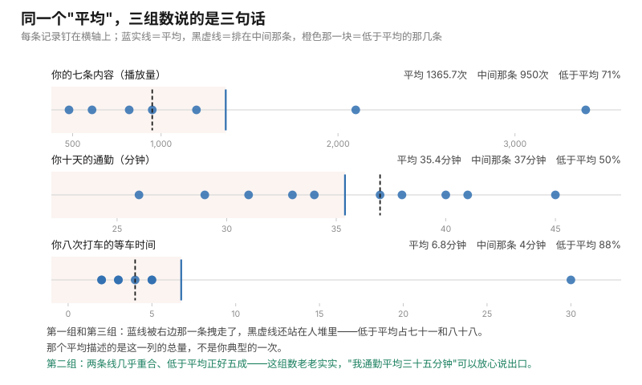

# 第 05 课 · 为什么"平均值"会骗你

**模块**：M0 数学与金融必备 ｜ **用时**：约 35 分钟，其中动手 15 分钟 ｜ **前置**：第 01–04 课
**学完你会得到**：一个判断，用来识破你自己报表里那个最常被误用的数字。

**想在浏览器里一格一格跟着跑？** 浏览器版在 [05-why-the-average-fools-you.ipynb](../../notebooks/05-why-the-average-fools-you.ipynb)：按 `Shift + Enter` 逐格运行，跑出来的数字和本课里印的逐字一致（种子钉在 7）。 也可以[直接在 Colab 里跑](https://colab.research.google.com/github/JavenZheng/monte-carlo-finance/blob/main/notebooks/05-why-the-average-fools-you.ipynb)。

---

## 一、你算的"平均播放量"，可能只描述了你七条里的两条

你上账号后台，把最近七条内容的播放量加起来除以七，得到一个数：1365。

以后跟人说起自己的账号，你会说"我一条大概一千三百多播放"。

这句话听起来毫无问题。我们把它放到灯下看。你那七条其实是：820、1200、3400、610、950、2100、480。

七条里面，有五条低于 1365。也就是说，**你"典型的"一条内容，比你自己报出来的平均少了四百多**。你说出口的那句话，描述的是你七条里的两条。

这不是你算错了。加除以七，你算得完全正确。问题出在你从"这个平均"跳到"我一般水平"的那一步——那一步不成立，而且不成立得很安静，你完全感觉不到。

这节课讲的就是这一步：什么时候平均数在替你说话，什么时候它在替你撒谎。

## 二、你手上其实不是一列数，是一张"可能性表"

第 03 课你学会把一列记录交给电脑。今天要在这一列数上多看一眼——不是看它的总和，是看它的**形状**。

形状是什么意思？把你那七条数排好队，从最少到最多：480、610、820、950、1200、2100、3400。

现在你看到的不再是七个散乱的数，而是一个信息：**大部分条挤在 500 到 1200 之间，然后突然有一条 3400 一个人站得很远。** 这个"哪一片人多、哪一片人少、有没有人一个人站很远"的东西，就是统计里说的**分布**。

以后你会反复看到这个词。它的意思非常朴素：**把所有可能的结果，和它们出现的机会，一起列成一张表。** 你手上那七条，就是你账号这个月这张表的一个粗糙样本。

为什么这门课要绕这一圈？因为你以后要读的那本书，从头到尾处理的就是"形状"这件事。原书第一章开场就说了：我们不知道下一次抽签抽到什么，但我们知道所有可能的结果、以及每个结果的**可能性有多大**，于是能把这两样合起来变成一个数。这个思路在第 06 课正式给名字。今天先只练一件事：**看一列数的时候，除了平均，还看见它的形状。**

形状一眼看不全，那就用一个便宜的指标先抓住它。

## 三、三个都叫"你的水平"的数，只有一个骗不了人

给你一列数，有三个东西都能被叫做"我一般的水平"：

**平均**：全部加起来除以条数。你已经会了。

**排在中间那条**：排好队之后正中间那个。正式名字叫中位数。它的最大优点是——**它不受最远那个人影响**。你那七条里，中间那条是 950。把 3400 换成 34000，中间那条还是 950，纹丝不动。

**最常见那条**：出现次数最多的那个值。你这种连续的数字里常常没有真正的"最常见"（每个值只出现一次），所以我们今天主要用前两个。

这三个数在什么情况下会分开，是这一节课全部的实质。它们挤在一起，说明你这一列数老老实实；它们分开了，说明有一片数据在拖后腿或者有一两个在拽全场。

我们直接跑，看数字。

## 四、跑一下你自己手上这三组

代码在 [code/lesson05_where_the_average_sits.py](../../code/lesson05_where_the_average_sits.py)。它就是第 03 课那台机器的小改版：排个队、找中间那条、再数一数有几条在平均以下。

```python
def where_average_sits(records, unit=""):
    n = len(records)
    mean = sum(records) / n
    ordered = sorted(records)
    middle = ordered[n // 2]

    below = 0
    for x in records:
        if x < mean:
            below = below + 1

    print(f"一共 {n} 条。平均 {mean:.1f}{unit}，排在中间那条 {middle}{unit}")
    print(f"低于平均的有 {below} 条，占 {below / n * 100:.0f}%")
    print(f"最多的一条 {ordered[-1]}，它比平均高 {ordered[-1] - mean:.1f}")
    return mean
```

`sorted(records)` 是把那一列数排好队（原来的列表不动），`ordered[n // 2]` 取中间那个位置——条数是双数时，它取的是中间偏右那条，今天这样够用，进阶框里说严格做法。

三组数据跑出来，我这台机器的原样输出：

```
一共 7 条。平均 1365.7 次，排在中间那条 950 次
低于平均的有 5 条，占 71%
最多的一条 3400，它比平均高 2034.3

一共 10 条。平均 35.4 分钟，排在中间那条 37 分钟
低于平均的有 5 条，占 50%
最多的一条 45，它比平均高 9.6

一共 8 条。平均 6.8 分钟，排在中间那条 4 分钟
低于平均的有 7 条，占 88%
最多的一条 30，它比平均高 23.2
```

分别是：你的七条内容、你十天的通勤、你八次打车的等车时间。

把这三组各自排成一条队、钉在横轴上，那三个数就同时看得见了：蓝实线是平均，黑虚线是排在中间那条，橙色那一块是低于平均的那几条。



图由 [code/fig05_average_vs_middle.py](../../code/fig05_average_vs_middle.py) 生成，算的就是上面那三个数。

**看第二组。** 平均 35.4，中间那条 37，两者差一块六；低于平均的正好占五成。这组数老老实实，"我通勤平均三十五分钟"这句话是干净的，可以放心说出口。

**看第一组和第三组。** 平均比中间那条高出一大截（1365 对 950，6.8 对 4），而"低于平均"占七十一和八十八。这个组合就是我们要抓的东西：**低于平均的条数超过一半很多，说明你的平均是被少数几条拽上去的。**

一句话读法：这一列的平均描述的是总量，不是你的典型一次。

第三组尤其值得记住。打车八次，平均等 6.8 分钟——可你八次里有七次是 2 到 5 分钟，只有那一次等了 30 分钟把整个数字抬起来。如果你按"平均 6.8 分钟"来安排出门时间，**你会七次早到、一次几乎不误事**，那个 6.8 从来没有对应过任何一次真实的等车。

## 五、为什么一条就能拽走整个平均

你大概会问：凭什么一条 3400 就能把七条的平均抬四百多？

因为平均是"加总除以条数"，加总是把每一条都算上。一条高出平均两千零三十的数，进了加法之后，它多出来的那部分**平摊到七条**上，每条分摊两百九。所以你把一条爆款放进你的历史里，你所有历史内容的"平均水平"都会往上飘——一条都没变，只是账变了。

而中间那条不参与加法，它只排队。它站在队列中间，谁在最后一位站得远，对它毫无影响。

这两件事的分别，用一句话记住：

**平均管总量，中间那条管典型。你要算总账用前者，要计划一次具体的日子用后者。**

这就是为什么"分布"这个词值得你今天认识它：**平均只是分布的其中一个特征，而且是唯一一个会被极端值拖走的特征。** 以后你看到任何一张报表上只有一个平均数，你缺的信息是：低于平均的占几成？

## 六、这件事在现实里最值钱的地方

你以后会遇到三类决策，它们各要你看不同的数。这不是统计课的分类，是你上班真的会撞上的一句话。

**老板问："这个功能上线以后平均能带来多少收入？"** 他要的是总量口径，用平均。因为收入是按全部用户加总的，一条爆款带来的量是真的进账。

**老板问："我明天给用户看到的是什么体验？"** 他要的是典型口径，用中间那条。你不能用平均回答"用户一般会遇到什么"，因为如果你的分布被一条拽高，平均值描述的那个体感根本不存在——就像那个从没发生过的"每次等 6.8 分钟"。

**风控问你："最坏的一次会坏到什么程度？"** 这两个数都不给他。他要的是最远那一位站多远，也就是尾巴。上节练习四里你朋友的"最多花 1000"就是这个问题的第一个版本。

这三种问句，以后你在原书里都会反复遇到：定价算平均（那是第 06 课），风险算尾巴（那是第 9 章的东西）。它们都对，只是回答的不是同一个问题。**大部分办公室里的争执，是两个口径在互相听不懂。**

## 七、把它变成你今晚能用的一句话

打开那个文件，把三组数据换成你自己手上一列今天或这个月的记录（外卖、点赞、通勤、几点到公司都行），跑一次，然后看那三个数：

第一句，`平均 vs 中间那条`。差得远，你的分布就是歪的，你以后报"平均"的时候必须补一句"典型值低一些"。

第二句，`低于平均占几成`。**这是这一节课给你的、可以随身带的东西。** 只要它明显超过一半——你手上那个平均就不可作为"一般情况"来说。五成上下才叫干净。

第三句，`最多那条比平均高多少`。如果它比平均高出接近一个平均的量（比如那七条播放：高两千零三十，而平均只有一千三百六），你就要警觉：你的报表是被一两条撑住的。

有了这三句，你今天晚上就能对自己的账号说一句以前不敢说的话：**"我一条内容典型是九百五播放，平均一千三百六十五是因为有两条拽上去的。"** 这句话对你的选题、报价、给自己的评价，全是另一套结论。而它比"我平均一千三"更接近你的真实水平，尽管它听起来小了一大圈。

## 八、一件要提醒你的事

平均没有错。

骗人的从来不是"全部加起来除以条数"这件事，是你从平均跳到"我一般是什么水平"那一步。上节练习四里，打卡数据的平均 0.7 是"七成天数动了"，那个读法就完全对；通勤的平均 35.4 干净；播放量的平均 1365.7 用来算"这个月一共带来 9560 次曝光"也毫无问题——那个总数是真的。

所以不要走向另一个极端，从此不敢用平均。**要做的只是在报出一个平均的时候，同时知道自己能不能扛住这一句反问："你低于这个平均的天数占几成？"**

原书第一章开场就在处理这件事的另一面：所有金融定价的核心问题，是"把每种可能的结果和它的可能性合起来变成一个数"。那个数就是平均。它一定会被算出来，也一定会被误当成"会发生的事"。这一点第 06 课正式给它名字，第 15 课你会看到它出现在股价的路径上。

## 九、练习

**一。** 你公司食堂的午饭价格：`[12, 15, 18, 13, 45]`。跑那个函数，或者手算：平均是多少？低于平均的占几成？"我中午一般花十七块八"这句话能说不说？

**二。** 你有两条地铁线路的通勤记录，一条平均 32 分钟、一条平均 36 分钟。你按第 07 课的思路会问"这个差能不能信"。但先问一个更前面的问题：如果 32 那组的"低于平均占九成"，你会怎么读这组数？为什么这个信息比那个平均更值得先看？

**三。** 你上节造的那个"下个月花销"的模拟，输出给你三个数：平均 879、一成的月低于 828、九成的月不超过 932。这三个数里哪一个是按平均口径、哪一个是按典型口径、哪一个是按尾部口径？你打算用哪一个去定你下个月的预算，为什么？

**四。** 有人说："我们平台创作者平均月收入 9000 块。" 用这一节课的任何一句话，指出这个说法最可能藏起来的东西，并且说你该追问一个什么数。

### 答案

**一。** 平均 20.6，中位 15，四条低于平均、只有一条（45）在上面，占八成。"我一般花十七块八"——不对，你一般花十五块以下；那句应该被改成"我典型一顿十五，但有一顿贵的把平均抬到二十块六"。食堂这组数其实说明了一个更重要的事：**你花出去的四十五块那一顿，在账本里对总量是真的**，只是它对"你一般中午吃什么"没有任何描述力。

**二。** 低于平均占九成，意味着这条线路的"平均 32"是被少数几天严重迟到的记录抬起来的：多数日子它比 32 还快，偶尔几天远远慢过 36。这组数据不该按平均选，你要问的是"我那天几点必须到"——能不能容忍那百分之十。第 07 课处理的是"这个差是真还是运气"，这一节课处理的是"即使它是真的，平均也不是给你选日子用的"。两件事要分开问。

**三。** 879 是平均口径（用来放钱、算总账）；828 和 932 是分位数口径，也就是尾部口径（一成、九成两个方向）。定预算要用 932：预算的作用正是"我不希望它被超过"，那是尾部的问题，平均回答不了。而如果你是在算"我这个月大概会花多少，用来做别的事的规划"，879 是对的数。**同一个模拟的输出，三个数回答三个不同的问题，选错一个就是给自己挖坑。**

**四。** 最可能藏起来的是"低于九千的占几成"。头部十个创作者拉高整个池子的平均，这在内容平台是常态，不是阴谋，只是口径。你要追问的那一个数：**中位数收入是多少**，或者等价地追问"收入低于这个平均的人占多大比例"。前者给你一个真实的人一般拿多少，后者给你一个"这组分布歪成什么样"的度量。这个反问句式，以后你在任何一张只写平均数的表上都该问。

---

## 十、一句话

报出一个平均之前，先问一句"低于它的占几成"；超过一半，你就得同时报出中间那条。

## 下一课

第 06 课把"把每种结果和它的可能性合起来变成一个数"这件事正式讲清楚——它就是期望，也是那本书第一章的核心动作。顺便回答你今晚可能冒出来的问题：为什么原书算的都是期望，而不是你最常拿到的那个数。

---

## 进阶框（可跳过，不影响下一课）

**"排好队取中间"的严格版本。** 条数是奇数，中间只有一位，取它；条数是双数，中间有两位，通常取这两位的平均。我这里偷懒用了 `ordered[n // 2]`，双数时它取的是中间偏右那一位。对你今天的目的（判断分没分叉）够用；如果你要给别人报中位数，请补上双数那一半的平均。

**为什么平均对极端值敏感，中位数不敏感。** 平均把所有值都加进去，一个值改多少，总和就改多少，除以 n 后影响被平摊；中位数只关心排位，最远那个数无论挪多远，排位没变它就不动。代价是：中位数丢掉了总量的信息，所以你不能用它估算总账。这不是谁更准，是两个不同的问题。

**这两个量在数学里的写法。** 平均写成 $\bar X$，读作"X bar"，是你手上那 n 条算出来的东西；期望写成 $E[X]$，是概率论意义上"无限多次之后的平均"。前者是后者的估计，这个区别是第 06 课的全部内容，也是原书 §1.1 整章在管的事——它要问你算出来的 $\bar X$ 离 $E[X]$ 有多远。今天你只需要知道：这两个符号现在不该混。

**分布这个词在原书里第一次出现的姿势。** 原书 §1.1.1 用概率和体积的类比开场（书页 1）：把所有可能的结果按可能性铺成一块，求某个量就是在这块上做积分/加权平均。你那七条播放量是一维离散版本，形状一样，只是可能性表还没写出来。

---

## 备忘卡

本课出现的东西，正式名字在这里。

**一列记录**是**样本**（sample）；**排好队取中间那个**叫**中位数**（median）；**出现最多的那个值**叫**众数**（mode）；**"每种结果和它的可能性列成一张表"**叫**分布**（distribution）；**有一两个值站得极远、把平均拖走**这种形状叫**长尾**或**厚尾**（heavy-tailed），原书在 **§9.3 A Heavy-Tailed Setting（书页 506）** 专门用一节课处理它；**低于平均值的那几条占多大比例**没有正式名字，但它是你今天最值得带走的那个诊断。

---

## 原书对应与版权说明

本课对应 Glasserman（2003）**§1.1 Principles of Monte Carlo（书页 1 起，PDF 页 11 起）**，尤其是 §1.1.1 用"可能性铺成一块"开场的那个视角——它是全书所有"求一个平均"的合法性来源。尾巴那一面在 **§9.1 Loss Probabilities and Value-at-Risk（书页 481）** 与 **§9.3 A Heavy-Tailed Setting（书页 506）**，那是第 04 课"下个月最坏花多少"这个动作的正式版本。

本课未复制原书任何文字、图表或表格。所有输出均在本机 Python 3.12 实测：播放量 `[820, 1200, 3400, 610, 950, 2100, 480]` → 平均 1365.7 / 中位 950 / 低于平均 71% / 最大比平均高 2034.3；通勤 `[34, 41, 29, 38, 45, 31, 37, 40, 26, 33]` → 35.4 / 37 / 50% / 高 9.6；等车 `[3, 5, 2, 4, 30, 3, 2, 5]` → 6.8 / 4 / 88% / 高 23.2；食堂 `[12, 15, 18, 13, 45]` → 平均 20.6 / 中位 15 / 八成低于平均。完整章节页码见 [原书章节索引](../book-index.md)。**建议购买正版**支持作者：Springer, *Monte Carlo Methods in Financial Engineering*, 2003；中译本《金融工程中的蒙特卡罗方法》。

**上一课**：[第 04 课 · 你的第一个真模拟](../m1-tooling/04-your-first-real-simulation.md) ｜ **下一课**：[第 06 课 · 期望与方差](06-expectation-and-spread.md) ｜ **返回**：[学习路线图](../../README.md)
