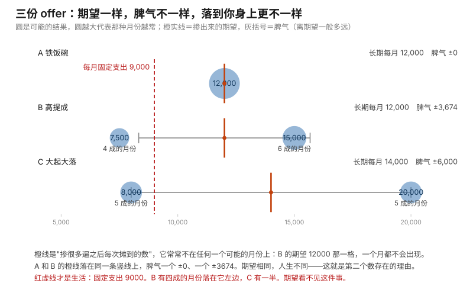

# 第 06 课 · 期望与方差：老板问"稳不稳"时在问什么

**模块**：M0 数学与金融必备 ｜ **用时**：约 40 分钟，其中动手 20 分钟 ｜ **前置**：第 04、05 课
**学完你会得到**：一套能摆到桌上的方案对比法——两个数，一个回答长期，一个回答脾气。

**想在浏览器里一格一格跟着跑？** 浏览器版在 [06-expectation-and-spread.ipynb](../../notebooks/06-expectation-and-spread.ipynb)：按 `Shift + Enter` 逐格运行，跑出来的数字和本课里印的逐字一致（种子钉在 7）。 也可以[直接在 Colab 里跑](https://colab.research.google.com/github/JavenZheng/monte-carlo-finance/blob/main/notebooks/06-expectation-and-spread.ipynb)。

---

## 一、两份 offer，钱数一模一样

你手上来了两份工作。

第一份：每月固定 12000，旱涝保收。

第二份：底薪加提成。六成的月份拿 15000，四成的月份拿 7500。

你心里第一反应大概是"第二份平均下来是 12000 还是 13500？我得算算"。算完你会发现一件让人不太舒服的事：**它跟第一份一模一样，都是 12000。**

于是你站在两个看起来完全等价的数字中间，选不下去。

而这时候你其实已经漏掉了那个真正的差别。这两个方案的长期钱数相同，脾气完全不同：一个是每个月都 12000，一个是有的月多三千、有的月少四千五。

老板问"这个方案稳不稳"、你妈问你"这个工作靠不靠得住"、你自己半夜想"要不要接那个提成岗"——**他们问的从来不是第一个数，是第二个。**

这节课给这两个数起名字，教你怎么算它们，然后告诉你一件更值得记住的事：**这两个数分别回答什么问题，以及什么情况下第二个比第一个重要得多。**

## 二、第一个数：把每种可能按它的机会掺在一起

先给这个动作的名字，它叫**期望**。它替你回答的问题是：**如果这件事我重复一万遍，我每次平均能拿到多少。**

算法只有一句：每一种可能的结果，乘以它发生的机会，然后把它们全加起来。

第二份 offer 就是这么算的：

```
15000 × 0.6 + 7500 × 0.4 = 9000 + 3000 = 12000
```

代码写出来是第 03 课那台机器的形状：

```python
def expectation(outcomes, probs):
    total = 0
    for x, p in zip(outcomes, probs):
        total = total + x * p
    return total
```

`zip(outcomes, probs)` 是这一节唯一的新语法，它做的事很朴素：**把两列数并排起来，一次拿一对**。第一列是"结果"，第二列是"这些结果各有多大概率"，并排之后每次循环手里就同时拿到一个结果和它的机会。第 03 课进阶框里我说过"你完全可以让循环同时看着两列数"，指的就是它。

跑一下两份 offer 和骰子：

```python
print(expectation([12000], [1.0]))
print(expectation([15000, 7500], [0.6, 0.4]))
print(expectation([1, 2, 3, 4, 5, 6], [1 / 6] * 6))
```

我这台机器输出：

```
12000.0
12000.0
3.5
```

`[1 / 6] * 6` 是"把这个数重复六次做成一列"，六个六分之一的概率加起来正好是 1，这是一张合法的可能性表该有的样子。

**现在看那个 3.5，它藏着期望这个概念最重要的一件事：你这辈子掷不出 3.5。**

一颗骰子的可能结果是 1、2、3、4、5、6，期望是 3.5，可 3.5 不在里面。期望不是"你会拿到的那个结果"，它是"重复很多遍之后每次摊到的那个数"。第 05 课那个"平均等车 6.8 分钟"也是同一个东西——你八次里没有任何一次等了 6.8 分钟。

这两个例子说的是同一句话：**期望描述的是长期，不是下一次。** 你把这句话记住，后半节课的所有判断都靠它。

## 三、为什么那本书第一章就在算这个

你要读的那本书，标题里是蒙特卡洛，内容上大部分在算期望。

原因在金融的定价逻辑里：**一支期权值多少钱，等于它未来所有可能的赔付，按各自的可能性掺在一起，再折回今天。** 掺在一起这个动作就是期望，折回今天是第 14 课的事。

比如一支投资九块的期权，十种可能的世界里分别赔 0、0、2、5、9……你要的那个"公平价格"，就是把每个世界的赔付乘那个世界的机会，加起来——和第 03 课、这一节课那行 `for` 循环一字不差。

问题来了：这些"可能性"往往复杂到没人能手算。你不知道一百万种股价路径各赔多少。

**于是就有了蒙特卡洛：既然算不出，就抽一百万次，把每次的结果加起来除以次数。** 这就是第 04 课你已经做过的那件事。

换句话说，期望和蒙特卡洛的关系是：**期望是你想要的那个数，模拟是你拿到它的手段。** 第 04 课已经给你演示过一次：它第五节那段"还没发生过的月"，一千个月跑出来平均 879 块；而它的理论期望是每天 25 到 55 的中点 40 块，乘 22 天正好 880。

模拟给的 879 和手算的 880 差一块。那差的一块不是算错，是运气，而它有多大——就是第 07 课整节课的内容。

## 四、第二个数：光有期望不够，还得问脾气

现在把两份 offer 摆平：期望都是 12000。你必须用第二个数把它们分开。

第二个数回答的问题是：**这些可能的结果，离那个掺好的数一般有多远。** 它的名字叫**方差**，正式算法是"偏差的平方的加权平均"：

```python
def spread(outcomes, probs):
    m = expectation(outcomes, probs)
    v = 0
    for x, p in zip(outcomes, probs):
        v = v + (x - m) ** 2 * p
    return math.sqrt(v)
```

先算每一个结果离期望差多少（`x - m`），把它平方（这就是第 03 课那行 `(x - mean) ** 2`，你已经见过它了），按机会加权，最后开根号——**开根号那一步是为了把单位从"块钱的平方"变回块钱**。平方之后的那个中间量是方差，开完根号才是你在生活里能说出口的"脾气有多大"。

（这个函数要用 `math.sqrt`，所以文件开头需要一行 `import math`——上一节课那台机器不需要，这里第一次需要。写在这段代码上面两行即可。）

跑三份方案：

```python
offers = [
    ("A 铁饭碗", [12000], [1.0]),
    ("B 高提成", [15000, 7500], [0.6, 0.4]),
    ("C 大起大落", [20000, 8000], [0.5, 0.5]),
]

for name, outcomes, probs in offers:
    m = expectation(outcomes, probs)
    s = spread(outcomes, probs)
    print(f"{name}：长期每月 {m:.0f}，脾气 ±{s:.0f}")
```

我这台机器的输出：

```
A 铁饭碗：长期每月 12000，脾气 ±0
B 高提成：长期每月 12000，脾气 ±3674
C 大起大落：长期每月 14000，脾气 ±6000
```

现在你手上有两个数了，而它们给的结论完全不同：

A 和 B 长期一模一样，但 B 每月上下三千六百七。**C 长期比 A 和 B 多两千，但脾气翻倍。**

选哪个？这不是数学题，数学到这里已经答完了，剩下的取决于你的处境——下一节就讲这个"取决于"到底取决于什么。

顺便，期望和方差的算法都需要那张可能性表（结果 + 机会）。现实里你常常没有表，只有记录。那就用第 07 课那台计算器：把机会全当成相等（也就是除以 n 或 n−1），一样的形状，算出来的是同一件事的估计。**有表算表，没表算记录**——这是这门课一直在用的分工。

## 五、什么情况下第二个数比第一个重要

看一个具体的处境：**你这个月固定要支出 9000**——房租、地铁、吃饭，一分不能少。

A：每月 12000。永远够。

B：六成月份 15000，四成月份 7500。**四成的月份你会缺 1500。**

期望上 A 和 B 一样好，可它们对你不是同一个东西：B 每十个多月里就有四个多月让你去借钱、动存款、或者向家里开口。C 更极端，一半的月份缺 1000。

把这三份 offer 摆成一张图，两个数和那条红线就同时在上面了：圆是可能的月份，圆的大小是那种月份有多常来；橙实线是掺出来的期望，灰括号是脾气；红虚线是你这个月一分不能少的 9000。



图由 [code/fig06_expectation_and_spread.py](../../code/fig06_expectation_and_spread.py) 生成，用的就是上面那两个函数。

**为什么会这样？** 因为期望说的是"重复一万次之后每次摊到的数"，而你只工作一次、只过这个月一次。**你不能把你的人生当成重复一万遍的实验。** 那份 offer 你只接一次，四成那个坏月份砸到你头上就是百分之百。

这是这一节课最值钱的一句，也是它和第 05 课连起来的地方：

**能被摊平的事按期望选，不能摊平的事按最坏那次选。**

公司可以按期望选，因为它雇一千个人做同样的提成岗，四成的坏月份会在这一千人身上摊平成稳定的成本——大数定律替它把风险吃掉了。你不行，你是一个人。

（这一句以后会以另一种形式回来很多次。原书整章讲风险管理，讲的就是"哪些风险能摊平、哪些不能"。今天你只需要拿到这个形状：**同期望 ≠ 同样好**。）

## 六、期望会加总，脾气不会

这一节只给你一件事，因为它是后面一整门课的伏笔，现在只需要留下印象。

如果两份工作你可以**同时**做，A 加 B 的长期钱数就是各自的期望相加：12000 + 12000 = 24000。期望天生可以相加，这是它好用的原因，也是为什么定价能拆成一段一段算再加起来。

脾气不能相加。A + B 的起伏**不是** 0 + 3674 = 3674，实际会比这个数小，因为 B 的上下有一部分会和 A 的稳定互相抵消。到底小多少，取决于两件事的**起伏是不是同步发生**——同一个季度大盘不好，你的提成和公司的奖金可能一起掉，那就不抵消。

**"两件事的波动同不同步"就是相关性**，它是金融里最重要的概念之一，第 11 课专门讲它。今天你只要记住一件事：钱可以加，风险不能加，因为风险中间夹着"它们是不是一起坏"这一层。

## 七、今晚就能用的那个对比表

代码在 [code/lesson06_expectation_and_spread.py](../../code/lesson06_expectation_and_spread.py)，两个函数，浏览器里直接粘。

用法是把你的选项各写成两列：`[可能的钱数]` 和 `[各自的机会]`，然后各跑一次，把两行结果并排放桌上：

```python
options = [
    ("留在现在这份", [12000], [1.0]),
    ("接那个提成岗", [15000, 7500], [0.6, 0.4]),
    ("和合伙人干", [20000, 8000], [0.5, 0.5]),
]
for name, outcomes, probs in options:
    print(f"{name}：长期每月 {expectation(outcomes, probs):.0f}，脾气 ±{spread(outcomes, probs):.0f}")
```

我这台机器跑出来：

```
留在现在这份：长期每月 12000，脾气 ±0
接那个提成岗：长期每月 12000，脾气 ±3674
和合伙人干：长期每月 14000，脾气 ±6000
```

这张表你今晚就能填自己的：换工作、接不接一个外包、要不要囤那批货、把存款放活期还是那支基金。**只要一个选择有多个可能的结果，它就能写成这两列。**

填的时候有一件事你必须自己检查：**第二列那些机会是谁给的？** 0.6 和 0.4 是你估的，还是别人告诉你的？期望这个数完全由这两列决定，而这两列全是你填的。第 01 课那句"蒙特卡洛给你的答案，最准也只能准到你那个假世界本身"，在这里就变成一句可操作的话：**你算出来那个"长期每月 12000"，含金量等于你对那 0.6 的了解程度。**

第三件要做的事：在旁边写一句你的**线**——你每月不能低于多少，低于多少你就撑不住。这个数字不在表里，但它才是决定选 A 还是 B 的那个。

## 八、一件要提醒你的事

这一节课你可能会得出一个"所以别选有波动的"的结论。那不是我要说的。

真相更实用一点：**期望是你在长期里唯一能挣到的东西，方差是你在过程中可能死掉的原因。**

不做第二个方案，你这辈子都在拿那个平的 12000；做了，你十年下来平均可能多挣两千。**但你会在某些月份缺钱。** 一个正确的处理不是退回 A，而是给自己铺一层缓冲：存三个月固定支出，那个 7500 的月份就砸不到你身上，而你能继续拿那份更高的长期。

这也是原书处理风险的思路：不是把风险去掉，是把它变成你能扛的形状。你今晚能做的决定不是"要不要怕波动"，是"我要留多少缓冲，才能接住那个四成的月份"。

## 九、练习

**一。** 两份工：一份固定 8000；一份一半概率 12000、一半概率 4000。跑那个函数，两个期望和两个脾气各是多少？如果你的线是每月 6500，你选哪个？如果线是 4500 呢？

**二。** 你演一颗骰子：写一个循环，`random.randint(1, 6)` 抽一万次，取平均。我这台机器跑出来是 3.4714，手算期望是 3.5。用第 04 课哪一句话说清这两个数的关系？

**三。** 有人拉你玩一个游戏：交 100 块，九成什么都拿不到，一成拿回 1200。期望是多少（按净收支算）？这个数是正是负？如果这是你唯一一次机会，你玩不玩？

**四。** 你老板说："我们有 200 个人干提成岗，所以按期望发钱公司不亏。" 用第五节哪句话说明他对、用哪句话说明你未必该照他的逻辑给自己做决定？

### 答案

**一。** 固定那份：期望 8000，脾气 0。另一份：期望 8000、脾气正好 4000（我跑出来是 8000.0 与 4000.0）。**线在 6500 时应该选固定**，因为那个 4000 的月份你会缺 2500，一半的月份你过不去；线在 4500 时两份都过不去那个月，但 4000 只缺 500——这时候你实际上是在"要不要为了一半月份多四千，接受另一半月份少四千"之间选，答案取决于你缺 500 那个月痛不痛。

这道题真正的收获是这个：**两个方案谁好，不是这两个数决定的，是你那条线决定的。** 同一张表，线不同，结论相反。以后看到任何人拿"期望更高"当结论，先问他有没有一条线。

**二。** 第四节的说法：**期望是你要的那个数，模拟是你拿到它的手段。** 3.5 是这张可能性表算出来的真值，3.4714 是你抽一万次得到的估计；它俩差 0.0286，这个差就是"你这一次抽签的运气"（第 07 课给它名字：毛边）。顺便：3.5 这个期望值你一次也掷不出来，这就是第二节说的那件事。

**三。** 净结果是两种：亏 100（九成）和赚 1100（一成）。期望 = 0.9 × (−100) + 0.1 × 1100 = **+20**，我跑出来就是 20.0。**期望是正的**，纯按期望你应该玩。

但这是你唯一一次机会，你有九成的概率净亏 100。**期望为正的一次性赌局，不值得你把钱压上去**——除非那 100 块丢了对你无所谓。这就是第五节那句话的实际版本：能摊平的事按期望选，摊不平的事按最坏那次选。公司可以同时开两千个这种游戏，靠那 +20 稳赚；你只能玩一次，靠运气。

**四。** 他对，用的是第五节里"公司雇一千个人做同样的岗，坏月份在一千人身上摊平"那句——大数定律替他吃掉了风险，所以按期望给他定价是合理的。

你自己不该照抄，因为**你只过一次这个月**。你和他面对的是同一个分布、完全不同的重复次数。这个区别不是情绪，是数学：期望在重复次数大时描述"你会得到的"，在重复次数为 1 时只描述"赌局的价值"，而赌局的价值付不了你的房租。原书风险管理那一章，本质就是在处理这个差别。

---

## 十、一句话

先用期望问"长期我挣多少"，再用起伏问"哪一次我会撑不住"；能被摊平的事按前者选，摊不平的按后者。

## 下一课

第 07 课处理你今晚一定会冒出来的那个问题：既然模拟给的 3.4714 和手算的 3.5 不一样，那我手上那个由有限条记录算出来的平均，到底该信几分——那一节课给你一个能量出"毛边"的式子。

---

## 进阶框（可跳过，不影响下一课）

**两个名字严格定义。** 期望（也叫均值）$\mu = E[X] = \sum_x x\,P(X=x)$；方差 $\sigma^2 = E[(X-\mu)^2]$，标准差 $\sigma = \sqrt{\sigma^2}$ 只是把单位从"块钱的平方"变回块钱。随机变量 $X$ 就是"还没发生但有规律的那个数"，它本身不是一个数，是一张表。

**为什么平方，而不直接取平均距离。** 三点：一是平方让这件事在数学上可以加总（第六节那个"起伏不能相加"要靠协方差才能算清，而协方差就是用平方定义的），二是绝对值在 0 点不可导、不好处理，三是平方会自动加重惩罚少数几次大偏差——而大偏差正是我们关心的东西。代价是它对极端值敏感，所以你用第 05 课那招（中位数）做交叉检查值得保留。

**期望的线性。** $E[X+Y] = E[X]+E[Y]$，**不需要** X 和 Y 独立。这是为什么定价能分段拆开算再加回来，也是这门课后面会反复动用的那一条。

**方差不是线性的。** $\mathrm{Var}(X+Y)=\mathrm{Var}(X)+\mathrm{Var}(Y)+2\,\mathrm{Cov}(X,Y)$。多出来那一项叫协方差，量的是"这两个东西是不是一起上下动"；第 11 课讲相关性，讲的就是把它除以两个标准差之后的样子。第六节那句"脾气不能相加"就是它。

**骰子那个 1.71 怎么来的。** 六个面的期望是 3.5，偏差平方是 $(1-3.5)^2, (2-3.5)^2, \dots$，加权平均得 $35/12 \approx 2.917$，开根号 $1.7078$。我跑出来的正是 1.71。这类能手算的小题，是我们检验程序对不对的抓手（第 01 课进阶框那条规矩）。

---

## 备忘卡

本课出现的东西，正式名字在这里。

**掺在一起的那个数**叫**期望**（expected value，$E[X]$，也叫均值 μ）：重复很多遍之后每次摊到的，未必是你任何一次真拿到的。**还没发生但有规律的那个量**叫**随机变量**（random variable）。**偏差平方的加权平均**叫**方差**（variance，$\sigma^2$），开根号叫**标准差**，正文里我一直叫它**脾气**（起伏）——第 07 课会沿用"起伏"这个词。**机会全等于 1 的除法版**（用记录、没有可能性表时）是第 07 课那台计算器。**两件事一起动**叫**相关**（correlation），第 11 课。

---

## 原书对应与版权说明

本课对应 Glasserman（2003）**§1.1 Principles of Monte Carlo（书页 1 起，PDF 页 11 起）**：那里的核心动作就是"想求的量是一个期望，求不出来就靠模拟平均去逼近"；**§1.1.3 Efficiency of Simulation Estimators（书页 9，PDF 页 19）** 则正面处理方差，并把估计量的误差写成 σ²/n 的形式——那正是第 07 课的落点。定价需要期望这个动机在 **§1.2 Principles of Derivatives Pricing（书页 19，PDF 页 29）**，本课程第 14 课展开。风险不能摊平这条线在 **Chapter 9（§9.1 在书页 481）** 成为整章主题。

本课未复制原书任何文字、图表或表格。所有数字本机实测（Python 3.12）：A/B/C 三组 → 12000 与 ±0、12000 与 ±3674、14000 与 ±6000；骰子 → 期望 3.5、起伏 1.7078（= √(35/12)）、一万次模拟平均 3.4714；练习一两组 → 8000/±0 与 8000/±4000；练习三 → 净期望 +20.0；第 04 课那一千个月的平均 879 对理论期望 880。完整章节页码见 [原书章节索引](../book-index.md)。**建议购买正版**支持作者：Springer, *Monte Carlo Methods in Financial Engineering*, 2003；中译本《金融工程中的蒙特卡罗方法》。

**上一课**：第 05 课 · 为什么"平均值"会骗你 ｜ **下一课**：[第 07 课 · 要测多少次，你才敢下结论](07-how-many-before-you-decide.md) ｜ **返回**：[学习路线图](../../README.md)
