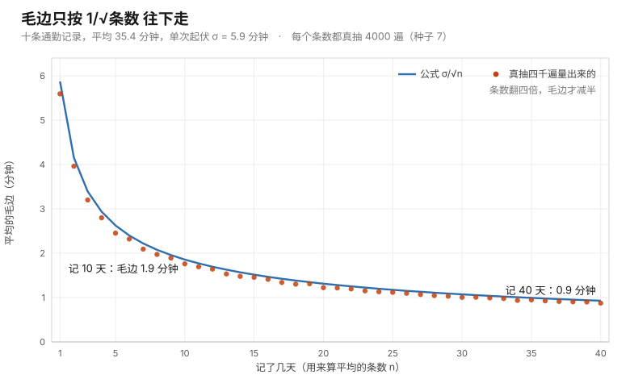

# 第 07 课 · 要测多少次，你才敢下结论

**模块**：M0 ｜ **用时**：约 35 分钟，其中动手约 15 分钟 ｜ **前置**：第 05、06 课
**学完你会得到**：一个可以随身带的判断法，用来回答"我手上这几个数字，够不够支持我做这个决定"。它今晚就能用在你的通勤记录、记账本或者账号后台上。

**想在浏览器里一格一格跟着跑？** 浏览器版在 [07-how-many-before-you-decide.ipynb](../../notebooks/07-how-many-before-you-decide.ipynb)：按 `Shift + Enter` 逐格运行，跑出来的数字和本课里印的逐字一致（种子钉在 7）。 也可以[直接在 Colab 里跑](https://colab.research.google.com/github/JavenZheng/monte-carlo-finance/blob/main/notebooks/07-how-many-before-you-decide.ipynb)。

---

## 一、你手上有两个数字，可你不知道该不该信它

假设你在经营自己的账号。最近你在想，标题是不是换个写法更好。

你翻了后台：旧写法发了九条，平均播放三千。新写法也发了九条，平均播放三千五。

新写法高出五百。你的第一反应大概是，那就换吧。

这节课不打算扫你的兴，但我想陪你把这件事问到底，因为你以后会一遍又一遍地撞上同一个形状的问题。换一家外卖贵三块，换一条地铁线路快八分钟，换一家供应商每月省两百块，换个时段发多两千曝光。全都是这样：你手上有两个平均数，它们的差就是你想追的东西，而你其实并不知道这个差是真是假。

## 二、你算出来的那个平均，也是一次抽签

九条视频的平均播放量是三千五，你的直觉是"新写法的水平就是三千五"。

可你想一想：如果重来一遍，还是这套写法，只是发在另一个星期、被另一批人刷到，你还会算出三千五吗？

大概不会。你多半会得到两千九、四千二之类的某个数。你手上这个三千五，只是恰好是那九条的成绩。换九条，就是另一个数。

这就是整节课的核心，也是后面所有内容唯一的一道门槛：**你算出来的平均不是一个固定的数，而是一次抽签的结果。它有自己的脾气，会飘。**

你真正想知道的那个数字——假如你把过去三年发的三百条全算一遍得到的那个水平——一直稳稳地待在那里。可你永远只抽得到一次签。你抽到多少，就以为它是什么。

于是问题自然变成：这一次抽签，可能离真相有多远？

## 三、把"可能有多远"算出来

要回答它，只需要两个你已经有的东西。

一个是这些数据本身的起伏有多大。播放量有的八百有的六千，起伏就是大；每条都挤在两千九到三千一之间，起伏就是小。你自己后台就能看出来大概。

另一个是你抽了几次签，也就是算这个平均时用了几条数据。

两者合在一起，就是这节课唯一的式子：

```
你算出的平均可能飘多远  ≈  数据的起伏  ÷  √数据条数
```

请注意这个式子在替你做的事。它不是让你算一个数交差，它是回答你本来只能靠胆量和感觉去猜的那个问题：**这几个样本给我的答案，到底有几分成色。**

代入你的账号。单条播放量围绕平均上下浮动大约两千，你用了九条，九开根号是三，两千除以三约等于六百七。

意思是：新写法这九条给你算出三千五，可同样这套写法，换九条再抽一次签，抽出两千八、抽出四千二，都不算意外。**六百七就是你手上这个数字的毛边。**

## 四、有了毛边，再回头看那五百

现在你可以回答开头那个问题了。

你测出来的差距是五百，而你手上这个数字本身的毛边就有六百七。也就是说，光新写法这一个平均就可能在上下七百的范围内晃，旧写法那九条同样在晃。两个都在晃的数相减，那个差当然更靠不住。

粗略地说，两个平均的差距要明显大过它们毛边之和，才值得你当真。六百七加六百七是一千三，而你看到的只有五百。

**所以你现在换写法，和抛硬币做决定差不多。** 这不是说你运气差，是九条本来就太少，谁测都一样。

那要多少条才够？这才是这个式子最值钱的地方，我们下一节算。

## 五、这个式子的真正用途：在动手之前就知道划不划算

你以后会用它做三类现实决定，我把每一类都算给你看。

**第一类，要不要开始这场测试。**

你想让五百的差距变得可信，就得把毛边压到两百左右。起伏两千是这套内容天生的脾气，你改不了，能改的只有条数。两千除以两百是十，十的平方是一百。所以每个写法各要发一百条。

一周三条，那是三十三周。

注意这里的关系：你想让毛边减半，条数要变成四倍；想让它变成十分之一，条数要变成一百倍。这条规律没有例外，也不取决于你多努力。有人给它起了个外号叫**根号税**——精度是按开根号涨的，成本是按平方涨的。

算到这一步，你今天就可以做决定了：这场测试我不做。或者我换一个更粗糙但更快的问题来问，比如"这两种写法有没有两倍以上的差距"，那种大差距，九条其实看得见。

生活里很多比较根本不该开始。常见的情形是，人在发到第四十条时才想起从没算过总共要发多少，于是要么半途而废，要么硬下结论。工作里申请一笔投放预算、决定要不要做用户调研，缺的都是开工前这一笔账。

**第二类，只有这么多预算时，我能看清多大的改进。**

你说我只愿意再发三十条。三十开根号约五点五，两千除以它是三百六。两条各三百六，加起来七百出头。

含义很清楚：这次你只能看清"七百以上的差距"，五百的改进对你完全是隐形的。测不出来不等于不存在，只是你请不起。这就是预算和精度之间真实的取舍，跟你在公司里申请一笔调研经费是同一道题。

**第三类，今晚就能开始的那种。**

通勤比账号便宜，因为你本来每天都在产生数据。

假设有两条去公司的路线，你各记录了十天，一条平均三十二分钟，一条平均三十六分钟。差四分钟，你想换。

可十天的毛边是多少？单次的起伏大约八分钟，用上一节的式子，八除以根号十，约两点五分钟。两条各有两点五的毛边，加起来是五。

你看到的四分钟，比这个差本身的成色还小。**别换。**

想让四分钟变得可信，你需要把两条路线的毛边加起来压到四分钟以内，也就是每条各两分钟。八除以二是四，四的平方是十六。每条路线各记十六天就够了，两个多星期，还是你本来就在过的日子。想给自己留点余量，记满二十几天更稳。

你可以选择记三个星期，也可以选择承认"这两条路线的差别不在我在意的尺度上"，然后按心情选。两个决定都合理，唯一不合理的是在没算之前先纠结三个月。

## 六、把你自己的数字放进去算

现在做一件比读下去更有用的事。打开浏览器里的 Colab，或者本地任意一个 Python，把你这个月的通勤记录粘进去。

```python
import math

# 把你自己的记录粘在下一行，单位随你：分钟、元、曝光量都行
records = [34, 41, 29, 38, 45, 31, 37, 40, 26, 33]

n = len(records)
mean = sum(records) / n
spread = math.sqrt(sum((x - mean) ** 2 for x in records) / (n - 1))
fuzz = spread / math.sqrt(n)

print(f"你的平均：       {mean:.1f}")
print(f"单次起伏：       {spread:.1f}")
print(f"这个数字的毛边： {fuzz:.1f}")
print(f"真实水平大概落在 {mean - 2 * fuzz:.0f} 到 {mean + 2 * fuzz:.0f} 之间")
```

我拿上面这组十天的记录跑过，输出是这样：

```
你的平均：       35.4
单次起伏：       5.9
这个数字的毛边： 1.9
真实水平大概落在 32 到 39 之间
```

四行代码，每行在做什么：第二行求平均；第三行求起伏，也就是每条记录离平均大概有多远，其中分母写成 `n - 1` 而不是 `n` 是个技术性修正，你照着抄就行，不影响判断；第四行就是本课的式子；最后一行把毛边翻成一句你敢说出口的话。

最后一行值得多说两句。你大概听别人讲过"我有九十五%的把握"这种句子，它就是从这里来的：毛边乘二，就是你敢报出的范围。为什么乘二而不是乘三，是下一课的内容，今天你先当成一条能用的规矩。

有了这四行，你能回答的现实问题立刻多起来。

你记了三十天开销，平均日花一百八，毛边算出来是十八块。那"这个月比上个月省了二十块"这种话就还不能说，因为上个月那三十天同样带着十八块的毛边，二十的差距塞不满两个毛边。

你连续七天记录文章打开率，毛边大约三个百分点。那"改版后打开率涨了两个点"这件事，目前还只是你的希望。

这两条都是那种会在周报里被写成人成果的结论。你现在有办法在写之前先量一下。

把第五节那句"想让毛边减半，条数要变成四倍"画出来，就是下面这张图。横着是记了几天，竖着是那四天算出的平均有多毛边；蓝线是式子给的 $\sigma/\sqrt n$，橙点是我拿上面这十条记录真去抽、每个天数各抽四千遍量出来的散布。两者贴着走，谁也没有例外。



图由 [code/fig07_standard_error.py](../../code/fig07_standard_error.py) 生成，数据就是上面那十条。

## 七、如果你不信这个式子，让电脑演一遍

到这儿你可能还有一半不服：凭什么两个都在晃的数相减就是不可信？我又不是只能靠一个粗糙的加法来猜。

这个怀疑非常好，而且它正好是这门课的起点。当算式变得复杂、当规律不好用一行写出来，你可以不推导，直接让电脑把这件事演一万遍。

下面这段回答的就是你最开始那个问题：**如果新旧两种写法其实一模一样好，只发九条会有多容易骗到我？**

```python
import numpy as np

rng = np.random.default_rng(7)

OLD, NEW = 3000, 3000     # 假设两种写法其实一样好
SPREAD, EACH = 2000, 9    # 单条起伏两千，每种发九条

trials = 20000
old = rng.normal(OLD, SPREAD, (trials, EACH)).mean(axis=1)
new = rng.normal(NEW, SPREAD, (trials, EACH)).mean(axis=1)

leads = new - old
print(f"新写法看起来高出 500 以上的概率：{np.mean(leads >= 500) * 100:.0f}%")
print(f"看起来高出 1500 以上的概率：      {np.mean(leads >= 1500) * 100:.0f}%")
```

跑出来是：

```
新写法看起来高出 500 以上的概率：29%
看起来高出 1500 以上的概率：      6%
```

**两种写法完全一样的时候，你也会大约有三次机会（每十次里三次）看见"新写法高出五百"。** 你现在手上那个五百，很可能就是这三次里的一次。

这就是你人生中第一个真正的蒙特卡洛。它的形状以后不会变：不清楚一条规律能不能信，就造出很多个平行世界的你，让每个人照样做一遍"各发九条"的测试，数一数其中有多少个被骗了。你不需要会推导，你需要的是愿意演一遍。

顺手做个实验：把 `EACH = 9` 改成 `100`，再跑一次，那个 29% 会掉到 4%。第五节里算出来的"每个写法各发一百条"，你刚刚亲眼看见了它换来什么。

顺便你大概已经注意到，这段模拟用的数字是"两种写法一样好"。这是它最有用的一点：**它量的是你被骗的概率，不是世界真实差距的概率。** 你自己那五百到底是不是真的，模拟回答不了——它只告诉你，就算什么都没有，你也很可能看见那样一个五百。

## 八、一件要提醒你的事

上面这一切量化的都是运气不好：抽到的样本恰好偏了。

还有另一种错，跟运气无关，加多少次都治不了。

比如你只记工作日的通勤时间，周末一次都不记。那你算出的平均代表的是"工作日通勤水平"，永远不是"我出门要花多久"。这时你再记一年，也不会更接近后者，因为问题不在次数，在你怎么记的。

再比如你只统计自己账号里播放量高的那几条来做对比，或者你测通勤的那两周恰好赶上地铁故障。

加次数治的是手抖，治不了瞄准镜歪。这句话你先记住就够了，后面讲到模型和离散化，我们会专门用一节课回来处理它。

---

## 九、练习

**一。** 你记账记满三个月，月支出平均八千六，起伏一千二。这个平均的毛边有多大？你能不能对室友说"我一个月大概花八千六"？

**二。** 你想知道自己换做饭带饭后，月支出有没有省下两百块。起伏仍按一千二算，你需要记多少个月才敢下这个结论？

**三。** 你账号后台有二百条历史视频，平均播放两千四，单条起伏一千五。今天新发的一条跑到三千一。你可以说"这条爆了，我找到方法了"吗？

### 答案

**一。** 毛边是一千二除以根号三，约六百九。乘二就是一千四百左右。所以你的真实水平大概落在七千二到一万之间。跟室友说"八千六上下，误差可能有一千四"是诚实的；只说"八千六"就假装有把握了。这里让你不舒服的东西不是数学，是三个月本来就少。

**二。** 要分辨两百的差距，毛边得压到一百左右。一千二除以一百是十二，十二的平方是一百四十四。一百四十四个月，十二年。

这就是根号税在日常生活里的样子，也解释了为什么几乎没人靠自家记账证明"我省了钱"。不是你懒，是这件事按这种方式根本测不出来。换成先知道这一笔，你会直接去看总账的环比，或者干脆用预算硬约束代替测量。

**三。** 不能。单条视频本来就在上下浮动一千五，多七百完全在正常呼吸范围内，大约只是半个起伏的事。想验证"我找到方法了"，得攒够一批同类视频再算平均：按第五节第二类的算法，一千五的起伏要分辨七百的差距，每条写法得发到十八条上下。

这一题值得多说一句，因为它在生活中无处不在：一条爆款之后紧接着十条平庸，中间没有"方法"，只有你刚才看见的那 29%。

---

## 十、一句话

先量一量你手上这个数字的毛边，再决定要不要相信它，值不值得为它继续测下去。

## 下一课

第 08 课会解释第六节里那个"毛边乘二"到底为什么是二，并且教你把这条规矩用在真实的比较上：什么才算真涨了、什么才算我的错觉。这是你在会上最常说出口的一句结论的来处。

---

## 进阶框（可跳过，不影响下一课）

**为什么偏偏是开根号。** 关键在于各次抽签之间互不影响。你这条视频的播放量高，并不会让你下一条也高。统计里管这个叫独立。

独立时有一件事成立：把 n 个互不相干的噪声加起来，它们的总起伏按 √n 增长，而不是按 n 增长。求平均相当于"加总之后除以 n"，于是

$$
\text{SE}(\bar X)=\frac{\sigma}{\sqrt n}.
$$

正文里那句"两条毛边加起来才靠谱"是偏保守的粗略说法。严格地讲，两个独立估计相减，差值的毛边是它们各自平方相加再开根号，即 σ·√(2/n)，比直接相加要小一些。用你账号的数字算：n 等于 9、σ 等于两千时，差值的毛边是一千左右，而"加起来"给出一千三百。所以第七节那段模拟是更可信的做法——它不需要你记规则，它直接把答案演出来。

至于"乘二"这个倍数，来自平均值分布接近钟形这件事，它有一个名字叫中心极限定理，下一课见。

---

## 备忘卡

本课出现的东西，按你以后回查的频率排序。

**毛边**，也就是标准误（standard error，SE）：你算出的平均可能离真相多远。**起伏**，也就是标准差（standard deviation，σ）：单条数据离平均多远。这两个词很容易混，区别只有一个：起伏是数据本来的脾气，你改不了；毛边是你多测几次就能压下去的。

**真值**（μ）：你想知而永远看不到的那个数。**样本量**（n）：你抽了几次签。**独立**：各次抽签互不影响，这是开根号那条规律成立的前提。**置信区间**：毛边乘二给出的范围，下一课讲它的来历。**偏差**（bias）：与运气无关的那种错，加次数治不了。

---

## 原书对应与版权说明

本课对应 Glasserman（2003）**§1.1.3 Efficiency of Simulation Estimators（估计量的效率，书页 9，PDF 页 19）**，那里正式给出你算出的那个平均的方差 σ²/n 与"用 n 换精度"的算法；数学准备放在**附录 A Convergence and Confidence Intervals（书页 539，PDF 页 549）**，收敛与置信区间在那里严格展开。

第八节那句"加次数治手抖、治不了瞄准镜歪"在原书有明确的落点：**§7.1.1 Bias and Variance（书页 378，PDF 页 388）**，作者用一整节讨论有限差分估计量如何"偏差随步长变小而方差随步长变小而爆炸"，并给出最优均方误差的取法（§7.1.2）。你今天要走的毛边，是那里所有讨论的地基。

本课未复制原书任何文字、图表或表格，公式自行排版、数字全部本地实测。完整章节页码见 [原书章节索引](../book-index.md)。**建议购买正版**支持作者：Springer, *Monte Carlo Methods in Financial Engineering*, 2003；中译本《金融工程中的蒙特卡罗方法》。

**上一课**：[第 06 课 · 期望与方差](06-expectation-and-spread.md) ｜ **下一课**：[第 08 课 · 那个"乘二"是从哪来的](08-where-the-times-two-comes-from.md) ｜ **返回**：[学习路线图](../../README.md)
