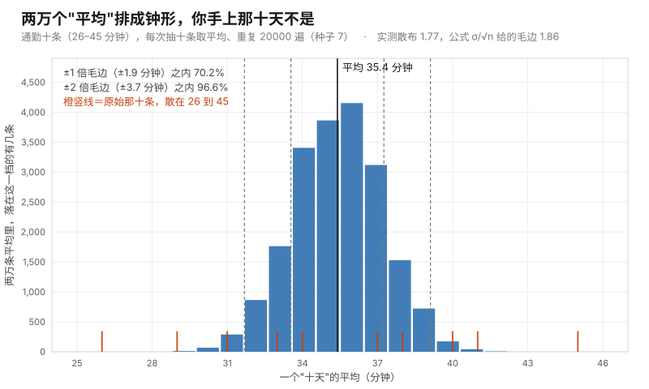

# 第 08 课 · 那个"乘二"是从哪来的

**模块**：M0 数学与金融必备 ｜ **用时**：约 40 分钟，其中动手 20 分钟 ｜ **前置**：第 07 课
**学完你会得到**：一个你可以当场演给对方看的把握数字，以及知道它在什么情况下会说谎。

**想在浏览器里一格一格跟着跑？** 浏览器版在 [08-where-the-times-two-comes-from.ipynb](../../notebooks/08-where-the-times-two-comes-from.ipynb)：按 `Shift + Enter` 逐格运行，跑出来的数字和本课里印的逐字一致（种子钉在 7）。

---

## 一、第 07 课让你乘了二，但没跟你讲为什么

第 07 课给你的那台计算器，最后一行是：

```
真实水平大概落在 32 到 39 之间
```

那个"大概"里面藏着一次乘法：**毛边乘二**。我当时说"为什么乘二而不是乘三，是下一课的内容，今天你先当成一条能用的规矩"。

你现在有权利要一个解释了。而且这个解释很重要，因为它决定你能不能把这句话改成别的说法——比如"我有九成的把握"，或者"我可以说这个涨幅是真的吗"。乘二只是最外面那一层皮，里面是一件你可能从没亲眼见过的事。

所以这一节课不推导，我们**演**。这是这门课第二次用蒙特卡洛，你会发现它的形状和第一次一模一样：不清楚一件事到底什么样，就造很多个平行世界，让每件事在里面发生一遍，然后去数。

## 二、把"平均"这件事演两万遍，看它长什么形状

回忆第 07 课最核心那句话：你算出来的平均不是一固定的数，而是一次抽签的结果。这句话你可能还有点不服——它凭什么？

那就把这件事演出来。用你手边那列十天通勤记录：`34、41、29、38、45、31、37、40、26、33`。它的平均是 35.4。

现在做一件现实中永远不会发生的事：**假装有无数个"十天"**，从这十个数里每次抽十条（抽完放回，所以下一次还是这十个数的脾气），算一个平均，记录下来。这样得到两万个平均。

代码在 [code/lesson08_error_bars.py](../../code/lesson08_error_bars.py)。核心是那台你已经很熟的机器，只换了要数的东西：

```python
random.seed(7)
avgs = []
for _ in range(20000):
    sample = random.choices(commute, k=10)
    avgs.append(sum(sample) / 10)
```

`random.choices(commute, k=10)` 是"从这列数里带放回抽十条"，`avgs` 收集两万条平均。然后把这两万条数按大小分堆、画成图——图是这段代码自己排的字符，不需要任何别的工具。

我这台机器跑出来的形状（横着看，每行是一个时长区间，`*` 的长短是落在里面的次数）：

```
  29.0  *  43
  30.4  ***  418
  31.8  **************  1854
  33.2  **********************************  4506
  34.6  **********************************************  6077
  36.1  ***********************************  4632
  37.5  ***************  1989
  38.9  ***  434
  40.3  *  47
```

**中间鼓，两头瘦，左右大致对称。** 这个形状有个名字叫**钟形**（也叫正态）。

注意你在上面这张图里看到的东西：**两万个"平均"自己排成了一个漂亮的形状，而你手上的原始记录完全不是这个形状。** 原始那十天是散在 26 到 45 之间的一把数；平均却老老实实堆在 35 附近，越远越少。

同一件事画成图如下。蓝色柱子是两万条平均的分堆，底部那一排橙色短竖线是原始那十条钉在横轴上的位置——同一把尺子（分钟），两种形状。



图由 [code/fig08_central_limit.py](../../code/fig08_central_limit.py) 生成，和上面那段字符图用的是同一轮抽签（种子 7）。

这就是第 07 课那句"平均是一次抽签"的真面目：它不是随便乱飘的抽签，它有形状，而且形状是可以演出来给你看的。

## 三、钟形这份礼物：它把"乘几"变成了"几成把握"

形状一旦知道，倍数就不再是拍脑袋的规矩，而是有对价的东西。我拿上面那两万条平均直接去数：

```
±1 倍毛边（±1.9 分钟）之内：70.2%
±2 倍毛边（±3.7 分钟）之内：96.6%
±3 倍毛边（±5.6 分钟）之内：99.9%
```

**这就是那三个数的来历。** 毛边乘一，覆盖七成；乘二，覆盖九成五以上；乘三，几乎全覆盖。以后你在任何场合看到"误差棒 ±2"之类的写法，它的意思就是这一行数：我给你的这个范围，用同样的方法重复做一百次，大概有九十五次会把真值罩在里面。

所以"乘二"不是魔法数字，是你用**四分的把握换七成的把握**（从 70% 到 96.6%）买到的那个价格。你以后完全可以选别的倍数，只是要报出你选它换来的把握——**这是这一节课真正想给你的东西：一个可以谈判的旋钮，而不是一条规矩。**

顺便验证一下第 07 课那个式子。它说毛边 = 起伏 ÷ √条数。我这台机器算出来：

```
预测的毛边 1.86，实测两万条平均的散布 1.77
```

式子给的 1.86，和把两万个平均排出来量它们的散布 1.77，差了五个百分点左右。这两个数本来就该接近——式子说的是"这件事的脾气"，模拟是"真的做一遍"。**它们是同一件事的两种看法，而且它们对上了。**

（那五个百分点的差也不是错。量"散布"本身也要靠抽签，两万次抽出来的散布自己也有毛边。这条以后你会在方差缩减那一章见到正式版。）

## 四、为什么平均会变钟形，而你手上的数不会

这件事有个名字，叫**中心极限定理**。它的直觉版本只有一句话，而且你其实已经在第 07 课的进阶框里见过它：

**很多个互不相干的小波动加起来，形状会趋向钟形——不管每个小波动自己是什么形状。**

你的平均正是这样一次加总：十条记录相加再除以十。每一条各自抽自己的，互不影响（这就是"独立"那两个字的用途，也是第 01 课那句"抽完必须放回"背后在保护的东西）。加总之后的形状，比任何单个成员都要规矩得多。

原始记录为什么不钟形？因为它不是加总，它是**单次抽签**。你某一次等车 30 分钟，那一次不需要对任何人负责。钟形是"很多次一起"才出现的规律，单个成员享受不到它。

这一点对后面很重要。原书有一整套技术用来对付"这个平均到底有多准"，它们全都建立在钟形之上——而钟形的代价是：**你必须真的在算某种加总。** 你要估计的东西如果是"最坏那一次"，它就不在钟形管辖之内（第三节末尾那个"两端的数飘"就是前兆）。

## 五、它什么时候不灵

我把同一套动作换到那列很歪的等车记录上（`3、5、2、4、30、3、2、5`，八次数里有一次等了半小时），同样抽十条取平均，重复一万遍。跑出来的形状是：

```
   2.3  **********************************************  2553
   4.2  *****************************************  2250
   6.1  *****************************  1620
   8.0  *******************************************  2370
   9.9  ***************  834
  11.9  **  112
  13.8  ****  216
  15.7  *  41
  17.6  *  4
```

**这不是钟。这是两个包。** 左边那一大坨是"这次十条里没抽到那个 30"（大多数时候都在 2.3 到 6 之间），右边那鼓包是"这次抽到了 30"（平均一下被抬到 8 以上）。中间那段 6.1 反而是低谷。

钟形呢？它还没来。原因不是定理错了，是十条太少：一个平均要"平均掉"很多小波动，才会规矩地堆在中间；当某一次抽签里的一个成员能顶起整个结果（30 相对其他七个数就是这种成员），十条根本不够。我把它改成抽一百条再跑，形状就变成中间鼓两头瘦了，把"乘二"的覆盖数也变回九成六：

```
   3.8  *  21
   4.5  ******  381
   5.3  ************************  1632
   6.0  **********************************************  3125
   6.7  *****************************************  2797
   7.5  **********************  1477
   8.2  *******  465
   8.9  *  92
   9.7  *  10
```

**这就是你要带走的第二个结论，而且它在生活里比第一个更有用：条数少 + 数据歪，这两件事叠在一起的时候，第 07 课那个"起伏 ÷ √条数"和你那个"乘二"会一起失真。** 而你的真实数据，绝大多数都是歪的：播放量、发票金额、订单大小、支出、等待时长——它们全都长得像那列等车记录，不像通勤记录。

这不是这门课的边角问题。原书整整一节（§9.3）处理"厚尾"这种形状，因为金融里最贵的错误几乎都是它带来的：**你以为你有一百条数据，所以你的估计很稳；其实你有一条数据，其他九十九条只是陪衬。**

## 六、还有一件事，它管不了

现在把两节课拼起来。

你算出"我的平均通勤 35.4 分钟，毛边 1.9，乘二之后范围 31.7 到 39.1"。这句话的正确读法只有一个：**如果我的记录方式是诚实的，那么真值大概率在这个范围里。**

它没有覆盖的是"我的记录方式本身歪了"。你只记工作日的通勤，那 35.4 是"工作日的水平"，无论你抽两万遍、把范围缩到多窄，它都不会靠近"我每天出门花多久"。第 07 课第八节说的那个瞄准镜，我们当时只交代了它存在；到这里可以说得更准一点：

**毛边、乘二、置信区间这一整套，量的是"我抽到的这两万个平均有多分散"。而你抽样的对象本身是不是你想问的那个东西，这套东西一个字都不管。**

原书第 7 章第一节（§7.1.1）用"偏差与方差"两个词正面处理这件事，因为估计一个希腊字母时，这两种错会同时存在，而且常常互相掩盖：**你把方差压得很小，看起来精确到小数点后四位，其实那个数是歪的。** 你以后会看到很多这样的表。

## 七、今晚就能用的：一句带把握的话

那台计算器就在文件的第一部分，给你的任何一列记录加一根误差棒：

```python
def fuzz(records, unit=""):
    n = len(records)
    mean = sum(records) / n
    spread = math.sqrt(sum((x - mean) ** 2 for x in records) / (n - 1))
    se = spread / math.sqrt(n)
    print(f"平均 {mean:.1f}{unit} ± {se:.1f}（毛边）")
    print(f"你敢报的范围：{mean - 2 * se:.1f} 到 {mean + 2 * se:.1f}{unit}")
```

它跑那列等车记录（第一部分那次）输出：

```
平均 6.8 分钟 ± 3.3（毛边）
你敢报的范围：0.1 到 13.4 分钟
```

看这一行，你就知道这一课不是白上的：**范围宽到 0.1 到 13.4，八条数据里有 30 那种东西，这套办法给你的诚实答案就是"我什么也说不了"。** 换成通勤那十天，范围是 31.7 到 39.1，你才敢说一句"我大概三十五分钟，可能差三四分钟"。

于是你在会上最有用的那句话，从"我们测出来涨了 500"变成：

**"我们测出来涨了 500，毛边 670，所以这个涨幅还没出噪声范围。要分辨 500 的差距，每组要一百条。"**

三件套：**一个数、它的毛边、要多少条才能看清你在意的那个差距。** 这三样齐全的话，没人能用"你这个数怎么这么好看"把你带走。

## 八、练习

**一。** 你记账三十二天，平均日花 118 块，起伏 46 块。算毛边，写出乘二的范围，然后用第三节的把握数说明这个范围有几成把握。如果你这个月只记了八天，同样的起伏，范围会变成多宽？

**二。** 你用第二节那套动作跑了一次自己的数据，出来的形状像第五节那"两个包"，不像钟。这时候"毛边乘二"还靠谱吗？你手上缺的到底是什么？

**三。** 你朋友说："我的置信区间窄得很，说明我算得准。" 用第六节哪句话回他？举一个你自己的例子：区间很窄但结论仍然是歪的。

**四。** 你要在两种写法之间选（第 07 课那道题），但这次你知道你手上数据的形状很歪（偶尔一条爆款）。你会把"每组一百条"这个数往上加还是往下调？为什么？

### 答案

**一。** 毛边 = 46 ÷ √32 ≈ 8.1 块，乘二是 ±16.3，范围大约 **102 到 134 块**，按第三节的数，把握是九成五左右。只记八天的话毛边变成 46 ÷ √8 ≈ 16.3，范围宽到 ±32.5，也就是 **85 到 151 块**——同一个平均，一个能说"我大概一百一十几"，另一个什么都说不了。

注意这里我没有考虑你的记录是不是把周末也记进去了；答案二和答案三会咬这一口。

**二。** 不能保证靠谱，但也不至于全废。钟形不出现意味着"乘二 = 九成五把握"这个对价关系不一定成立（因为它是从钟形来的），而你手上那个式子 σ/√n 只是量了散布，它仍给你大致对的**宽度**。你缺的是条数：第五节那列歪数据从抽十条换到抽一百条，形状就回到中间鼓两头瘦、把握也回到九成六。**歪的数据要多抽几遍，才能把钟形抽出来。**

**三。** 用第六节那句：毛边和置信区间量的是"这两万个平均有多分散"，不管"你抽的是不是你想问的东西"。区间窄只说明你运气稳，不说明你瞄对了。举一个具体的：你只统计了自己账号里播放量前三十条来做"我一条平均多少"，区间可以做得很窄，因为三十条内部相当一致；但你要问的是"我一般多少播放"，那三十条是精选过的，整个范围框着一个错的中心。

**四。** 往上加。第 07 课那个"一百条"是用比较规矩的形状算的；一旦数据里有那种能顶起整个平均的少数几条（爆款），抽十条会像第五节那样分成两个包，你需要更多条才能把它们平均掉。具体多少不好一口报——但你可以直接用那台计算器测：**先抽三十条算毛边，再抽六十条算毛边，如果两次的毛边按 √ 的比例缩，说明你到钟形那边去了；如果不缩，继续加。** 这个动作叫"收敛检查"，原书在做方差缩减和准蒙特卡洛时全程靠它，你今晚就能对自己的账号做一次。

---

## 九、一句话

乘二不是规矩，是用四成把握换九成五把握的那个价格；而它只在"很多次加在一起"的那个数上成立——你的数据越歪，要加的次数越多。

## 下一课

第 09 课开始处理机器那头的事：`random.random()` 抽出来的那个 0 到 1 之间的数，怎么变成你想要的任何形状（那正是第 05 课"可能性表"的编程版），这是原书第 2 章整章在做的事。

---

## 进阶框（可跳过，不影响下一课）

**中心极限定理的严格说法。** 一堆独立同分布、起伏有限的数 $\sigma$，它们平均之后的分布，在条数趋于无穷时趋于钟形（标准化后就是 $N(0,1)$），而且平均的标准差正好是 $\sigma/\sqrt n$。这句话里有三个"而且"：它要求独立、要求起伏有限（厚尾到起伏不存在的分布，它就不管用了）、要求 $n$ 足够大。上面第五节那个两个包的图，就是"足够大"这一条被当场抓住的样子。

**为什么严格说不是二，是 1.96。** 钟形下"九成五"精确对应 ±1.96 倍标准差，工程上取二，因为它好记、略微保守，且省得你去查表。你如果在论文里看到 95% 置信区间，那是 1.96；看到"误差棒 ±2"，那是二。**两者给的结论一样，别为这个打架。**

**除以 n 还是 n−1。** 我这里沿用了第 07 课那个 $\sqrt{\textstyle\sum (x-\bar x)^2/(n-1)}$。$n-1$ 的用处是：你手上有的是记录而不是那张可能性表，用 $n$ 会系统性地把起伏估小一点点。条数大的时候两者差别小到无所谓，条数只有八条的时候才值得管。严格理由属于估计量理论，原书不在这条上花时间；你现在只需要一条：**照抄，别改。**

**两组平均之差的毛边。** 第 07 课进阶框说过它是 $\sigma\sqrt{2/n}$。现在你能看懂它从哪来了：两个独立的量相加（这里是相减），起伏平方相加，所以 $\sqrt{\sigma^2/n + \sigma^2/n}$。用你的账号数字，$n=9$、$\sigma=2000$ 时它是一千左右，而"两个毛边直接相加"给一千三百——后者偏保守。第三、五节那两张图给了你一个更可靠的判断方法：**与其推公式，不如把两组各抽一次、相减、重复一万遍，直接量它排出来的形状。** 这正是蒙特卡洛在整门课里的用法。

---

## 备忘卡

本课出现的东西，正式名字在这里。

**中间鼓两头瘦的那个形状**叫**钟形 / 正态分布**（normal）；**"很多独立的小波动加起来会变成钟形"这件事**叫**中心极限定理**（CLT）；**"±1、±2、±3 各覆盖七成、九成五、几乎全部"**这个规矩叫 **68–95–99.7**；**你报出口的那个范围**叫**置信区间**（confidence interval），**它覆盖真值的比例**叫**置信水平**（confidence level，乘二对应约 95%）；**图上那种一根竖线加两头的写法**叫**误差棒**（error bar）；**"我抽的东西本身就不是我要问的那个总体"**这种错叫**抽样偏差**（selection bias），属于第 07 课第八节说的瞄准镜那一路。

---

## 原书对应与版权说明

本课对应 Glasserman（2003）**附录 A Convergence and Confidence Intervals（书页 539，PDF 页 549）**——那里正式给出大数定律、中心极限定理，以及把置信区间写成样本标准差的形式；用到的地方是 **§1.1.3 Efficiency of Simulation Estimators（书页 9，PDF 页 19）**，原书在那里就是用"标准差除以 √n"给模拟估计量的误差定标。第五节和练习四的"歪数据要多抽才出钟形"，在**§9.3 A Heavy-Tailed Setting（书页 506，PDF 页 516）**有它的正面版本；第六节的偏差与方差在 **§7.1.1 Bias and Variance（书页 378，PDF 页 388）**——那是全书把这两件事摆在一起最清楚的一节。

本课未复制原书任何文字、图表或表格。所有数字本机实测（Python 3.12，钉住种子可复现）：通勤 $n=10$ 的两万次平均 → 形状如第二节、±1/±2/±3 覆盖 70.2% / 96.6% / 99.9%、预测毛边 1.86 对实测散布 1.77；等车八条 → 平均 6.8 ± 3.3、范围 0.1 到 13.4、一万次十条平均呈双峰、预测毛边 2.99 对实测 2.81；等车抽一百条 → 形状回到中间鼓、覆盖回到 96.6%；练习一 → 32 天毛边 8.1（范围 102–134）、8 天毛边 16.3（范围 85–151）。完整章节页码见 [原书章节索引](../book-index.md)。**建议购买正版**支持作者：Springer, *Monte Carlo Methods in Financial Engineering*, 2003；中译本《金融工程中的蒙特卡罗方法》。

**上一课**：[第 07 课 · 要测多少次，你才敢下结论](07-how-many-before-you-decide.md) ｜ **下一课**：[第 09 课 · 随机数其实是排队领号](09-making-random-variables.md) ｜ **返回**：[学习路线图](../../README.md)
