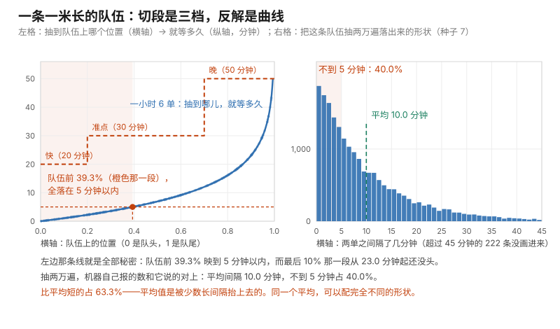

# 第 09 课 · 随机数其实是排队领号

**模块**：M0 数学与金融必备 ｜ **用时**：约 40 分钟，其中动手 20 分钟 ｜ **前置**：第 04–08 课
**学完你会得到**：一项你之前只能靠别人给的工具——把"任何形状的不确定性"造出来，包括只有一堆历史记录、没有公式的那种。

**想在浏览器里一格一格跟着跑？** 浏览器版在 [09-making-random-variables.ipynb](../../notebooks/09-making-random-variables.ipynb)：按 `Shift + Enter` 逐格运行，跑出来的数字和本课里印的逐字一致（种子钉在 7）。 也可以[直接在 Colab 里跑](https://colab.research.google.com/github/JavenZheng/monte-carlo-finance/blob/main/notebooks/09-making-random-variables.ipynb)。

---

## 一、你已经会抽签，但只会抽一种

第 04 课你用过 `random.random()`，它给你一个 0 到 1 之间的数；你还用过 `random.uniform(25, 55)` 造每天的花销。

到这里你可能一直没好意思问：**如果我想造的东西不是"25 到 55 之间等可能"呢？**

比如外卖 App 说三十分钟到。真实情况是：有五成的机会正好三十分钟左右，两成很早就到，三成拖到一个小时。这个形状不均等，你手上那个"区间里随挑"根本造不出来。

再比如你手上只有过去七条内容的播放量记录，没有任何公式，可你想知道"下个月三十条大概能带来多少总播放"。

这两种需求其实是同一件事：**从"等可能的抽签"变成"按我给的形状抽签"。** 这节课就解决这个，而且解决方式简单到有点不像话。

## 二、那条一米长的队伍

先把 `random.random()` 到底给了你什么想清楚。

想象一条一米的队伍，你站在最前面那个位置，电脑往后随便指一个位置，指到哪儿你就站到哪儿。**每个位置被指到的机会一样多。** 位置用数字表示，就是 0 到 1 之间那个小数——0 是队头，1 是队尾。

这就是均匀分布的全部内容，也是所有随机的起点（"均匀"就是指位置等可能）。原书 §2.1 整节在讲"电脑怎么把这条队伍造出来"，答案是它造的是伪随机数、有周期，但周期长到你用不完，所以够用。这一节我们只管**用**这条队伍。

关键的一步在这里：**你不需要每个形状都另找一台抽签机器。队伍就一条，你可以拿它当任何东西。**

因为队伍上的一段，长度就代表机会。

## 三、离散：把队伍切成段

送达时间你想定成三档：两成早、五成准、三成晚。

做法是把一米长的队伍切成三段，长度分别是 0.2、0.5、0.3。抽签落在哪一段，就出哪一档：

```python
def pick(u, table):
    """u 是 0 到 1 之间的抽签；table 是 [(上沿, 名字)]，从小到大排好。"""
    for edge, name in table:
        if u < edge:
            return name
    return table[-1][1]

table = [(0.2, "快（20分钟）"), (0.7, "准点（30分钟）"), (1.0, "晚（50分钟）")]
```

注意那个 `0.2、0.7、1.0`：**它们不是三档的概率，是三段的"右端点"**，也就是累积起来的位置。两成 → 第一段到 0.2；五成是累积到 0.7；剩下的到 1.0。这就是这一节课唯一的技术点，其余全是它的变形。

跑两万次数一数（`random.seed(7)`）：

```
快（20分钟）：20.0%
准点（30分钟）：50.2%
晚（50分钟）：29.8%
```

你要的是 20%、50%、30%，机器给你 20.0、50.2、29.8——差的都是第 07、08 课说的那种抽签毛边。

**这件事的名字叫逆变换**，正式写法是"拿一个均匀抽签 u，去查那个累积到 u 的位置对应的结果"。名字先放着，你刚才已经做完了：切成段，看落在哪段。以后你在原书 §2.2 看到的公式，就是这个动作换了身衣服。

## 四、连续：区间里随挑，和"多久来一单"

离散是切段，连续是**拉直**：把 0 到 1 这段队伍整段拉长到 25 到 55。

```python
def uniform_between(u, low, high):
    return low + (high - low) * u
```

队伍上 0.3 的位置，拉到 25 + 30 × 0.3 = 34。两万次跑出来平均 **39.93**，理论值正好是区间中点 40。

稍微难点的形状：假设你店里平均每小时来 6 单，你想知道"两单之间的间隔"长什么样。这一类"等到某件事发生要多久"的形状有个名字叫指数分布，造法是一行：

```python
def exponential(u, rate):
    return -math.log(1 - u) / rate
```

`math.log` 是自然对数，`rate` 是"平均每小时几单"。为什么是这一行，进阶框里给严格的一小步；这里先直接看它对不对。跑两万次，`rate = 6`：

```
平均间隔 10.0 分钟（理论 10 分钟）
不到 5 分钟就来一单的比例：40.0%
```

一小时 6 单，平均十分钟来一单——机器给 10.0，对上了。

**现在看第二行，它是这一节课第一个真正反直觉的事实。** 平均间隔十分钟，可"不到五分钟就来一单"的情况占了四成。四成！而"间隔正好落在平均附近"远没有那么常见。

这不是机器出错。到达类的事情天生这样：你等的时间分布是**一边长尾巴**的——短间隔非常多，偶尔一次特别长把平均拽到十分钟。

这条规律生活里到处能用，而几乎没有凭直觉的人会答对：

**等一件"平均十分钟"的事，你有六成的机会比十分钟还早（两万遍里是 63.3%），也有少数几次会被拖得很久。** 所以"预计 30 分钟送达"这句话，如果你按 30 分钟来安排，你会经常提前空等、偶尔严重迟到——因为它说的是平均值，不是你会遇到的那一次。第 05 课讲的"平均不是典型"在这里以另一种形式回来了：**同一个平均，可以配完全不同的形状。**

把第三节那三档和第四节这条曲线画在同一张图上，"拿一条队伍当任何东西"就看得见了。左格是映射本身：横轴是队伍上的位置，纵轴是"抽到这儿该等多久"，橙台阶是三档送达，蓝线是每小时 6 单反解出来的曲线，蓝点是两万遍里挑出来的几百个真实抽签。右格是把蓝线抽两万遍落出来的形状——橙色那一块就是"不到 5 分钟"，占了四成，而平均（绿虚线）在十分钟后头。



图由 [code/fig09_inverse_transform.py](../../code/fig09_inverse_transform.py) 生成，就是上面这一轮抽签（种子 7、两万次）。

顺带，`1 - u` 那个写法你可能会问：直接写 `u` 不行吗？行。队伍从哪头开始数都一样，因为 u 和 1−u 是同一个形状（进阶框有一句解释）。用 `1-u` 只是为了避开 `log(0)` 那个边界意外。

## 五、最难也最值钱的那种：你只有历史，没有公式

上面那些形状是你自己定的概率。可现实里你更常见的情形是：**你不知道任何概率，你只有一堆过去发生过的事。**

比如你的七条播放量：`820、1200、3400、610、950、2100、480`。你想知道下个月三十条大概总共能跑到多少。

办法朴素得让人怀疑：把这七条本身当成那条一米长的队伍——七条各占七分之一（每条的机会相等，因为你没有理由说哪条更该重现），然后把"从这七条里有放回抽三十次"重复一万遍，数出来的就是答案。

```python
def future_total(records, k, runs):
    """从历史 records 里有放回抽 k 条，看这 k 条加起来是多少；重复 runs 次。"""
    out = []
    for _ in range(runs):
        drawn = random.choices(records, k=k)
        out.append(sum(drawn))
    out.sort()
    return out
```

`random.choices(列表, k=30)` 就是"有放回抽三十次"，第 04 课你已经用过它。跑一万遍"未来的三十条"（种子 7）：

```
三十条的总播放：一成低于 34190，中位 40830，九成不超过 47910
最常在哪个区间：37230 到 44490
```

**这就是一个可以直接说出口的结论**："按我这七条的形状，下个月三十条的总播放大概四万，保守说三万四以上，乐观不超过四万八。"

而且它顺手解决了一件事：你完全没有假定播放量服从任何有名有姓的分布。这个做法有个正式名字叫**经验分布**——把你手上那一列记录当成可能性表；重复抽它、看统计量怎么变，叫 **bootstrap**。名字留在备忘卡，你今天拿到的是动作。

顺手验一下它的合理性：七条的平均是 1365.7，乘三十 = 40971，而模拟的中位是 40830。第 06 课那句话在这里正好闭环：**期望（40971）是你想要的那个数，模拟（40830）是你拿到它的手段。**

## 六、今晚就能用起来，但三件事要先说清

代码在 [code/lesson09_making_any_distribution.py](../../code/lesson09_making_any_distribution.py)。你要改的只有第五节那一列 `plays`——换成你自己的任何记录：这半年的月收入、这一年的账单、所有跑过的步数。

三种现实用法，都是同一段代码：

**"下个月总播放大概多少"**（把三十换成你实际的发文条数）。

**"我这个月打车费会到多少"**：把历史每一笔金额粘进去，一次抽二十二天，取总和。这比第 04 课那个"每天 25 到 55"更实在，因为那个区间是我编的，而这一列金额是你真花过的。

**"客服要排几个人"**：如果你有历史每天的问题量，同样的动作给你"九成不超过多少"，那就是排班要看的数（第 05 课练习三的答案口径：**预算和排班按分位数定，不按平均定**）。

三件事必须说清，因为这套办法的毛病全部藏在这里：

**第一，你抽不出你历史上没出现过的形状。** 那七条里最大 3400，所以一万遍里永远不会出现一条五万的。你的"下个月最好情况"被你的历史封顶了。如果你的账号其实有可能爆一条大的——而它正是你经营它的理由——这套办法会系统性低估你的上限。这就是第 05 课那条尾巴、原书 §9.3（书页 506）整节在处理的对象：**样本给不了你没见过的事。**

**第二，有放回地重抽历史，等于假设"下个月和过去这七条是同一个世界"。** 你换了选题、换了平台推荐策略、或者签了 MCN，这个假设当场断掉。断掉不是错误，是你必须知道它断了——就像第 01 课那个杯子，你把概率改了，答案才跟着改。

**第三，条数太少时，第五节那三个数给的是一种虚假的精确。** 七条记录抽三十条，"一成低于 34190"这个数本身是用一万次抽签量的，它自己也有毛边（第 07 课那套算式适用于它）。七条数据报出"34190"这种四位数精度，是在装饰自己。取整说"三万四到四万八"就够了。

## 七、练习

**一。** 你想造"中午点单的等待时间"：三成 20 分钟、五成 30 分钟、两成 50 分钟。把第三节那个 `table` 写出来（三个右端点分别是什么？），跑两万次，得到什么？

**二。** 第四节那行"不到五分钟就来一单四成"，你信不信？把 `rate` 改成 3（平均二十分钟一单），跑一次，看"间隔小于十分钟"的比例是多少。它和 40% 比是高还是低？为什么？

**三。** 把第五节那一列换成你自己的记录（十到三十条都行），跑出三个数。然后按第六节第三条，把它们改成你敢说出口的说法——报几个有效数字？

**四。** 你说"我历史最大播放 3400，所以下个月总播放最多不超过四万八"。这句话错了两处。用第六节的哪两条提醒分别指出它们？

### 答案

**一。** 累积右端点是 0.3、0.8、1.0（三成、三成+五成=八成、全部）。我跑两万次得 30.3% / 49.7% / 20.0%。注意你要的是 30/50/20，机器给的是**接近但不等于**——那零点几个点的差就是第 08 课的毛边；两万次的毛边大约是 σ/√20000，小到你可以不管，但十万次会更贴。

**二。** 我跑出来是 40.0%（rate=3，间隔小于十分钟）。和原来那个 40.0% **一样**，不是更低。原因：指数形状只看"这段时间是平均间隔的几倍"，不看平均本身——5 分钟对平均 10 分钟、10 分钟对平均 20 分钟，都是"一半的平均"，所以机会一样。这就是它"无记忆"的那一面：把任何一单挪到时间轴上，间隔形状不变。

现实里这条很实用：**"平均二十分钟回消息"和"平均十分钟回消息"，你"很快就收到"的机会是一样的**（都是四成上下）。差别只在你运气差的那一次有多差。所以别拿平均值当"我大概要等多久"的决策依据。

**三。** 这题没有标准答案，标准是**两个有效数字**。你手上十几条记录算出来的分位数，第六节第三条说了它的可信度上限；把 34190 说成"三万四"、把 47910 说成"四万八"，你才没有把噪声包装成精度。以后你写任何一份带模拟结果的周报，都用这条尺子自检：**这个数的小数点位数，配得上我的记录条数吗？**

**四。** 第一处：**上限错了**。四万八是一万次抽签里的九成位置，不是极限——第 04 课那句"演了一千遍没出现不等于不会发生"，第 05 课练习四的那条尾巴。第二处更严重：**这个算法根本造不出超过 3400 的一条**，所以你算的"最坏情况"其实是"最坏的历史情况"（第六节第一条）。两者叠起来会让你的乐观和悲观都偏窄，而方向恰恰是你想要的那一边被剪掉了。

---

## 八、一句话

一台均匀抽签就够：把队伍切成段就是离散，整段拉直就是均匀，反过来解就是指数，把历史当成队伍就是没有公式时的答案——但队伍以外的事，它永远抽不出来。

## 下一课

第 10 课处理金融里最常用的那两副面孔：正态与对数正态。你会明白为什么"每天涨跌 1%"造出来的价格永远不会变成负数，以及为什么原书模拟股价时相加的不是价格而是收益率。

---

## 进阶框（可跳过，不影响下一课）

**逆变换的严格一句话。** 想要的那个分布有个累积函数 $F(x) = P(X \le x)$——它就是"到 x 为止切了多长一段"。做法是解 $F(x) = u$，也就是 $x = F^{-1}(u)$。第三节那段"看落在哪个累积段"就是它对离散情形的直译；第四节那行 `-math.log(1-u)/rate` 是把 $F(x) = 1 - e^{-\lambda x}$ 反过来解出来的：令 $u = 1-e^{-\lambda x}$，得 $x = -\ln(1-u)/\lambda$。原书 **§2.2 一般抽样方法（书页 53，PDF 页 63）** 开头给的就是这一招，并讨论哪些分布能反解、不能反解时怎么办（拒绝法、正态专用法）。

**为什么 `1-u` 和 `u` 一样。** u 在 0 到 1 上等可能，则 1−u 也在 0 到 1 上等可能，两个是同一个分布；换一下只是让队伍从头数还是从尾数。用 `1-u` 是因为当 u 恰好抽到 0 时，`log(0)` 会炸，而 `log(1)` 是 0，安全。

**"不到一半的平均"那个 39.3% 从哪来。** 指数间隔落在 5 分钟以内的概率是 $1 - e^{-6 \times \frac{5}{60}} = 1 - e^{-0.5} = 39.3\%$，我模拟跑出来是 40.0%——又是两个独立算法撞到同一个数上。顺带这条也解释了一个常识：**"平均十分钟一单"的时候，最短的那一段概率密度其实最高**，短间隔最多、长间隔少，但平均值被少数长间隔抬起来了。

**"每小时来几单"这件事还有个名字叫泊松过程。** 它描述"稀有事件在时间上到达"，间隔服从指数。原书在 **§3.5 Processes with Jumps（书页 134）** 用这类过程给股价加跳；生活里电话量、订单量、地铁故障都是它。

**电脑那条队伍是怎么来的（§2.1，书页 39）。** 它是按一个固定的算术递推生成的序列（"伪随机数"），周期极长、统计上通过各项检验。第 04 课那颗种子决定的是递推的起点，不是把结果存下来给你看。所以你钉种子能复现，删种子每次不同。原书在那里还提醒：周期有限、序列有结构，某些粗糙的取法（比如每隔很多个取一个）会暴露相关性——这是工程细节，但它是"你的随机数可能有问题"这一类事故的正经来源。

---

## 备忘卡

本课出现的东西，正式名字在这里。

**0 到 1 等可能**叫**均匀分布**（uniform）；**"到某个位置为止累积了多少机会"**叫**分布函数 / 累积分布**（CDF，$F$）；**用均匀抽签反查位置得到想要的值**叫**逆变换法**（inverse transform）；**"每隔多久来一单"那种一边长尾巴的形状**叫**指数分布**（exponential），描述它的到达叫**泊松过程**（Poisson process）；**把一列历史记录当成可能性表**叫**经验分布**（empirical distribution）；**从经验分布里有放回重抽、看统计量散布**叫 **bootstrap**；**"每个结果机会相等"**是均匀分布，也是你手里只有记录时的默认假设。

---

## 原书对应与版权说明

本课对应 Glasserman（2003）**Chapter 2 Generating Random Numbers and Random Variables**：章起始在书页 39（PDF 页 49），其中 **§2.1 Random Number Generation（书页 39）** 讲那条队伍怎么由递推生成、种子和周期的意义，**§2.2 General Sampling Methods（书页 53，PDF 页 63）** 就是把均匀抽签变成任何分布的三招（逆变换、拒绝、专用方法）。指数与到达类过程在 **§3.5 Processes with Jumps（书页 134，PDF 页 144）** 派上用场；第六节第一条"历史封顶了你没见过的事"，是 **§9.3 A Heavy-Tailed Setting（书页 506，PDF 页 516）** 的入口。

本课未复制原书任何文字、图表或表格。所有数字本机实测（Python 3.12，钉种子 7 可逐字复现）：三档送达两万次 → 20.0% / 50.2% / 29.8%（目标 20/50/30）；区间 25–55 两万次 → 平均 39.93（理论 40）；指数 rate=6 两万次 → 平均间隔 10.0 分钟、间隔小于 5 分钟占 40.0%（理论 39.3%）、比平均间隔短的占 63.3%；rate=3 时"小于十分钟"40.0%；练习一那组累积段 0.3/0.8/1.0 → 30.3% / 49.7% / 20.0%；七条播放量的三十条重抽一万遍 → 一成低于 34190、中位 40830、九成不超过 47910、中间一半落在 37230 到 44490，对照期望 30 × 1365.7 = 40971。完整章节页码见 [原书章节索引](../book-index.md)。**建议购买正版**支持作者：Springer, *Monte Carlo Methods in Financial Engineering*, 2003；中译本《金融工程中的蒙特卡罗方法》。

**上一课**：[第 08 课 · 那个"乘二"是从哪来的](08-where-the-times-two-comes-from.md) ｜ **下一课**：[第 10 课 · 为什么股价跌不成负数](10-normal-and-lognormal.md) ｜ **返回**：[学习路线图](../../README.md)
