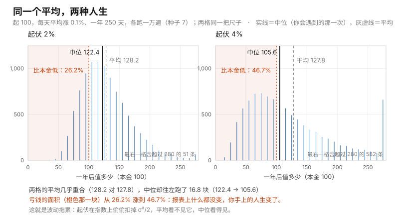

# 第 10 课 · 为什么股价跌不成负数

**模块**：M0 数学与金融必备 ｜ **用时**：约 45 分钟，其中动手 20 分钟 ｜ **前置**：第 08、09 课
**学完你会得到**：一个能造出"价格"的写法（它永远不会给你负价格），以及一句能当场识破假模型的话。

---

## 一、你的模拟程序造出了一个不该存在的东西

上一课你会造任何形状了，于是你可能顺手试了最自然的那个动作：**模拟一只股票。**

你手上有个 3000 块的基金，你觉得它每天大概涨跌 1% 左右。你按最直的思路写：今天的价格等于昨天的价格加上一个随机的涨跌。为了看数方便，我们一律把起点记成 100（这样每个结果都是百分比，3000 块那只只要把数乘 30 就行）。

跑一万遍，最惨的一遍是 **−208.5**，一万遍里有 **1036 遍**的终点是负数。

一只基金的价格不可能是负的。你检查一下代码，逻辑没写错、随机数没写错、参数也合理。那问题出在哪？

问题出在你把"涨跌"当成了**几块钱**。而这门课要说的第一件事是：**价格上的涨跌其实是按比例的，比例和块钱不是同一种东西。** 这一件事讲透，负价格自动消失，而且你会顺手拿到金融里最常用的那个分布。

## 二、先跌一半再涨一半，你回不到原点

在写任何代码之前，先算三道一年级算术。

你手上 100 块。第一天跌一半，剩 50。第二天涨一半——是 50 的一半，25——回到 75。

$$100 \times 0.5 \times 1.5 = 75.0$$

换成先涨后跌也一样：100 涨一半到 150，再跌一半（150 的一半是 75），回到 75。

而如果是块钱呢？+50 块钱、−50 块钱，回到 100。跑一遍程序，三种写法的结果分别是 **75.0、75.0、100**（前两个数字是同一件事的两种顺序）。

这就是全部的秘密：**块钱可以抵消，比例不能抵消。** 跌掉的那一刀是按小本金算的，涨回来的那一刀也是按小本金算的，两头不对称。

**记住这两行的差别，第四节的负价格和第五节的"越晃越亏"都从它长出来。**

## 三、把第 08 课那个钟形拿来当每天的涨跌

第 08 课你已经见过"中间鼓、两头瘦"那个形状，它叫正态分布。现在我们要用它，只需要一行工具：

```python
random.gauss(平均, 起伏)
```

它给你**一个**服从正态分布的数：以"平均"为中心，散布宽度大约是"起伏"。这就是第 09 课那条一米队伍的正态版本——你不用再切段，直接要一个钟形里的抽签。

于是"模拟价格"有两种写法，差别就是第二节那两道算术：

```python
p += random.gauss(0, 5)          # 每天加减 5 块钱
p *= 1 + random.gauss(0, 0.02)   # 每天涨跌 2%
```

第一种是块钱，第二种是比例。把每一段前面都钉上种子 `random.seed(7)`，各跑一万遍，一年按 250 天算。

## 四、块钱那版会给你负价格，比例那版不会

**加减 5 块钱那版**（起点 100，平均 0）：

```
终值是负数的：1036 遍，占 10.4%
中途跌破过零的：1948 遍，占 19.5%
最惨的一遍：-208.5 元
一成低于 -2，中位 100，九成不超过 201
```

一万遍里有整整一成遍，一年后这只基金值负钱。你的程序没坏，它只是**忠实地演了一个你把世界搭错了的杯子**（第 01 课第六节那句话在这里第一次真的用上）。

**涨跌 2% 那版**（同样起点 100、平均 0）：

```
最惨的一遍：27.63 元（没有一遍是负的）
一成低于 63.3，中位 95.3，九成不超过 142.3
一万遍的平均：99.9
一年后比起点还低的：占 56.3%
```

**价格永远为正**——因为它只能被越乘越小，乘不到零以下去。这就是"股价只能为正"这件事的全部工程实现：不是加了什么限制，是**乘**这个动作本身就不会穿过零。

再看形状，把一万条路径的终值排成一张图（`*` 的长短是次数）：

```
     28  *******  601
     58  *******************************************  3491
     89  ********************************************  3569
    119  ********************  1601
    150  *******  542
    180  **  133
    211  *  51
    241  *  8
    272  *  4
```

跟第 08 课那张钟比：**左边到 28 就断了（不能再低），右边一路拖到 272 还没断。** 这个"有底、无顶"的形状叫**对数正态**——它是正态的按比例版本，也是金融里用得最多的一个分布。你现在只需要认得它的长相：左边削平，右边拖尾。

## 五、"平均不涨"不等于"你不会亏"

第四部分那一串数里，有三个必须放在一起看：

- 每天平均涨跌 **0%**；
- 一万遍的平均终值是 **99.9**，也就是说不涨不跌，公平游戏；
- 可一年后**比本金还低的路径占 56.3%**，中位数只有 **95.3**。

**平均是 100，典型却是 95，超过一半的人亏钱。**

这不是矛盾，就是第二节那道算术在大量天数上累积起来的结果：每一天"跌 2%"和"涨 2%"看起来对称，但跌的那刀砍在更大的本金上。晃来晃去，钱就自己往下走了一点。

把起伏加大，这件事会变得非常刺眼。下面两组**平均涨跌完全一样**（每天 +0.1%），只有起伏不同，各跑一万遍：

```
起伏 2%：中位 122.4，平均 128.2，亏钱的占 26.2%
起伏 4%：中位 105.6，平均 127.8，亏钱的占 46.7%
```

**平均值几乎没动（128.2 → 127.8），典型结果掉了 17 块钱（122.4 → 105.6），亏钱的概率从四分之一跳到将近一半。**

同一把尺子画成两格，就看得见那个"往左跑"：黑实线（中位）在右格里明显偏左，灰虚线（平均）却几乎没动；橙色那一块是"比本金低"的面积。



图由 [code/fig10_volatility_drag.py](../../code/fig10_volatility_drag.py) 生成，用的就是上面这一轮抽签（种子 7、各一万遍）。

再把起伏拉到 10%、平均涨跌归零：中位是 **28.4**，平均是 **97.3**——按平均算几乎没亏，按你会遇到的那一次算，本金剩不到三成。

这就是"起伏"这个词在按比例的世界里真正的价格：**同样是"平均涨 0.1%"，晃得越凶，你个人拿到手的结果越差，而报表上的平均值对此毫无反应。** 第 05 课那句"平均会骗你"在这里换了一副面孔回来：不是因为有个爆款把平均拉高，而是因为**平均是加法的孩子，你的账户是乘法的**。

## 六、log：把 250 个乘法变成 250 个加法

上面那套道理还差一件趁手工具。我们想让第 07、08 课那些只适用于**加法**的算式（毛边 = 起伏 ÷ √条数、乘二换成九成五）也用在价格上，但价格是连乘的。

`math.log` 干的就是这件事：**它把一串乘法变成一串加法。** 拿一条真实路径验证（起伏 2%、平均每天 +0.1%，250 天）：

```
连乘完再取 log = 0.4325；把每天的 log(1+r) 加起来 = 0.4325
```

同一个数，两种算法。所以你真正该假设"每天近似正态"的，不是价格本身，而是**每天那个 `log(1+涨跌)`**。这一句就是原书模拟股价时"相加的不是价格而是收益率"的全部理由。

变成加法以后，第五节那件事有个干净的式子。它替你回答的问题是：**"每天平均涨 0.1%、起伏 2%，一年下来我典型能拿到多少？"**

$$\text{中位终值} \approx \text{起点} \times e^{T \times \text{日均涨跌} - \frac{\sigma^2}{2} T}$$

代进去（$T = 250$、日均 $0.001$、$\sigma = 0.02$）：$100 \times e^{0.25 - 0.05} = 122.1$，而模拟跑出来是 **122.4**。又是两个独立算法撞到同一个数——和第四、第五节一样，式子和抽签互相作证。

式子里那个 $-\frac{\sigma^2}{2}$ 就是第五节掉下去的那 17 块钱：**起伏越大，它减得越多**（$\sigma$ 从 2% 变成 4%，这一项就变成四倍，因为它是平方）。原书 **§3.2 几何布朗运动（书页 93）** 那个连续版本 $S_T = S_0 \exp\left((r - \frac{\sigma^2}{2})T + \sigma W_T\right)$ 里，$\sigma^2/2$ 就明晃晃写在指数上，你今天在模拟里看见它干活了。

## 七、今晚就能用，但先说三件事

代码在 [code/lesson10_normal_and_lognormal.py](../../code/lesson10_normal_and_lognormal.py)。你要改的是三个参数：起点、日均涨跌、起伏（`mult_price(3000, 0.0005, 0.015, 250, 10000)` 就是"我那只三千万……三千块的基金"）。

三件可以直接拿去用的事：

**给你的持仓做一次"最坏情况体检"。** 报三个数而不是一个数：一成低于多少、中位多少、九成不超过多少。以 3000 块起、日均 +0.05%、起伏 1.5% 为例，实测是 **2435 / 3310 / 4470**，另有 **34.0%** 的概率一年后比 3000 还低。这句话可以原样进你的家庭财务讨论。

**当别人拿"期望收益"说服你时，问一句"典型情况呢"。** 第五节那两组数（平均 128.2 对 127.8、中位 122.4 对 105.6）就是这一问的标准杀伤力：同一个平均，两种人生。

**把你自己的任何模拟做一次"负数体检"。** 你的模型如果会造出负的价格、负的销量、负的人数，那你就是把块钱和比例搞混了——这是最容易发现、也最容易被忽略的建模错误。**能跑出负数的价格模型，一定错。**

然后三件事必须说清楚：

**第一，正态会低估你最怕的那种日子。** 钟形两头瘦得极快，真实市场却会有一天跌 10% 的事反复发生。上面这一万遍里最差的路径是 −72%，听起来很惨，但真实市场不会给你这种形状的尾巴（第 05 课的长尾、原书 **§9.3 厚尾设定（书页 506）** 一整节就在处理这件事）。用正态做估计，你的"最坏情况"通常偏乐观。

**第二，"每天独立地涨跌"是个很强的假设。** 我们让每天的抽签互不影响（第 01 课那个"抽完必须放回"的规矩），可真实的涨跌会扎堆：大跌之后紧跟大跌的概率比独立假设给的高。这一条不影响你今天算数，但它是你以后读到原书第 3 章、第 6 章时会重新遇到的东西。

**第三，日均涨跌和起伏这两个参数从哪来，比模型本身更要命。** 用过去一年的记录估出来的这两个数，本身就带第 07 课那种毛边（`random.gauss` 的两个参数写错了，一万遍会精确地告诉你一个错答案，就像第 01 课那个杯子）。

## 八、练习

**一。** 把第二部分的起伏改成 5%（`sd_r = 0.05`，平均仍是 0），跑一万遍。最惨的一遍是多少？有几遍是负的？平均和中位谁大、各大多少？一年后亏钱的占几成？

**二。** 用你自己的数：起点 3000、日均 +0.05%、起伏 1.5%、250 天，跑一万遍，报出三个分位数和亏钱比例。按第七节第三条和上一课第六节第三条，把这几个数改写成你敢在饭桌上说出口的一句话。

**三。** 同事说："我这个策略日均收益 0.1%，一年期望 128。"你怀疑他，但说不出问题在哪。用第五节哪两个数、怎么问他？

**四。** 为什么"每天 ±2%"跑出来左边卡在 28 就断了，右边却能拖到 272？用第二节的算术回答，不许出现"对数正态"这个词。

### 答案

**一。** 实测（种子 7）：最惨 **3.28**，**0 遍**为负；一成低于 **26.3**、中位 **73.4**、九成不超过 **200.6**、平均 **99.4**，一年后亏钱的占 **65.5%**。注意平均仍是 99.4（几乎没动），但中位已经跌到 73.4，而且三分之二的遍数在亏钱。起伏从 2% 到 5%，报表上什么都没变，你手上的人生变了 40 多块。

**二。** 实测：**2435 / 3310 / 4470**，亏钱占 **34.0%**。可以说出口的版本："一年以后大概三千三，差的时候两千四上下，好的时候不到四千五；而且大约三次里就有一次我是亏的。"取整到百位——这几个数是从两个你自己估的参数来的，报四位有效数字是在装饰自己。

**三。** 那两个数是 **128.2 和 122.4**（起伏 2% 那组），或者更狠的一组：**127.8 和 105.6**（起伏 4%）。问法是："你的起伏是多少？"因为 128.2 和 127.8 这两个"期望"几乎一样，而对应的典型结果是 122.4 和 105.6。**只报期望的策略比较，等于没比较**——第 06 课说"能被摊平的按期望选"，但你这份本金摊不平。

**四。** 因为跌到零需要把本金一路乘到没有：每一天最多只能砍掉一部分，砍不掉负的那边，所以往下有底。而往上没有这种限制——涨 2% 是在已经涨起来的本金上再涨 2%，越滚越大，所以右边可以一直拖。**"有底、无顶"是乘法本身的形状，不是参数调出来的。**

---

## 九、一句话

涨跌是按比例的，所以乘法造出来的价格永远为正、右边拖尾；也正因为是乘法，"平均不涨"的东西对中位数是往下掉的——起伏在指数上偷偷扣你 $\sigma^2/2$。

## 下一课

第 11 课把两个随机变量放到一张桌子上：它们各自会晃还不够，要看它们是不是**一起**晃。你会用手上两组记录算出一个数，并用它判断自己的副业、自己的账号矩阵到底是分散还是同一个东西买了三遍。

---

## 进阶框（可跳过，不影响下一课）

**为什么中位数会掉、平均值不掉。** 设每天涨跌 $r_t$ 独立、均值 0、方差 $\sigma^2$。终值是 $\prod(1+r_t)$。取对数变成 $\sum \log(1+r_t)$，把 $\log(1+r)$ 在 0 处展开到二阶：$\log(1+r) \approx r - \frac{r^2}{2}$。取期望，$E[r] = 0$，而 $E[r^2] = \sigma^2$（这一步用到了第 06 课那个"方差就是平方的期望减期望的平方"）。所以每天的对数期望大约是 $-\frac{\sigma^2}{2}$，$T$ 天累起来就是 $-\frac{\sigma^2}{2}T$。**减号是二阶项带来的，不是谁规定的。** 而 $E[\prod(1+r_t)] = \prod E[1+r_t]$（独立性让期望能拆开，这就是第 06 课说的线性能用的场合）仍然是 $100$，所以平均不动。

**$e$ 是什么。** $e^{0.2} \approx 1.2214$，就是"连续地按 20% 增长"的结果，Python 里写 `math.exp(0.2)`。第六节那个式子之所以用 $e$，是因为我们把乘法经 log 变成了加法，反对数就自然长成 $e$ 的幂。

**为什么 gauss 和上一课那套切段是同一件事。** 正态分布没有可以直接反解的累积函数（$e^{-x^2}$ 积不出初等式子），所以第 09 课那招逆变换在这里用不上，得换招：原书 **§2.2（书页 53）** 提到正态用专门的构造（Box–Muller，用两个均匀抽签算出一对正态数）。`random.gauss` 内部就是这类做法。你用不到细节，但要知道：**"能反解就用逆变换，不能反解就用别的手段"正是那一节的组织方式。**

**原书怎么写的。** **§2.3 Normal Random Variables and Vectors（书页 63，PDF 页 73）** 先给正态的密度与性质，再讲多维正态——那就是下一课。**§3.2 Geometric Brownian Motion（书页 93，PDF 页 103）** 把今天第六节那个指数式子写成随机微分方程的解，并且明确提醒它恒为正；原书在那里还给出用对数正态直接算欧式期权定价模拟的写法。你今天的 $-\frac{\sigma^2}{2}$ 就是它指数上那一项。

---

## 备忘卡

本课出现的东西，正式名字在这里。

**中间鼓两头瘦的那个形状**叫**正态分布 / 钟形**（normal，第 08 课已给）；**按比例连乘出来的、左边削平右边拖尾的形状**叫**对数正态分布**（lognormal）。**涨跌是按比例的**叫**收益率**（return），按块钱的那叫**损益额**（P&L change）——两者的区别就是这一节课。**同样平均但更晃的东西长期更差**这件事叫**波动拖累**（volatility drag），量上是指数上的 $-\frac{\sigma^2}{2}T$；"典型结果"就是**中位数**，"平均结果"是算术平均，两者在对数正态里必然不相等。把涨跌按时间乘起来的写法叫**几何布朗运动**（geometric Brownian motion，原书 §3.2）的离散版本。

编程词汇：`random.gauss(mu, sigma)` 抽一个正态数；`math.exp(x)` 是 $e^x$，和 `math.log` 正好互逆。

---

## 原书对应与版权说明

本课对应 Glasserman（2003）**§2.3 Normal Random Variables and Vectors（书页 63，PDF 页 73）**（正态与多维正态，下一课接着讲多维那半）与 **§3.2 Geometric Brownian Motion（书页 93，PDF 页 103）**（为什么股价模型必须恒为正、$\sigma^2/2$ 从哪来）；抽样机制本身回到 **§2.2 General Sampling Methods（书页 53，PDF 页 63）**；第七节第一条"正态低估极端"是 **§9.3 A Heavy-Tailed Setting（书页 506，PDF 页 516）** 的入口。

本课未复制原书任何文字、图表或表格。所有数字本机实测（Python 3.12，每段前钉种子 7 可逐字复现）：加法版（起点 100、每天 ±5 块、250 天、一万遍）→ 终值为负 10.4%（1036 遍）、中途跌破零 19.5%（1948 遍）、最惨 −208.5、分位 −2 / 100 / 201；乘法版（每天平均 0%、起伏 2%）→ 最惨 27.63、无负值、分位 63.3 / 95.3 / 142.3、平均 99.9、56.3% 低于起点，终值直方图 601/3491/3569/1601/542/133/51/8/4；100×0.5×1.5 = 75.0 与 100×1.5×0.5 = 75.0，而 100+50−50 = 100；日均 +0.1% 时起伏 2% → 中位 122.4、平均 128.2、亏钱 26.2%，起伏 4% → 中位 105.6、平均 127.8、亏钱 46.7%；起伏 10%、日均 0% → 中位 28.4、平均 97.3（理论 $e^{-0.10^2/2\times250}\times100 = 28.7$）；一条路径连乘取 log 与逐日 log 相加都是 0.4325，理论中位 122.1 对模拟 122.4；练习一（起伏 5%）→ 最惨 3.28、0 遍负、26.3 / 73.4 / 200.6、平均 99.4、亏钱 65.5%；练习二（3000、日均 0.05%、起伏 1.5%）→ 2435 / 3310 / 4470、亏钱 34.0%。完整章节页码见 [原书章节索引](../book-index.md)。**建议购买正版**支持作者：Springer, *Monte Carlo Methods in Financial Engineering*, 2003；中译本《金融工程中的蒙特卡罗方法》。

**上一课**：[第 09 课 · 随机数其实是排队领号](09-making-random-variables.md) ｜ **下一课**：[第 11 课 · 一篮子公司为什么还会同一天倒霉](11-correlation-and-baskets.md) ｜ **返回**：[学习路线图](../../README.md)
