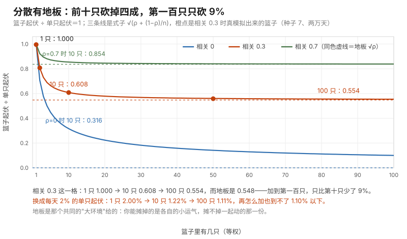

# 第 11 课 · 一篮子公司为什么还会同一天倒霉

**模块**：M0 数学与金融必备 ｜ **用时**：约 45 分钟，其中动手 20 分钟 ｜ **前置**：第 06、08、10 课
**学完你会得到**：一个能算的数，用来判断"你的分散是真分散还是心理安慰"；以及一条能当场挡回去的说法："我看了八天，这两件事明显相关。"

---

## 一、你明明买了十只，为什么那天全绿

你有三个账号，都是生活类选题。你告诉自己这叫矩阵、叫分散风险。

某天平台改了推荐权重，三个账号同一天播放量腰斩。

基金也一样。你买了十只，心想"总不会一起跌吧"，结果某天打开账户，十只全绿。

**"一篮子里东西多"和"篮子里的东西会不会一起倒霉"是两件事。** 前者你数得清（十只就是十只），后者你一直没算过。这一节课就把它变成一个数，然后你会看到：分散这件事有一个消不掉的地板，而地板的高度就是那个数决定的。

第 06 课我们说过一句话——**期望能拆开相加，方差不能**。当时欠你的那一项，今天补上。

## 二、"一起动"是可以数的

手上两列数，一列是每天 A 的涨跌，一列是每天 B 的涨跌。要判断它们是不是一起动，做法只有一步：**先看 A 高于自己平均的那些天，B 是不是也高于自己的平均。**

是，就是正相关；反过来就是负相关；高低对不上就是各动各的，相关约等于 0。

写成代码：

```python
def corr(xs, ys):
    """两列数有多"一起动"：-1 到 1。"""
    n = len(xs)
    mx = sum(xs) / n
    my = sum(ys) / n
    sx = spread(xs)
    sy = spread(ys)
    return sum((x - mx) * (y - my) for x, y in zip(xs, ys)) / (n - 1) / (sx * sy)
```

`spread` 是第 08 课那台量散布的机器。`zip` 是第 06 课那招"两列数一次各拿一个，凑成一对"。整个函数做的事就是第一节那句话：把"各自偏离自己的平均"配成对乘起来，再除以两列各自的散布——除这一步是为了把结果压进 −1 到 1 之间，好让"0.7"这种数在不同问题上可比。

**这个数叫相关系数，记作 $\rho$。** 它是这门课第一个真正描述"两件事之间的关系"的数，也是原书第 2 章后半节（多维正态）和第 9 章（组合风险）共同的地基。

它灵不灵？我造了几组已知答案的数据来验（共同的大环境占多少，就用 `market_pair` 那个函数控制），两万天：

```
设定相关 0.0 → 实测 corr 0.013
设定相关 0.3 → 实测 corr 0.309
设定相关 0.7 → 实测 corr 0.699
设定相关 0.9 → 实测 corr 0.900
```

量尺是对的。

## 三、两个加起来，起伏不是相加

你中午点外卖、晚上打车，两笔钱合起来是一天的开销。如果它们各自动，合起来的起伏是多少？

很多人会答"两个加起来"。第 06 课已经说过这是错的，但错多少一直没给数。现在有数了。让两列起伏都是 1，各跑两万天，把每天的两个数相加再看散布：

```
两者相关 0.0：加起来的起伏 实测 1.424 / 理论 1.414
两者相关 0.3：加起来的起伏 实测 1.617 / 理论 1.612
两者相关 0.7：加起来的起伏 实测 1.836 / 理论 1.844
两者相关 1.0：加起来的起伏 实测 2.002 / 理论 2.000
```

这张表值得慢慢看：

- 完全各动各的（$\rho = 0$），合起来的起伏是 $\sqrt{2} = 1.41$，**既不是 1，也不是 2**。第 08 课那个"A/B 两组比较的毛边是单组的 √2 倍"，出处就在这里。
- 完全同步（$\rho = 1$），才是老老实实的 1 + 1 = 2。
- 中间的值由 $\rho$ 决定。

写成式子。它替你回答的问题是：**"两个来源合起来，会比各自更晃多少？"**

$$\operatorname{Var}(X+Y) = \operatorname{Var}(X) + \operatorname{Var}(Y) + 2\rho\,\sigma_X\sigma_Y$$

左边是"合起来的方差"，前两项是各自的方差，第三项就是第 06 课欠你的那一项。$\rho = 0$ 时它消失，$\rho = 1$ 时它让 $1 + 1$ 变成 $4$（开根号就是 2）。

**这一项有个要命的性质：你买多少东西都消不掉它。** 下一节就说这件事。

## 四、一篮子的起伏，和它消不掉的那部分

现在把"分散"变成一个动作：$n$ 只资产各买十分之一。每只单看起伏都是 1，彼此相关 $\rho$。

最自然的搭法是"每个账号/每只股票都受同一个大环境影响，再各加一点自己的运气"：

```python
value = math.sqrt(rho) * common + math.sqrt(1 - rho) * random.gauss(0, 1)
```

`common` 那天只有一个（平台改规则、降息、疫情），每只都沾一点；后面那项是各自的私事。这样造出来的两两相关正好是 $\rho$（进阶框给三行验证）。

跑两万天，$\rho = 0.3$，看篮子每天的起伏：

```
 1 只：实测 0.996 / 理论 1.000
 2 只：实测 0.808 / 理论 0.806
10 只：实测 0.608 / 理论 0.608
50 只：实测 0.559 / 理论 0.560
```

理论那列是这一行：

$$\text{篮子的起伏} = \sqrt{\rho + \frac{1-\rho}{n}}$$

它回答的问题就是第一节那个：**"我买到第 n 只，到底降了多少风险？"** 而式子把答案摊得很直白：加进去的那部分风险是 $(1-\rho)/n$，它会被 $n$ 摊薄到没有；**留下来的 $\rho$ 摊不掉，因为它是所有资产共享的那一个大环境。**

把地板列出来（各跑两万天同一套代码，只是换 $n$）：

```
相关 0.0：1 只 1.000 → 10 只 0.316 → 100 只 0.100；地板（无穷多只）0.000
相关 0.3：1 只 1.000 → 10 只 0.608 → 100 只 0.554；地板（无穷多只）0.548
相关 0.7：1 只 1.000 → 10 只 0.854 → 100 只 0.838；地板（无穷多只）0.837
```

换成每天 2% 的基金：单只 2.00%，十只 1.22%，一百只 1.11%，**而无论买多少都下不去 1.10%**（$\rho=0.3$ 时）。

上面那三行画成图就是三条往下弯、然后被同色虚线接住的曲线。橙点是我真去模拟出来的篮子起伏（相关 0.3、两万天），它们就落在式子的线上。



图由 [code/fig11_diversification.py](../../code/fig11_diversification.py) 生成，橙点用的就是第三部分那一轮抽签（种子 7）。

三件事一次看清：

**从 1 只到 10 只，砍掉将近四成风险；从 10 只到 100 只，只砍掉 9%。** 你的分散绝大部分在前十只就拿到了，后面买的是手续费。

**真正决定效果的是 $\rho$，不是 $n$。** $\rho = 0.7$ 时买一百只的起伏还有 0.838，几乎是单只的 84%。**三个同题材账号不是三个账号，是一个账号发了三遍。**

**$\rho$ 变小比 $n$ 变大值钱。** 把 $\rho$ 从 0.7 降到 0.3，等价于多买很多只；而换一个赛道就能把 $\rho$ 降下来，不用花一份钱。

顺带你现在能解释第一节那两个现象了：那天全绿，不是你的十只基金出了事，是它们共享的那个 `common` 出了事。

## 五、你算出来的那个相关，本身也在飘

第四节的整套结论都建立在"你知道 $\rho$"上。可现实里你只有几十天的记录。

上一课说过分位数有毛边，这一课的 $\rho$ 一样有。脚本第五部分那段做的事有点残忍：**造两列真·毫不相干的数据（$\rho$ 设为 0），只给你八天，然后算相关系数。** 五千轮：

```
各 8 天：|相关| > 0.5 的占 21.0%，一半的情况会算出 0.28 以上
各 30 天：|相关| > 0.5 的占 0.6%，一半的情况会算出 0.13 以上
各 100 天：|相关| > 0.5 的占 0.0%，一半的情况会算出 0.07 以上
```

**八天数据，两件事明明毫不相干，也有五分之一的一遍会算出 0.5 以上的相关。**

这不是理论把戏。我自己随手记了两列十天的数：通勤 34/41/29/38/45/31/37/40/26/33，午餐花费 32/28/45/30/52/26/38/41/29/35。两列是我分别写的，没有任何共同原因。跑 `corr` 得到 **0.406**。

要是我在周报里写"通勤时间与午餐花费相关 0.41，说明上班路上久了吃得也多"，你没法反驳我——数据就在下面。但上面那一轮实验说明，这个 0.41 完全可能是八天、十天的运气。

所以从今天起，"我看了几天数据，发现 A 和 B 相关"这句话，要自动补上一句：**"我看了几天？"**

## 六、今晚就能用，还有三件事必须说清

代码在 [code/lesson11_correlation_and_basket.py](../../code/lesson11_correlation_and_basket.py)。改成你自己的两列记录只需要一步：把 `corr(你的第一列, 你的第二列)` 写出来跑。

**判断你的副业是不是真副业。** 两份收入等权时，合计起伏 = $\sqrt{\rho + (1-\rho)/2}$ 倍的一份的起伏。脚本第四部分给你三个数：$\rho = 0.7$（都靠同一家平台、同一个行业）→ **0.922**；$\rho = 0.3$ → **0.806**；$\rho = 0.1$ → **0.742**。翻译成人话：**两份高度相关的收入，跟一份收入差不多（只降了 8%）；换一个不相关的赛道，同样两份钱能降掉四分之一。**

**判断你的账号矩阵是几个账号还是一个账号。** 把三个账号同题的日播放当成 $\rho$ 高的一篮子里的几只，第四节那张地板表直接给出答案。

**在别人的结论里插一句话。** 有人给你看一张散点图或者一个"相关性 0.4"时，问两件事：**几天数据？中间是不是有个共同原因？** 前一句是第五节，后一句是下面的提醒一。

三件事必须说清楚：

**第一，相关不是因果。** $\rho$ 只说"一起动"，不说"谁让谁动"。冰淇淋销量和溺水人数高度相关，共同原因是夏天。你在第四节看到的 `common` 就是这个角色：真正要防的从来不是两件事相关，而是它们背后那个共享的东西（一个平台、一个行业、一个客户、一段宏观）。

**第二，$\rho$ 会在你最需要分散的时候往上跳。** 我们一直把 $\rho$ 当常数算，可真实的资产相关在市场大跌时会集体趋近 1——平时各动各的，出事那天全绿。这正是第 09 课那个毛病的另一种形态：**你的模型给不了你没放进参数里的事**。你按平时的 $\rho = 0.3$ 算的地板，出事那天可能是 $\rho = 0.8$ 的地板（$\sqrt{0.8} \approx 0.89$，几乎等于没分散）。原书在第 9 章的信用组合部分专门处理这件事。

**第三，`corr` 只抓"一起高一起低"这一种关系。** 两件事可以是强关联但非直线（比如收入越高储蓄率越高但会饱和），这时 $\rho$ 会低估它们的关系。反过来说也成立：$\rho$ 接近 0 不代表独立，第 15 课的布朗运动里就有"每天不相关但长期趋势明确"的例子。

## 七、练习

**一。** 用第二节那个 `corr`，算这两列十天的数：`[34, 41, 29, 38, 45, 31, 37, 40, 26, 33]` 和 `[32, 28, 45, 30, 52, 26, 38, 41, 29, 35]`。你猜是多少？实测多少？按第五节，这个数能说明什么、不能说明什么？

**二。** 把第三部分的 $\rho$ 改成 0.7、$n$ 改成 5，跑两万天。实测多少？理论 $\sqrt{0.7 + 0.3/5}$ 多少？和第四节的地板表比，五只高相关的篮子相当于多少只低相关的篮子？

**三。** 你现在有一份工资，打算再找一份副业。选项 A 是同行业兼职（$\rho = 0.7$），选项 B 是完全没有关系的手艺活（$\rho = 0.1$）。按第六节，两份收入合起来的起伏各是多少？A 相比只有一份，风险降了多少？

**四。** 有人说："我这三十个账号之间相关很低，所以我已经分散了。"用第四节的哪一行式子，加上第六节的提醒二，你能指出他两个问题？

### 答案

**一。** 实测 **0.406**。我事先猜"应该接近 0"，结果算出 0.41。能说明的是：这两列在这十天里确实一起高低过；不能说明的是：它们之间有任何关系。第五节那条实验给出判据——**两列毫无关系的数，八天里有 21% 的一遍会算出 0.5 以上**，十天的一半情况也能算到 0.28 上下。0.41 完全在这个噪声带里。要下结论，得把天数加到几十天以上，或者换一批独立的记录复算。

**二。** 实测 **0.870**，理论 $\sqrt{0.76} = 0.872$。查第四节那张表：0.87 左右出现在 $\rho = 0.7$、$n = 10$（0.854）附近，而在 $\rho = 0.3$ 那一行，0.806 只要 $n = 2$ 就拿到了。**换句话说：五只高相关的比两只低相关的更脆。** 数量不重要，$\rho$ 重要。

**三。** $\rho = 0.7$：合计起伏 **0.922** 倍；$\rho = 0.1$：**0.742** 倍；只有一份是 1.000。**A 相比只有一份只降了 7.8%，B 降了 25.8%。** 所以那门"跟主业同行业"的兼职，本质上不叫第二份收入，叫同一份收入发了两遍。真要降低风险，选一个跟你行业不共享 `common` 的方向。

**四。** 第一个问题在式子里：$\sqrt{\rho + (1-\rho)/n}$，$n = 30$ 时第二项只剩 $(1-\rho)/30$，也就是说三十个账号能拿到的分散**最多**就是把 $\rho$ 以上那部分摊掉，剩下的全看 $\rho$。第二个问题在提醒二：他测的那个"相关很低"是平时的相关；出事那天所有账号一起被限流时，$\rho$ 会跳到接近 1，那时候他这三十个账号等价于一个。该问的不是"有几个"，而是"我们共享了什么"。

---

## 八、一句话

起伏可以摊薄，共享的那一部分不能；判断分散别看有几个，看那个消不掉的 $\rho$ 有多大——而且要用够多的天数去量它。

## 下一课

第 12 课讲"知道一件事之后，另一件事该怎么重算"——条件期望。它是这一节课 $\rho$ 的进阶版：相关只告诉你一起动多少，条件期望告诉你**先知道谁，能帮你省下多少**。那是原书方差缩减（第 4 章）的入口，也是整个第一期的最高点。

---

## 进阶框（可跳过，不影响下一课）

**为什么 `sqrt(rho)*common + sqrt(1-rho)*noise` 的相关正好是 $\rho$。** 两项相互独立、方差相加：$\operatorname{Var} = \rho \cdot 1 + (1-\rho)\cdot 1 = 1$。两列共用的只有 `common`，所以 $\operatorname{Cov} = \sqrt\rho\cdot\sqrt\rho = \rho$；两边方差都是 1，相关系数就是 $\rho$。这也是第一节那张核对表能对上数的原因。

**$\operatorname{Var}(X+Y)$ 那一行怎么来的。** $\operatorname{Var}(X+Y) = E[(X+Y - \mu_X - \mu_Y)^2]$，把括号里当成两个偏差之和展开平方，交叉项 $2E[(X-\mu_X)(Y-\mu_Y)]$ 正是 $2\operatorname{Cov}(X,Y) = 2\rho\sigma_X\sigma_Y$。**第 06 课说的"方差不线性"，差的就是这个交叉项。**

**篮子那一行的极限。** $n$ 只等权、两两相关都是 $\rho$：$\operatorname{Var} = \rho + (1-\rho)/n$。$n \to \infty$ 时它趋于 $\rho$，开根号就是 $\sqrt\rho$——这就是第四节那个"地板"。它说明**系统性风险不是靠数量能解决的，只能靠对冲或换暴露**，这句话在原书第 9 章是风险管理的主线。

**多维正态怎么写。** 把 $n$ 个联合正态的变量排成向量 $\mathbf{X}$，只需交代均值向量和**协方差矩阵** $\Sigma$（对角线是各自方差，非对角是两两协方差）。原书 **§2.3 Normal Random Variables and Vectors（书页 63，PDF 页 73）** 后半就是这件事：造多维正态时，先算一个 $\Sigma$ 的分解（Cholesky，写作 $CC^{\top} = \Sigma$），再用 $C$ 去乘一列独立的标准正态数。第四节那个 `common` 加 `noise` 的写法，就是 $\Sigma$ 有"共同因素"结构时这个分解的最小版本。

**原书在别处怎么用相关。** **§3.2 Geometric Brownian Motion（书页 93，PDF 页 103）** 里多只资产的股价运动共享一个布朗运动的驱动项，那就是 $\rho$ 的连续时间版本；**Chapter 9 Applications in Risk Management（§9.1 书页 481）** 算组合在险价值时，输赢完全取决于资产之间那个相关结构——第六节提醒二说的"崩盘时相关升到 1"，是信用风险模型里的正式议题（原书在 §9 之后的延伸阅读里指向 copula 一类工具）。

---

## 备忘卡

本课出现的东西，正式名字在这里。

**"两件事有多一起动"**叫**相关系数**（correlation，记作 $\rho$，取值 −1 到 1）；**没除之前的那一项**叫**协方差**（covariance，$\operatorname{Cov}$，第 06 课登记过符号，今天终于用上了）；**两列数各自动、互不透露消息**叫**独立**（independent，$\rho = 0$ 只是它的必要条件）；**所有资产共享的那一个驱动**叫**系统性因素 / 共同冲击**（common factor / systematic shock），它在第四节那个式子里就是留下的 $\rho$；**把风险摊薄的做法**叫**分散化**（diversification），它的极限就是那个地板；**描述多件事一起的散布**要用**协方差矩阵**（$\Sigma$）。

编程词汇：`zip` 在第 06 课学过，本课用它把两列数配成对；`math.sqrt(rho) * common` 这种写法叫**用系数拼出想要的相关度**。

---

## 原书对应与版权说明

本课对应 Glasserman（2003）**§2.3 Normal Random Variables and Vectors（书页 63，PDF 页 73）** 的后半（多维正态与协方差矩阵）；共同因素那一写法是它的特例。连续时间里的对应物在 **§3.2 Geometric Brownian Motion（书页 93，PDF 页 103）**，把相关写进股价过程；相关结构真正派上用场是在 **Chapter 9 Applications in Risk Management（§9.1 Loss Probabilities and Value-at-Risk，书页 481，PDF 页 491）** 的组合层面。第 06 课"方差不线性"那句话在 **附录 A Convergence and Confidence Intervals（书页 539，PDF 页 549）** 也有正式表述。

本课未复制原书任何文字、图表或表格。所有数字本机实测（Python 3.12，每段前钉种子 7 可逐字复现）：`corr` 核对（两万天）→ 设定 0.0/0.3/0.7/0.9 实测 0.013/0.309/0.699/0.900；两数相加的起伏（各起伏 1.0，两万天）→ 相关 0.0 实测 1.424（理论 1.414）、0.3 → 1.617（1.612）、0.7 → 1.836（1.844）、1.0 → 2.002（2.000）；篮子起伏（$\rho = 0.3$，两万天）→ 1 只 0.996、2 只 0.808、10 只 0.608、50 只 0.559，理论 $\sqrt{\rho+(1-\rho)/n}$ 分别 1.000、0.806、0.608、0.560；地板表 → $\rho$ 为 0.0/0.3/0.7 时 10 只 0.316/0.608/0.854，100 只 0.100/0.554/0.838，无穷只 0.000/0.548/0.837，换算成单只 2% 即 10 只 1.22%、100 只 1.11%、地板 1.10%；小样本伪相关（五千轮，$\rho$ 真值为 0）→ 8 天时相关系数绝对值超过 0.5 的占 21.0%、中位 0.28，30 天 0.6% 与 0.13，100 天 0.0% 与 0.07；练习一那两列十天记录 → `corr` = 0.406；练习二（$\rho = 0.7$、$n = 5$）→ 实测 0.870、理论 0.872；两份收入等权 → $\rho$ 0.7/0.3/0.1 对应合计起伏 0.922/0.806/0.742。完整章节页码见 [原书章节索引](../book-index.md)。**建议购买正版**支持作者：Springer, *Monte Carlo Methods in Financial Engineering*, 2003；中译本《金融工程中的蒙特卡罗方法》。

**上一课**：[第 10 课 · 为什么股价跌不成负数](10-normal-and-lognormal.md) ｜ **下一课**：[第 12 课 · 知道明天下雨，就该重估单量](12-conditioning-and-control.md) ｜ **返回**：[学习路线图](../../README.md)
