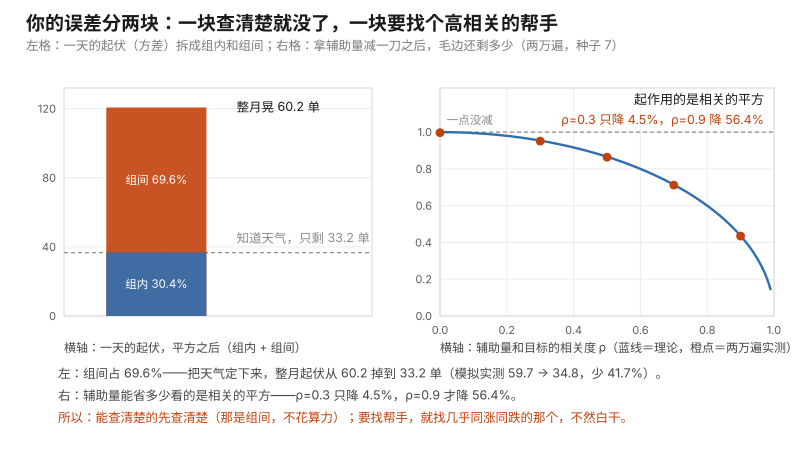

# 第 12 课 · 知道明天下雨，就该重估单量

**模块**：M0 数学与金融必备 ｜ **用时**：约 50 分钟，其中动手 20 分钟 ｜ **前置**：第 06、07、09、11 课
**学完你会得到**：一个动作——把"你已经知道的事"从随机抽签里拿出来，你的误差可以少四成；以及一条判断标准：什么样的已知信息值得动这个手。这是原书第 4 章（方差缩减）的入口，也是第一期的最高点。

**想在浏览器里一格一格跟着跑？** 浏览器版在 [12-conditioning-and-control.ipynb](../../notebooks/12-conditioning-and-control.ipynb)：按 `Shift + Enter` 逐格运行，跑出来的数字和本课里印的逐字一致（种子钉在 7）。 也可以[直接在 Colab 里跑](https://colab.research.google.com/github/JavenZheng/monte-carlo-finance/blob/main/notebooks/12-conditioning-and-control.ipynb)。

---

## 一、你模拟的时候，把已经知道的事又抽了一遍

你在经营一家小店，中午外卖。你手上有一条规律：下雨天单量平均 60，晴天平均 40，本地一个月大概三成天在下雨。

按第 09 课的做法，你写了一个模拟：循环三十次，每次先抽"今天下不下雨"，再抽"今天多少单"，加起来就是月总量。跑两万遍，报出一个平均和三个分位数。

这段代码没错。但请你注意一件事：**如果下个月的排班表已经写死了、天气预报已经给了你十二天雨，你却让电脑每天重新抽一次"下不下雨"——你是在花随机数去买你已经知道的东西。**

更常见的是另一种：你连"下雨"这件事都当成随机，其实你那个月本来就有几件确定要发生的事（固定的活动、签了的服务、日历上的节假日）。它们不是随机的，可它们在代码里是随机的。

这一节课就处理这个：**知道一件事之后，另一件事该怎么重算。** 它有两个结果——期望会变，误差也会变，而且后一个变得往往很大。

## 二、把期望拆开算

先只算期望，不碰模拟。

你要的是"平均一天多少单"。你知道的是两件事各自的条件：雨天平均 60，晴天平均 40，雨天占三成。那么：

$$E[\text{单日单量}] = 0.3 \times 60 + 0.7 \times 40 = 46.0$$

这个式子替你回答的问题很直白：**"我不知道今天下不下雨，那我该用哪个数？"** 答案是"按可能性给两个平均掺一下"。它是第 06 课期望定义的直接套用——把每种情况下的平均值，按那种情况的机会加权。

一个月就是 $30 \times 46.0 = 1380$ 单。

让电脑老老实实按"先抽天气、再抽单量"演两万遍，得到 **1380.0**。两条路对上同一个数。

这里冒出一个新说法。**"已知下雨时的平均单量"写成 $E[Y \mid X]$，读作"在 X 之下的 Y 期望"，竖线就是"已经知道"的意思。** 它叫**条件期望**。上面那一行其实是它的组合版：先有"雨天 60、晴天 40"这两个条件期望，再按天气的机会加权回去，得到不带条件的期望。这个"先分后合"的规矩叫**全期望公式**。

你现在只需要记住：**条件期望就是"知道了一件事之后，你对另一件事的平均要换成哪个数"。** 它不是新算法，是你本来就会的加权平均。

## 三、一条信息要重算两笔账

现在把"你已经知道"这件事真的放进代码：假设这个月**确定**有 12 天雨（预报给你的、或者你的排班决定了的），你不再抽天气，只抽每天单量。跑两万遍，和原来那版对比：

```
不知道天气、每天现抽：月总量 平均 1380.0，起伏 59.7 单
已知这个月有 12 天雨：月总量 平均 1440.1，起伏 34.8 单
```

两笔账都变了：

**期望从 1380 涨到 1440。** 因为你知道这个月雨多，12 天而不是平均 9 天。这条不用解释——信息当然会改你的判断。

**可毛边从 59.7 掉到 34.8，少了 41.7%。** 这一条才是这一节课的主角：**你多用了一条信息，什么都没多算，误差就少了四成。** 而你要做的只是把"抽天气"那一行删掉。

顺手说一句怎么读这个数：在"已知 12 天雨"的条件下，你的月总量大概是 1440，毛边 35，所以你敢报的范围是 1440 ± 70（第 07、08 课那套乘二）。而不知道天气那一版，范围是 1380 ± 120。**想把后者的毛边也压到 35 附近，你得把模拟次数加到大约三倍**（$59.7/\sqrt{3} \approx 34.5$，就是第 07 课那笔根号税）——而那条预报不花一份算力，还顺手把期望修正了 60 单。**多演只在"你已经把该知道的都知道了"之后才值钱。**

## 四、为什么能降这么多：大头在"组间"

第三节的毛边降四成不是运气。这一节给你看它从哪来，因为**知道这个来源，你就知道什么样的已知信息值钱。**

一个量的总起伏可以拆成两块：一块是**组内**（雨天和晴天各自内部还会晃），把组定下来也消不掉；另一块是**组间**（今天到底下不下雨），你一旦知道它就彻底消失。

$$\text{总起伏（方差）} = \text{组内} + \text{组间}$$

它替你回答的问题是：**"我的误差是从哪来的？我该去找哪一类信息？"**

按我们的数算一遍。单日组内 = $0.3 \times 8^2 + 0.7 \times 5^2 = 36.7$；单日组间 = $0.3 \times (60-46)^2 + 0.7 \times (40-46)^2 = 84.0$。加起来 120.7，乘三十天开根号 = **60.2 单**——和第三节实测的 59.7 是同一个数（差在抽签毛边）。

而 **60.2 里有 69.6% 来自组间**。

这就是第三节那 41.7% 的全部来历：你一旦把"这个月几天下雨"定下来，那块占七成的方差就不再参与抽签了，只剩下组内那部分（三成）还得靠模拟。

这条规律很实用，因为它给了你一个可以提前问出口的问题：**"我这块误差，是'组内'的还是'组间'的？"** 组间的大头，靠**信息**解决；组内的大头，才靠**多演几遍**解决。多数人把预算花错了地方——他们把已经能问清楚的事（促销有几天、几个大客户会下单、这季度发几条）留在代码里当随机数，然后花十倍算力去抽它。

这也正好是第 11 课那个共同因素的另一种说法：`common` 那一层（下不下雨、大环境好不好）是组间，各自的 `noise` 是组内。**第 11 课教你怎么把它摊薄，这一课教你怎么直接把它知道掉。**

## 五、更一般的招：控制变量

第四节要的是"你真的知道下雨几天"。可多数时候你手上不是一个确定数，而是**另一件你了解得更多的事**。这一节给它一个通用形式，也是原书第 4 章第一节的正式内容。

想法是这样。你要估一个量 $Y$（下个月单量），你手上还有一个量 $X$（上个月单量、或者平台后台已经给你的近三十天曝光），它满足两个条件：**和 $Y$ 相关**，而且**它自己的平均你知道**。那就不要单独估 $Y$，改估这个差：

$$Y - a \times (X - \text{已知的 } E[X])$$

它回答的问题是：**"我能不能少抽一点随机数，把抽过的部分重复利用？"** 三项读法：$Y$ 是你要的东西；$(X - E[X])$ 是"这件事这次比它平时的平均水平高了多少"；减掉 $a$ 倍，就是把这部分"你已经能从 $X$ 那边解释掉的运气"扣掉。**关键是它不减掉真值**：$X$ 的平均你已知、$(X - E[X])$ 长期为零，所以期望不变，只是散布变小。

$a$ 取多大有最优解（进阶框给三行推导），实测就用最优值。我把 $Y$ 和 $X$ 的起伏都归一为 1，只改相关度 $\rho$，各跑两万遍：

```
相关 0.0：毛边 减前 0.997 → 减后 0.997；理论 1.000
相关 0.3：毛边 减前 0.996 → 减后 0.951；理论 0.954
相关 0.5：毛边 减前 0.996 → 减后 0.863；理论 0.866
相关 0.7：毛边 减前 0.996 → 减后 0.712；理论 0.714
相关 0.9：毛边 减前 0.997 → 减后 0.435；理论 0.436
```

理论那一列是 $\sqrt{1 - \rho^2}$。这张表有一个非常容易被忽略的性质：**起作用的是相关的平方。**

- $\rho = 0.3$（"多少有点关系"），毛边只降 **4.5%**；
- $\rho = 0.5$，降 13.4%；
- $\rho = 0.7$，降 28.5%；
- $\rho = 0.9$，降 **56.4%**。

把第四节那一块和第五节这张表画在同一张图上，这一节课的两条线就合成一条了：左边那根柱子告诉你**该去找信息还是该加次数**，右边那条下弯的曲线告诉你**什么样的辅助量才值得动手**。



图由 [code/fig12_conditioning_and_control.py](../../code/fig12_conditioning_and_control.py) 生成，橙点用的就是上面那张表那一轮抽签（种子 7、各两万遍）。

所以这一招的真实脾气是：**找个"有点相关"的辅助量基本白干，找个几乎同涨同跌的辅助量才能把误差腰斩。** 原书第 4 章的技术含量，很大一部分就花在"到哪儿去找那个高相关的辅助量"。它给的第一答案，对你来说其实很眼熟：**就用你自己那个粗糙的旧估计。** 第 09 课 bootstrap 出来的均值、第 10 课那个中位数、你去年拍脑袋定的那版预算——它们和你要算的新数字高度相关（同一个世界、同一批记录），而它们的平均你自己就能算。这一条到第 14 课还会再出现一次：那时"旧估计"换成一个能用现成公式直接算出来的近似价格，相关度能高到表格最右端。

## 六、两种用法会把这招用废

**第一种：组平均是你自己估的，那部分毛边演多少遍都不会小。**

第四节整段都假定"雨天平均 60 单"是已知的。可现实里它是从你历史里那几条雨天记录算的。假设只有 3 条雨天记录，跑两万遍看这个"雨天平均"自己飘多少：

```
用  3 条雨天记录估"雨天平均单量"：毛边 4.62 单；乘到 12 天上 → ±55.4 单
用  8 条雨天记录估：毛边 2.81 单；乘到 12 天上 → ±33.8 单
用 30 条雨天记录估：毛边 1.46 单；乘到 12 天上 → ±17.5 单
```

看第一行。你把天气定下来，本可以省下第三节的 25 单毛边；**可你用 3 条记录去定"雨天平均"，光是这件事就带进 ±55 单的不确定——比你省下的多一倍。** 分组分得太细，比不分组更糟。

更要命的是这一列毛边的性质：它是**估计量的毛边**，不随模拟次数减少。你把两万遍改成两百万遍，4.62 一分不会降。这正是第 07 课那个区分：**多演治手抖，治不了你量不准的那把尺。**

所以定组之前先数一数每组有几条记录：只有两三条的组，不值得为它单开一个条件。

**第二种："已知"必须是你当时真的知道。**

第三节我用的是"预报给你 12 天雨"。如果那个 12 其实是你用 $30 \times 0.3$ 算出来的，你并不是知道它，你只是把随机性强行抹平了——你报出的 ±35 会变成一种不存在的安全感，而真实毛边还是 60。第 09 课第六节第三条讲过分位数的伪精度，这里是它的姊妹：**用期望冒充已知，得到的是偏窄的区间**（均值不偏，你的信心偏）。

同一道理，**未来的信息不能拿来条件**。跑完两万遍再回头看"哪几遍的下雨天数接近后来真实发生的那个月"，挑那些遍报数——那不是条件期望，那是事后挑数据，属于第 07 课那个"瞄准镜歪"。条件期望合法的唯一形态是：**在开始抽之前，你就已经知道。**

## 七、今晚就能用起来

代码在 [code/lesson12_conditioning_and_control.py](../../code/lesson12_conditioning_and_control.py)。把它改成你自己的场景，只需要动最上面那五个数（`RAIN_P`、两组的平均和起伏、`DAYS`）。

三件可以直接做的事：

**第一件：把已知项从模拟里拿出去。** 你算下个月家庭现金流时，房租、房贷、地铁月票、订阅费这些**根本不该出现在随机抽签里**，它们是加法里的确定项。把第 04 课那段月度模拟拿来照这一条改一遍：固定项先加，只让真正会晃的那几项参与抽签。你会立刻发现自己的"最坏情况"没那么吓人，因为原来它被你把确定项一起抖进去了。

**第二件：先决定"下个月发几条"。** 这是第 09 课那个播放量模拟的直接升级。脚本第六部分那段做了这个对照：七条历史播放量不变，一条把发文条数钉成 22，一条让条数在 14 到 30 之间随机（`random.randint(14, 30)` 抽一个整数，和 `uniform` 一回事，只是不出小数）：

```
已知下个月发 22 条：月总播放 平均 30027，起伏 4510
条数在 14 到 30 之间随机：平均 30080，起伏 8027
```

**期望几乎一样，起伏差了 78%。** 也就是说，逼自己先定一个发文条数（哪怕定错两条），比多跑十万遍模拟有用得多。这一条大概是这一节课对你今天最直接的改变。

**第三件：给别人提要求时，问"这块误差是组内还是组间"。** 你的方案被质疑"不确定太大"时，先把它拆成两块：能从现实里查清楚的那块（组间）去找信息，剩下的才需要加模拟次数。这两件事的预算和周期完全不同，混在一起说，别人只会让你"再多跑点数据"。

## 八、练习

**一。** 你换了个城市，下雨概率变成 0.25，雨天 70 单、晴天 45 单。按第二节，一天该用哪个期望？一个月（30 天）多少？不许用电脑，先手算。

**二。** 你想用"上个月的单量"当辅助量，你估它和下个月的相关是 0.6。按第五节，你的毛边能降到原来的多少？降了多少个百分点？如果相关只有 0.2 呢？

**三。** 你要给门店做下个月排班。你知道三件事：（a）下个月有 4 个周末促销日，日历写死了；（b）平日平均 45 单、起伏 9；周末平均 80 单、起伏 15；（c）你只有去年 5 个周末促销日的记录。按第四节和第六节，哪一块是"组间"、该定下来？哪一块定下来不划算？为什么？

**四。** 有人说："我跑了五百万遍，所以我的估计很准。"他上一句说的是"我用三条记录定了'雨天平均'这一档"。用第六节哪一行的哪个数能指出他的问题？

**五。** 把第三节改成"预报其实是 9 天雨"（也就是 $30 \times 0.3$），重跑对照：这时两笔账各变了多少？这句话为什么不算"一条信息"？

### 答案

**一。** 单日 $0.25 \times 70 + 0.75 \times 45 = 51.25$ 单，一个月 **1537.5 单**。注意这个数比原来那个城市的 46 大，尽管下雨概率更低——条件期望要连"雨天更忙"这个幅度一起吃进去，不能只看概率。

**二。** 剩下 $\sqrt{1 - 0.6^2} = \sqrt{0.64} = 0.800$，也就是降 **20.0%**。相关只有 0.2 时，剩 $\sqrt{1-0.04} = 0.980$，只降 2%——第五节那句"平方律"的意思就在这：**"多少有点关系"等于白干。**

**三。** 组间是"哪天是周末促销日"——它日历写死了（4 天），完全该定下来，等于第三节的 12 天雨那一栏。周末和平日的平均差（45 对 80）很大，所以这块方差占比很高，定下来省得多。不划算的是（c）：你只有 5 条周末记录，用它们定"周末平均 80"这个数，带进来的是 $15/\sqrt{5} \approx 6.7$ 单毛边，乘到 4 天上就是 ±27 单。而第三节那条对照告诉你，把天气这类组间信息定下来，一共也就省 24.9 单毛边。**一来一回是负的。** 该做的是先把周末记录补齐到二三十条，或者干脆把周末并入平日一档、只在报告里注明"促销日另算"。

**四。** 那一行是"用 3 条雨天记录估'雨天平均单量'：毛边 4.62 单"。要点在于它是**估计量的毛边**，不是模拟的毛边：五百万遍能让模拟那一块压到看不见，但 4.62 一分不会降，因为它是你那三条记录决定的。第五节还有个更狠的对照：相关只有 0.3 时控制变量降 4.5%，演再多遍也补不回这个量级——**他花的算力买的是已经不需要买的东西。**

**五。** 期望仍是 1380（$9 \times 60 + 21 \times 40 = 1380$），毛边从 59.7 掉到 34.8——**看起来赚了一条信息，其实那条信息是你自己算出来的。** 真实的下雨天数这个月还会在 9 附近晃（起伏约为 $\sqrt{30 \times 0.3 \times 0.7} \approx 2.5$ 天），你把它钉成常数，等于把组间方差删掉了却没换成任何知识。这正是第六节第二条说的：**用期望冒充已知，得到的是偏窄的区间。**

---

## 九、一句话

知道的事就别再抽：把已知定下来，期望要重算、毛边往往能少四成；而想靠辅助量压误差，得找到几乎同涨同跌的那个，因为省下的比例是相关的平方。

## 下一课

第 13 课转向原书的另一条主线需要的语言：导数和泰勒展开。你会看到它们只回答两个问题——"多一单位值多少钱"和"我用的这个近似式子，误差有多大"，而第二个问题正好接住这一节课的毛边。

---

## 进阶框（可跳过，不影响下一课）

**全期望公式和方差分解。** 全期望：$E[Y] = E[\,E[Y \mid X]\,]$——先把每种 $X$ 下的平均算出来，再对这些平均取平均。第三节的 1380 和 1440 就是它在天气这个两值 $X$ 上的样子。方差的对应分解更值钱：

$$\operatorname{Var}(Y) = E[\operatorname{Var}(Y \mid X)] + \operatorname{Var}(E[Y \mid X])$$

左项是组内（每种天气内部还晃多少，再按机会加权），右项是组间（不同天气的平均之间差多少）。第四节那两个数 36.7 和 84.0 就是这两项，加起来 120.7、乘三十天开根号得 60.2，与模拟的 59.7 对上。**这条式子是"该找信息还是该加次数"的正式判据：右项大就去找信息，左项大就加次数。**

**控制变量的最优 $a$ 和那个平方。** 新的估计量是 $Y - a(X - E[X])$，期望不变（因为第二项的期望是零）。它的方差是 $\sigma_Y^2 + a^2\sigma_X^2 - 2a\operatorname{Cov}(X,Y)$——**这正是第 11 课那个"两数相加，起伏不是相加"的式子，只是中间符号换成减号。** 对 $a$ 求导置零（第 13 课的第一种语言）得 $a^* = \operatorname{Cov}(X,Y)/\sigma_X^2$，代回去得最小方差 $\sigma_Y^2(1 - \rho^2)$。第五节那张表的 $\sqrt{1-\rho^2}$ 就是这么来的：$\rho$ 进到方差里是平方，所以省下的比例是 $1 - \sqrt{0.91} \approx 4.6\%$（实测 4.5%）。

**它和分层抽样只差一步。** 控制变量是"用一个连续的相关量把 $Y$ 校正一下"；分层（原书 **§4.3 Stratified Sampling，书页 209**）是"干脆把 $X$ 切成几档，每档单独模拟再按机会加权"——第四节那一手就是分层。两条路都在削同一个东西：**别让 $X$ 的随机性混进你的估计里**。原书 **§4.2 对偶变量（书页 205，PDF 页 215）** 是第三种削法，也是同一思路的极端情形：给自己造一个反向相关的副本（把 $\rho$ 硬设成接近 −1），一正一负互相抵消噪声。

**原书在哪里用。** **§4.1 Control Variates（书页 185，PDF 页 195）** 是本章第一招，也是金融意义上的重点：它常用的辅助量 $X$，是"同一个期权那个能用公式直接算出价格的近似版本"，因为两者几乎是同一个东西，相关度能高到第五节那张表的最右端。这也是为什么原书第 4 章被称为全书心脏：**它省的不是算力，是"你必须有那个算力才能报出的误差"。**

---

## 备忘卡

本课出现的东西，正式名字在这里。

**"知道 X 之后 Y 的平均"**叫**条件期望**（conditional expectation，$E[Y \mid X]$，竖线读作"在……的条件下"）；**先按条件分组取平均、再按机会合回去**叫**全期望公式**（law of total expectation）；**总起伏 = 组内 + 组间**这个拆分叫**方差分解**（variance decomposition，正式写 $\operatorname{Var}(Y) = E[\operatorname{Var}(Y\mid X)] + \operatorname{Var}(E[Y\mid X])$），组间那一块也就是第 11 课的共同因素；**用一个你已知平均、且和目标相关的辅助量去减掉噪声**叫**控制变量**（control variate），省下的比例由 $\sqrt{1-\rho^2}$ 给出；**把辅助量切成几档分别模拟**叫**分层抽样**（stratified sampling，下一期原书第 4 章正式讲）。

编程词汇：`if ... : ... else` 在第 03 课学过，本课用它抽天气；`random.randint(14, 30)` 抽一个整数条数，是第 04 课 `random.uniform` 的整数版。

---

## 原书对应与版权说明

本课对应 Glasserman（2003）**Chapter 4 Variance Reduction Techniques（章起始书页 185，PDF 页 195）**的思路起点：**§4.1 Control Variates（书页 185）** 是本课第五节的正式版本（辅助量、最优系数、$1-\rho^2$），**§4.3 Stratified Sampling（书页 209，PDF 页 219）** 对应第四节的分层，**§4.2 Antithetic Variates（书页 205，PDF 页 215）** 是同一思路取 $\rho = -1$ 的特例。条件期望本身在**附录 A（书页 539）**与原书第 8 章的美式期权处理（**§8.1 Problem Formulation，书页 421，PDF 页 431**）里都会再出现——那里它的形式是"在每一个决策时点，根据你此刻知道的东西重算继续持有的价值"。

本课未复制原书任何文字、图表或表格。所有数字本机实测（Python 3.12，每段前钉种子 7 可逐字复现）：全期望核对 → 日期望 46.0、月 1380，模拟两万遍平均 1380.0；已知 12 天雨对照 → 不知道 1380.0 / 起伏 59.7，已知 1440.1 / 起伏 34.8（期望 +60.1，起伏 −41.7%）；方差分解 → 单日组内 36.7、组间 84.0、合计 120.7（组间占 69.6%），月合计 3621、开根号 60.2 对模拟 59.7；控制变量（两万遍，起伏归一为 1）→ $\rho$ 为 0.0/0.3/0.5/0.7/0.9 时毛边 0.997/0.951/0.863/0.712/0.435，理论 $\sqrt{1-\rho^2}$ = 1.000/0.954/0.866/0.714/0.436；组平均自己的毛边 → 3 条记录 4.62（$\times 12$ 天 ±55.4）、8 条 2.81（±33.8）、30 条 1.46（±17.5）；发文条数 → 固定 22 条 30027 / 4510，条数 14–30 随机 30080 / 8027（+78.0%）；练习一 51.25 与 1537.5，练习二 0.800 与 0.980，练习三 $15/\sqrt5 \approx 6.7$，练习五 $9 \times 60 + 21 \times 40 = 1380$ 与 $\sqrt{30 \times 0.3 \times 0.7} \approx 2.5$。完整章节页码见 [原书章节索引](../book-index.md)。**建议购买正版**支持作者：Springer, *Monte Carlo Methods in Financial Engineering*, 2003；中译本《金融工程中的蒙特卡罗方法》。

**上一课**：[第 11 课 · 一篮子公司为什么还会同一天倒霉](11-correlation-and-baskets.md) ｜ **下一课**：[第 13 课 · 再多一块钱值不值](13-derivatives-and-error-tails.md) ｜ **返回**：[学习路线图](../../README.md)
