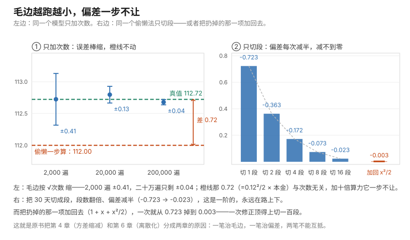

# 第 13 课 · 再多一块钱值不值

**模块**：M0 数学与金融必备 ｜ **用时**：约 50 分钟，其中动手 20 分钟 ｜ **前置**：第 06、08、10、12 课
**学完你会得到**：一个手续，用来判断"再往前一档还划不划算、最划算的是哪一档"；一句能在会上问出口的话，用来审别人给你的"敏感度"；以及把"我这个数不准"拆成两种不准，各报一个数。

---

## 一、你手上有一个真实的困惑

第一个困惑是定价或者投放。你的套餐从 32 涨到 33，一天是多赚还是少赚？你其实隐约知道答案不是"是／否"，而是"得看现在定在几块"。但你没法把它算出来：你知道涨价销量会掉，掉多少说不清，于是这件事一直停在"感觉再涨就要亏"。

第二个困惑来自你前面几节课。第 07、08 课告诉你抽签抽得少会有毛边，第 12 课告诉你把已经知道的事挑出来不抽能少掉一半。但你一直没问过第三件事：**我为了好算而把算法简化了，简化本身错了多少？** 每天乘一遍太麻烦，直接乘 1.12 省事——这个省事要收你多少利息？

这两个困惑是同一种数学的两面，也是原书后面几条主线共用的语言。第 7 章算"股价动一点，期权价格动多少"用的是第一面的语言；第 6 章比较"一口气走完"和"切成一百步走完"哪个更准，用的是第二面。这一节课把两面都落到你今天的数字上。

## 二、"多一单位值多少钱"是一个数，而它一直在变

场景是校门口那杯柠檬茶，硬成本 8 块。定价 $p$，一天卖 $D(p)$ 杯。你手上只有两条记录：卖 10 块一天出 60 杯，试过 11 块出 54 杯。于是你把这条需求写成直线：

$$D(p) = 120 - 6p$$

一天的利润是

$$L(p) = (p - 8) \times (120 - 6p)$$

这个式子替你回答的问题只有一个：**定这个价，一天赚几块。** 然后把它一档一档列出来（脚本第一部分实测）：

```
定价      一天利润    涨 1 块之后    多一块值
   9 元          66           120          +54
  10 元         120           162          +42
  11 元         162           192          +30
  12 元         192           210          +18
  13 元         210           216           +6
  14 元         216           210           -6
  15 元         210           192          -18
  16 元         192           162          -30
```

这张表就是"值不值"的全部真相：**同样是多涨一块，在 10 元那档值 42 块，在 14 元那档倒亏 6 块。** 所以你真正要问的从来不是"涨一块好不好"，而是"我现在在 13 这一块，往前一格好不好"。

那个"在这一档，多一单位值多少钱"就叫**导数**，经济学者嘴里叫**边际**。它替你回答的问题：**在我现在这个位置上，再往前一小步能换回多少。**

你现在就可以把第一个结论拿走，它不需要任何符号：**"值多少"不是一个数，是随你所在位置变化的一整条。** 任何人给你一个"敏感度"却不告诉你"在哪个位置量的"，他给的信息就不完整。外卖平台的"客单价弹性"、运营口中的"投放边际回报"、朋友的"这基金对利率很敏感"，全适用。

## 三、"多一块值 0"的那一档，就是你该待的地方

以 0.1 元为一档，从 8 块一路试到卖光，最赚的是 **14.0 元，一天 216 块**（实测）。

不试也能算。把 $L(p)$ 展开是 $-6p^2 + 168p - 960$，它的导数是 $168 - 12p$，令它等于 0 得 $p = 14$。

为什么"导数等于零"的地方就是最赚？看实测的两个数就明白了：13.9 那一档再涨一角还值 **+0.6**，到 14.1 同样涨一角变成 **−1.8**。中间必然经过一个"再涨一角刚好不赚不赔"的位置；过了它，每往前一步都是负的。所以**顶点不是"值最多"的地方，是"值零"的地方**——你一直往前加，加到那一单位不再划算为止，那一刻就是最优。

这就是所有"该投到哪一档"的共同手续：把结果写成一件事的函数，问"再多一单位还值不值"，一直加到它值为零。折扣力度、投放预算、加班时数、备货量、一条视频里塞几个标签，全是这个形状。

一条必须给的诚实话：这个手续只在"结果真的是一条光滑下弯的曲线"时好使。现实里你的档位常常是整数（班次、篇数），或者曲线根本不止一个鼓包——平台在不同价位段的流量是断崖式的，你从 29 涨到 30 会掉进另一个流量池。这种情况下"令导数为零"会给你一个漂亮而错的答案，而第二节那张一档一档列完的表反而老实。**枚举永远是底牌，导数只是抄近路；近路的代价是它假设曲线光滑。**

## 四、你读出来的那个"边际"是歪的，歪多少看曲线弯多厉害

第二节的表里藏着一件事。还是 p=10 这一档，脚本用三种步子去读"多一块值多少"：

```
  一步读（涨满 1 块）      ：42.0
  小步读（涨 0.1 块）      ：47.4
  两侧平均读（9.9 到 10.1）：48.0
  手算的瞬时值 168 − 12p 在 p=10：48.0
```

三个数都在回答"多一块值多少"，也都对，只是答的不是同一个问题：42 是 **10 到 11 这一段**的平均，47.4 是 **10 到 10.1 这一段**的平均，48.0 是 **9.9 到 10.1 这一段**的平均——而它的中点正好是 10。

利润是条下弯的曲线（涨得越高，每一块越不值），所以你往哪边迈一步，读数就被哪边拽走。这里有一个可以直接验证的规律：

```
在 p=10 涨满 1 块读到：42.0
10 那一点的瞬时值：48.0，11 那一点：36.0
10.5 那一点的瞬时值：42.0
```

**一步读出来的数，其实是这一段中点上的瞬时值**，不是出发点的。这不是四舍五入级别的小毛病。等你手上只有按天记录的数据，"这个月的边际"真正属于的是这个月和上个月的中点；你把 42 报成"10 元这一档值多少"，就悄悄把它挪了半格。

那怎么把读数读准？办法是把两侧都用上。脚本第三部分换了一条弯得更厉害的曲线（$e^x$，在 $x = 2$ 处真导数 $= 7.3891$），试了五种步长：

```
步长      往前读        误差        两侧平均读      误差
1.0000     12.6965      71.8%      8.6836    17.52%
0.5000      9.5869      29.7%      7.7008     4.22%
0.2500      8.3947      13.6%      7.4663     1.04%
0.1250      7.8707       6.5%      7.4083     0.26%
0.0625      7.6249       3.2%      7.3939     0.07%
```

规律很干净：**步长减半，往前读的错减半，两侧平均读的错降到四分之一。** 前者叫一阶准，后者叫二阶准。多算一次调用（往前挪一格不如前后各挪一格），换回来的是阶数。

原书第 7 章算期权的敏感度（Greeks）时，这是正式议题而不是小技巧：同一份模拟，往前扰动和两侧扰动给出的数误差量级不同，而误差量级直接决定那个数字能不能报出口。你现在已经能读懂那一节在争什么了。

## 五、泰勒展开只回答一个问题：我省掉的那一项，错多少

$$e^x \approx 1 + x + \frac{x^2}{2} + \frac{x^3}{6}$$

它替你回答的问题：**我用左边这个好算的式子代替右边那个难算的，会错多少？** 答案只有一句：**会错多少，约等于你扔掉的第一项有多大。**

这张表就是这句话的证据（脚本第四部分实测）：

```
  x        真值        1+x       差        1+x+x²/2      差
  0.01    1.010050    1.0100  +0.000050     1.010050   +0.000000
  0.04    1.040811    1.0400  +0.000811     1.040800   +0.000011
  0.10    1.105171    1.1000  +0.005171     1.105000   +0.000171
  0.30    1.349859    1.3000  +0.049859     1.345000   +0.004859
  0.50    1.648721    1.5000  +0.148721     1.625000   +0.023721
  1.00    2.718282    2.0000  +0.718282     2.500000   +0.218282
```

看 x=0.04 那一行：扔掉的第一项是 $x^2/2 = 0.000800$，实测误差 $0.000811$。看 x=0.1 那一行：1+x 错 0.00517，而 $x^2/2 = 0.00500$；1+x+x²/2 错 0.000171，而下一项 $x^3/6 = 0.000167$。**每一档的误差都被"你扔掉的第一项"报准了。**

读这张表的方式不是背式子，是看"差"那一列什么时候变得你不能忍。$x = 0.01$ 时一阶近似错十万分之五；$x = 0.3$ 时已经差到 0.05，占真值 3.7%；$x = 1$ 时一阶近似报 2、真值 2.72，错掉 26%。

**"能不能用省事式子"从来没有全局答案，只有这一行一行的答案。** 你要做的只有一件事：先把准备扔掉的第一项算出来，看它多大，再决定扔不扔。

同一个动作管另一件你常干的事。把 $e^x$ 那行换个方向写：

$$\ln(1 + r) \approx r - \frac{r^2}{2}$$

$r = 0.1$ 时真值 0.095310，两项式给 0.095000，差 0.000310，而下一项 $r^3/3 = 0.000333$——又是它。别小看这一行，第六节那个"一半人亏钱"的结论全部来自它的第二项。

## 六、第二项决定你属于哪一半

一笔钱 100，投 250 天，每天涨跌的平均是 0（一个真正不赚不赔的赌局），单日起伏 10%。

按一阶想：每天乘的那个数平均是 1，250 天乘下来还是 1，结论是"不亏不赚"。

实测（一万遍，脚本第五部分）：

```
平均 97.3，中位 28.4，78.9% 的路径低于起点
```

一阶说的确实是那个平均——它的真值就是 100，只是这个平均自己的毛边就有 ±2.8，因为少数路径能涨好几倍（第 08 课说过的厚尾毛病：这种数据的平均飘得凶）。而一半的人落在中位 **28.4** 上，本金剩不到三成。

差在哪？就在第五节那行 $\ln(1+r) \approx r - r^2/2$。250 天把每天那一项加起来，$r$ 那一项平均是 0，$r^2/2$ 那一项平均是 $\sigma^2/2 = 0.005$，天天照扣：

$$\text{中位} \approx 100 \times e^{-250 \times 0.10^2 / 2} = 100 \times e^{-1.25} = 28.7$$

公式给 28.7，实测 28.4。**第 10 课那个"波动拖累 $\sigma^2/2$"就是这里的第二项。** 那时它是背下来的，现在你知道它从哪来：它是 $\ln(1+r)$ 展开的第二项，是你随手扔掉就会算错一半人的那一块。

现实里这条最贵。一个日波动 10%、日均 0 的产品，宣传口径写"长期期望不亏"，这句没错；它的一半用户本金只剩三成，这句也没错。两句话之间的差就是那一个 $-\sigma^2 T/2$。所以你下次听到"这个平均收益是正的所以放心"，条件反射应该是：**这个平均是给谁算的？中位那一半人在哪？**

## 七、两种误差，只有一种能用算力买掉

回到最省事的那个算法。30 天，每天乘 $(1 + 0.4\%)$。精确算：$100 \times 1.004^{30} = 112.72$。偷懒算（当成一步涨 12%）：$100 \times 1.12 = 112.00$。**省事省掉 0.72 块，而这 0.72 正是第五节里 $x^2/2$ 那一块：$0.12^2/2 = 0.0072$，乘本金 100。**

这条偏差有多硬？把 30 天切成几段，每段用同样的偷懒法（脚本第六部分实测）：

```
切  1 段： 112.00  偏差 -0.723
切  2 段： 112.36  偏差 -0.363
切  4 段： 112.55  偏差 -0.172
切  8 段： 112.65  偏差 -0.073
切 16 段： 112.70  偏差 -0.023
```

段数翻倍、偏差减半——和第四节那个"往前读"一样是一阶准。而把第二项加回去（$1 + x + x^2/2$），偏差从 0.723 掉到 **0.003**：一次修正顶得上切一百段。原书第 6 章第二节整章（二阶方法）做的就是把这一类修正系统化——**不是把步子切细，而是找到被扔掉的那一项，把它加回去。**

再把它跑成模拟，看另一种误差怎么动。模型是每天乘一个随机数，平均涨 0.4%、单日起伏 3%；要估的是 30 天后终值的平均，真值 112.72：

```
  2000 遍：估计 112.72 ± 0.41（毛边）；偷懒的偏差仍是 -0.72
 20000 遍：估计 112.80 ± 0.13（毛边）；偏差仍是 -0.72
200000 遍：估计 112.68 ± 0.04（毛边）；偏差仍是 -0.72
```

**毛边按 $\sqrt{\text{次数}}$ 缩，偏差纹丝不动。** 到二十万遍，毛边已经比偏差小一个量级，你的总误差由那 0.72 说了算，再多的算力买不回它。

下面这张图把今天两件事画在同一个框里。左边是三根误差棒（同一个模型，只加次数），右边就是上面那张切段表（同一个偷懒法，只切段），最右边那根几乎看不见的橙条，是把 $x^2/2$ 加回去之后剩下的偏差：



图由 [code/fig13_bias_vs_noise.py](../../code/fig13_bias_vs_noise.py) 生成，用的就是上面这一轮抽签（种子 7）。看左边那根橙线：它从头到尾没动过一格。

这正是第 12 课练习四那个人的病：他跑五百万遍，压的是毛边；他的错出在"用三条记录定了一个组的平均"，那是偏差。今天可以把它推广成一条你随身带的判据：

**把次数加到十倍，看误差降到几分之几。降到三分之一，说明起作用的是毛边，该买算力；几乎不动，说明起作用的是偏差，该改算法、补数据或者换口径。**

这也是原书把第 4 章（方差缩减）和第 6 章（离散化）分成两章的原因：前者治毛边，后者治偏差，两笔预算不能互抵。

## 八、今晚就能用起来

代码在 [code/lesson13_derivatives_and_error_terms.py](../../code/lesson13_derivatives_and_error_terms.py)。改成你自己的场景只动最上面三个数：`COST`（硬成本）、`DEMAND_A`（定 1 元时的量）、`DEMAND_B`（每涨 1 单位少多少）。

**第一件：给你的价目表、折扣或者投放预算做一次"多一块值多少"的表。** 第二节的表只有三列：定这个价的结果、往前一档的结果、两者的差。你只需要两个历史点就能定出那条线——"卖 32 出 60 单、卖 33 出 54 单"这种话你本来就说得出。跑完找那一档从正变负的位置，那就是你该待的档位。**记得第三节那条诚实话：档位是整数、或者中间有断崖，就把表列完，别解方程。**

**第二件：别人给你一个敏感度数字时，问三句。** "在哪一点上量的？""步子多大？""往前挪还是两侧平均？"这三句分别对应第二、四节。你不需要懂金融，只要对方答不出第三句，他就多半是往前读了一格、然后把中点的数安在了起点上。

**第三件：报自己的模拟结果时，把两种误差写成两行。** 一行毛边（±0.04，来自抽签次数），一行偏差（−0.72，来自你简化那一步、你历史数据的条数、你钉死的那些假设）。两行的处置办法完全不同：前者加钱，后者改算法。合成一行报出去，别人只会回你一句"再多跑点数据"。

## 九、练习

**一。** 柠檬茶：p=11 和 p=12 各涨一块分别值多少？从 13 连涨两块到 15，一共多赚多少？为什么这个数和"13→14 值 +6"不矛盾？

**二。** $x = 0.1$。用 $1+x$ 近似 $e^{0.1}$ 差多少？用 $1+x+x^2/2$ 差多少？两次各对应你扔掉的哪一项？

**三。** 你手上有三个点：股价 99 时期权值 12.0，100 时 15.8，101 时 20.0。往前读、两侧读各是多少？这条曲线是往上弯还是往下弯？哪个读数更接近"100 这一点"的答案？

**四。** 100 块、60 天、日均 +0.5%。用单利省事会报多少？真值多少？用 $x^2/2$ 预估这个误差，估得准不准？

**五。** 日均 +0.3%、日起伏 6%、250 天。用二阶近似给出中位数，再给出平均。如果你是这个理财计划的产品经理，这两句话里哪一句该写进给用户的说明？

### 答案

**一。** 实测 p=11 时 **+30**（162→192），p=12 时 **+18**（192→210）。从 13 涨到 15：利润 210 → 210，**一共 0 块**，因为 13→14 值 +6、14→15 值 −6，正好抵消。不矛盾的原因就是第二节那句话：边际是一档一档的数，跨两档的总量要把每一步加回去（$+6 + (-6) = 0$）。**"从 13 涨到 15 好不好"这种问法必须拆成一步一步问。**

**二。** $e^{0.1} = 1.10517$。$1+x$ 报 1.10000，差 **0.00517**；$1+x+x^2/2$ 报 1.10500，差 **0.000171**。第一次扔掉的第一项是 $x^2/2 = 0.00500$，第二次是 $x^3/6 = 0.000167$——两次的误差都被它报到了。**这就是"误差约等于你扔掉的第一项"的原文。**

**三。** 往前读 $20.0 - 15.8 = $ **4.2**；两侧读 $(20.0 - 12.0)/2 = $ **4.0**。曲率看两侧读数之差再差一次：$20.0 - 2 \times 15.8 + 12.0 = $ **+0.4**，正号说明这条曲线往上弯（越涨越快），所以往前读会**高估**，两侧读更接近"100 这一点"的答案。这正是第四节那张表里"二阶准"的意思。

**四。** 单利：$100 \times (1 + 60 \times 0.005) = $ **130.00**；真值：$100 \times 1.005^{60} = $ **134.89**；差 **4.89**。预估：$x = 0.3$，$x^2/2 = 0.045$ 即 4.50 块；再补下一项 $x^3/6 = 0.0045$ 合计 4.95 块，实测 4.89——**两项就估到 1.3% 以内**。注意 $x$ 从 0.12（第七节）涨到 0.30 时，光留第一项就开始不够用了：这正是"x 越大、尾巴越要留"的具体含义。

**五。** 中位 ≈ $100 \times e^{250 \times (0.003 - 0.06^2/2)} = 100 \times e^{0.3} = $ **135.0**（实测中位 135.7）；平均 = $100 \times 1.003^{250} = $ **211.5**（实测 209.6 ± 2.5）。平均比中位高 57%，而且实测有 **37.4%** 的路径低于起点。**该写进用户说明的是中位那一类**："按典型情况，一年（250 个交易日）之后大约 135"；而不是"平均 211"。平均那个数只对少数运气极好的路径负责，把它当"你会拿到的数"讲出去，就是把第 05 课那个"平均值骗人"重新犯一遍。更老实的写法是同时给分位数（第 09 课：一成人低于多少、九成人不超过多少）。

---

## 十、一句话

多一单位值多少，要看你现在在第几单位，值到零那一档就是最划算的那档；而你为省事扔掉的那一步不是免费的——错的量就是你扔掉的第一项，它和抽签的毛边是两回事，加多少遍模拟都修不掉。

## 下一课

第 14 课把"值多少"接到钱的时间上：一个东西今天值几块，就是它未来每一笔现金流按概率加权、再折回今天的和。这一课会给你一次真正的反转——**市场那个价不听你心里的概率**，它听"我花几块能自己拼出同一笔赔付"。你会发现上一课那个"边际"在这儿有个专门的名字，而第七节那种"路上不能跌破某条线"的合同只能用你刚学会的两笔账（步长的偏差、抽签的毛边）去量。原书第 1 章第二节整节就是在写那一个期望。

---

## 进阶框（可跳过，不影响下一课）

**导数的定义和"为什么两侧读更准"。** 导数是 $f'(x) = \lim_{h \to 0} \frac{f(x+h) - f(x)}{h}$，也就是把步子一路缩小后读数的落点。把 $f(x+h)$ 在 $x$ 处展开：$f(x+h) = f(x) + hf'(x) + \frac{h^2}{2}f''(x) + \cdots$，于是往前读等于 $f'(x) + \frac{h}{2}f''(x) + \cdots$——**误差第一项是 $\frac{h}{2}f''$，和 $h$ 成正比，所以步子减半、误差减半。** 两侧各挪一格再相减时，$\frac{h^2}{2}f''$ 那一项自己抵消了，误差首项变成 $\frac{h^2}{6}f'''$——**和 $h^2$ 成正比，所以步子减半、误差变成四分之一。** 第四节那张表 71.8%→29.7%→13.6%（减半）和 17.52%→4.22%→1.04%（减到四分之一）就是这两行式的样子。

**曲率那个数。** $f''$ 叫二阶导，读作"导数的导数"，它衡量的是"值不值这件事本身变化多快"。$f'' < 0$（下弯，如柠檬茶的利润）意味着边际越往前越小，所以令导数为零真能找到最大；$f'' > 0$（上弯，如练习三那个期权）意味着往前读会高估。用三个等距点算它只需一次加减：$f'' \approx \big(f(x+h) - 2f(x) + f(x-h)\big)/h^2$，练习三那个 +0.4 就是这么来的。

**泰勒展开的正式说法。** $f(x+h) = f(x) + hf'(x) + \frac{h^2}{2}f''(x) + \cdots + \frac{h^n}{n!}f^{(n)}(x) + R$，余项 $R$ 的形状就是"你扔掉的第一项"（严格写法是 $R = \frac{h^{n+1}}{(n+1)!}f^{(n+1)}(\xi)$，某个你没看到的 $\xi$ 处取值——所以它是估计而不是保证）。$e^x$ 是最省事的一个例子：各阶导数都是它自己，于是系数正好是 $1, 1, \frac12, \frac16$，第五节那张表就是这一行。

**$\ln(1+r)$ 那一行和波动拖累。** 展开 $\ln(1+r) = r - \frac{r^2}{2} + \frac{r^3}{3} - \cdots$。取期望并用 $E[r]=0$、$E[r^2]=\sigma^2$，得 $E[\ln(1+r)] \approx -\sigma^2/2$；250 天累加就是 $-T\sigma^2/2$，指数回去就是第六节那个 28.7。同一件事换个说法是：$E[\ln(1+r)] < \ln(1 + E[r])$——**先乘后平均和先平均后乘不是一回事**，这是第 06 课"期望是线性的、其他都不是"的一个具体后果。

**原书第 6 章在争什么。** 模拟连续时间的价格路径时，只能把时间切成有限步。**§6.1 Introduction（书页 339，PDF 页 349）** 给出两类误差的记法：把每遍模拟的分布算准是"弱"的口径，把每条路径本身算准是"强"的口径。**§6.2 Second-Order Methods（书页 348，PDF 页 358）** 的全部动机就是第七节那一句：与其把步长砍一半（代价是计算量翻倍、毛边只降 $\sqrt2$），不如把被扔掉的项补回来。欧拉格式与更高阶格式之间的差别，正是本课上面"切细步子"与"加回第二项"那个对照的连续时间版本。

**Greeks 就是导数。** 原书 **§7.1 Finite-Difference Approximations（书页 378，PDF 页 388）** 算的 delta 就是 $\frac{\partial \text{价格}}{\partial S}$，而它讨论的第一件事恰是第四节：扰动用前向还是中心、扰动多大、模拟毛边会不会把差分吃掉。**§7.2 Pathwise Derivative Estimates（书页 386，PDF 页 396）** 是另一条路——不扰动，直接在每条路径上求导。**§9.2 Variance Reduction Using the Delta-Gamma Approximation（书页 492，PDF 页 502）** 则把组合价值对整个组合做二阶泰勒展开（delta 是一阶、gamma 是二阶），用它代替重新模拟；这就是本课第五、六节那两行式子在风险部门每天的用法。

---

## 备忘卡

本课出现的东西，正式名字在这里。

**"在这一档，多一单位值多少"**叫**导数**（derivative，记作 $f'(x)$ 或 $\frac{df}{dx}$）；它的生活名字是**边际**（marginal value，"再多一个"的那一个）；**导数带单位**（这里是"块每元"，就像毛边带"单"）。**"值零那一档"**叫**驻点／顶点**（令 $f'=0$ 求极值）；**"值不值本身变化多快"**叫**二阶导**（second derivative，$f''$，也就是曲线的**曲率**，$f''<0$ 下弯、$f''>0$ 上弯）。**用多项式代替一个难算的函数**叫**泰勒展开**（Taylor expansion）；**你扔掉的第一项**叫**余项／截断误差**（remainder / truncation error）。**误差随步长成比例**叫**一阶准**（first order，$\propto h$），**随步长平方成比例**叫**二阶准**（second order，$\propto h^2$），这个"几次方"统称**收敛阶**（order of convergence）。**因为把时间切成步而留下的固定误差**叫**离散化偏差**（discretization bias），它是**偏差**（第 07 课那个"瞄准镜歪"）的一种，不随模拟次数下降。$\frac{\sigma^2}{2}$ 就是第 10 课的**波动拖累**（volatility drag），今天知道了它是 $\ln(1+r)$ 的第二项。

金融词汇预告：敏感度的正式名字是 **Greeks**，其中一阶导叫 **delta（$\Delta$）**、二阶导叫 **gamma（$\Gamma$）**——第 14 课之后原书第 7 章正式讲。

编程词汇：`math.exp(x)` 算 $e^x$、`math.log(x)` 算 $\ln x$（第 09、10 课学过）。本课有一个新写法：**把函数本身交给另一个函数**，比如 `central(profit, 10, 0.1)`——`profit` 后面不带括号，意思是"把这台机器交出去"，由 `central` 自己在它想问的位置上开机。第四节能同一套代码试两种读法、五种步长，靠的就是这一招。

---

## 原书对应与版权说明

本课对应 Glasserman（2003）**Chapter 6 Discretization Methods** 的语言底子：误差的两类口径见 **§6.1 Introduction（书页 339，PDF 页 349）**，"把被扔掉的一项补回来"这一整章动机见 **§6.2 Second-Order Methods（书页 348，PDF 页 358）**。导数本身在金融里的正式用法是敏感性估计：**§7.1 Finite-Difference Approximations（书页 378，PDF 页 388）** 对应第四节的"往前读与两侧读"，**§7.2 Pathwise Derivative Estimates（书页 386，PDF 页 396）** 是另一条求导路线，**§9.2 Variance Reduction Using the Delta-Gamma Approximation（书页 492，PDF 页 502）** 对应第五、六节的二阶展开。连续时间版本（$\ln(1+r)$ 与 $\sigma^2/2$ 从哪来）在 **附录 B Results from Stochastic Calculus（书页 545，PDF 页 555）**，第 15 课会先用直觉碰一次。

本课未复制原书任何文字、图表或表格。所有数字本机实测（Python 3.12，每段前钉种子 7 可逐字复现）：`code/lesson13_derivatives_and_error_terms.py` 七部分输出 → 边际表 8 档（+54/42/30/18/+6/−6/−18/−30）、p=10 三种读法 42.0/47.4/48.0 与手算 48.0；枚举最优 p=14.0 元、216 块，13.9 与 14.1 的 0.1 元读数 +0.6/−1.8；差分核对（$e^x$ 在 $x=2$，真导数 7.3891）→ 步长 1/0.5/0.25/0.125/0.0625 时往前读 12.6965/9.5869/8.3947/7.8707/7.6249（误差 71.8%/29.7%/13.6%/6.5%/3.2%），两侧平均读 8.6836/7.7008/7.4663/7.4083/7.3939（误差 17.52%/4.22%/1.04%/0.26%/0.07%）；泰勒表（$e^x$ 真值与两档近似）→ x=0.01/0.04/0.1/0.3/0.5/1.0 时 1+x 的差 +0.000050/+0.000811/+0.005171/+0.049859/+0.148721/+0.718282，1+x+x²/2 的差 +0.000000/+0.000011/+0.000171/+0.004859/+0.023721/+0.218282；$\ln(1.1)$ 核对（$r = 0.1$）→ 真值 0.095310、两项 0.095000、下一项 $r^3/3$ = 0.000333；二阶项实验（100 起、250 天、日均 0、日起伏 10%，一万遍）→ 平均 97.3（自身毛边 ±2.8）、中位 28.4、78.9% 低于起点，公式 $100e^{-1.25} = 28.7$；分段偏差（30 天、日均 0.4%）→ 真值 112.72，切 1/2/4/8/16 段 112.00/112.36/112.55/112.65/112.70（偏差 −0.723/−0.363/−0.172/−0.073/−0.023），加回第二项 112.72（偏差 −0.003）；模拟毛边（每天起伏 3%）→ 2000/20000/200000 遍为 112.72±0.41、112.80±0.13、112.68±0.04；练习 → 13→15 一共 +0；$e^{0.1}$ 两档误差 0.00517 与 0.000171；三点差分 4.2/4.0/曲率 +0.4；单利 130.00 对真值 134.89（差 4.89，预估 4.50 与 4.95）；日均 0.3%、起伏 6%、250 天 → 中位公式 135.0、实测 135.7，平均公式 211.5、实测 209.6±2.5，37.4% 低于起点。完整章节页码见 [原书章节索引](../book-index.md)。**建议购买正版**支持作者：Springer, *Monte Carlo Methods in Financial Engineering*, 2003；中译本《金融工程中的蒙特卡罗方法》。

**上一课**：[第 12 课 · 知道明天下雨，就该重估单量](12-conditioning-and-control.md) ｜ **下一课**：[第 14 课 · 明年的 30 块，今天值几块](14-pricing-by-discounted-expectation.md) ｜ **返回**：[学习路线图](../../README.md)
