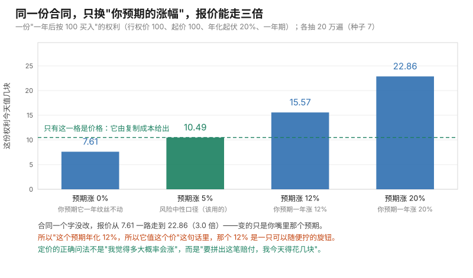

# 第 14 课 · 明年的 30 块，今天值几块

**模块**：M0 数学与金融必备 ｜ **用时**：约 55 分钟，其中动手 25 分钟 ｜ **前置**：第 06、07、10、12、13 课
**学完你会得到**：一个把"未来的钱"换算成今天的数的手续；一句能挡回去的话，用来面对"我觉得它大概率会涨"；以及一次亲眼看到前十三课的全部工具在同一道题上合体。

---

## 一、你手上一直有两道没算的题

第一道题很日常。有人拉你做副业：投进去的东西明年回款，运气好回 12 万，运气差回 4 万。他给的概率是六成对四成。你心里有个数叫"资金成本"，但你从没用它换算过什么，于是这道题你只能靠"感觉还行"。

第二道题更常见。有人给你一份"保底"合同：一年后如果某个价没跌破某条线，付你多少钱。你想知道这个价贵不贵，但你既没有金融背景，也没法问对方"你的概率是多少"——就算问到了，你也不信。

这两道题其实共用一个式子，而且这个式子就是原书第 1 章第二节整节要写的东西。这一节课把它拆成三步：先解决"未来的钱今天按几块记账"，再解决"没发生的可能性怎么加权"，最后解决一件会让你不太舒服的事——**市场定价根本不听你心里的概率。**

第三步是这一课的正主。前两步是算术，第三步是世界观。

## 二、明年的钱，今天要打个折记账

你现在手上有一万块。如果它按年利率 3% 存一年，明年是 10300。反过来问：**明年那一万块，今天该按几块记账？** 答案是把它除回来：$10000 \div 1.03 = 9709$。

这个"除回来"叫**折现**，除完得到的数叫**现值**。它替你回答的问题只有一个：**未来那一笔钱，今天算几块。**

$$PV = \frac{FV}{(1+r)^T}$$

$FV$ 是未来那笔钱，$r$ 是每年的资金成本，$T$ 是等几年。脚本第一部分把三个成本、三个年份排成一张表（全部实测）：

```
    金额    1 年后      2 年后      5 年后
  利率 3%      9709      9426      8626
  利率 5%      9524      9070      7835
  利率 8%      9259      8573      6806
```

看横竖两个方向：**利率越高、等得越久，同样的未来款越不值钱。** 年利率 8% 等五年，名义一万只按 6806 记账——三成了时间成本。

一个容易忽略的细节：**分期和一次性拖到最后，也不一样值。** 每月给你 25 块、连给 12 个月，名义 300 块；按 5% 摊成月利率 0.417% 一笔一笔折回今天，是 **292.0 块**。同样 300 块，如果一次拖到年底才付，只值 **285.7 块**。分期比年底一次付多 6.3 块，这 6.3 块就是"早拿到"的价格。你下次谈"年底一起结"还是"月结"时，这个数可以直接说出口。

## 三、把可能性也加权进去：定价 = 折现 × 期望

现在把第二节的确定性换成第一节的不确定性。明年有六成概率回 12 万、四成概率回 4 万。第 06 课那台"按机会掺在一起"的机器直接给：

$$E = 0.6 \times 12 + 0.4 \times 4 = 8.8 \text{ 万}$$

再用第二节折回来：$8.8 \div 1.05 = $ **8.381 万**。所以这个项目的估值是 8.381 万——如果你要投入超过这个数，就是在亏。

模拟两万遍核对（脚本第二部分，把每遍当成"明年实际发生一次"来抽签）：平均 **8.852 万 ± 毛边 0.028 万**。手算的 8.8 和它差 0.052，而毛边是 0.028——**不到两倍毛边**，第 07、08 课那条判据反过来用了一次：差在一两倍毛边以内，就别说"对不上"。折现那一步是纯算术，不需要核对；模拟要核对的是"概率你真的按 0.6/0.4 抽了吗"。

于是这一课的主式子出现了。它替你回答的问题是：**一个未来不确定、而且要等一段时间的收益，今天值几块？**

$$\text{今天的价格} = \frac{\text{未来的期望赔付}}{1 + r}$$

两件事各管一半：**折现管时间，期望管不确定。** 你以后看到任何定价公式，先把它拆成这两问——它折的是几年、它期望的是什么——拆开了它就不神秘了。

原书第 1 章第二节（§1.2，书页 19）说的正是这句话的金融版：**价格是那个折现期望**。而它接下去一整本书都在处理一个麻烦：有些期望算不出来，只能抽。

## 四、市场不听你心里的概率——这一节最贵

先做一道不带路径的题，为了看得清，把股价简化成只有两种结果：**某股票今天 100，明年要么涨 30%（变 130），要么跌 30%（变 70）。** 有一张合同这样写：涨到 130 付你 30，跌到 70 一分不给。

用你第三节的式子，加上你心里的六成概率：

$$(0.6 \times 30 + 0.4 \times 0) \div 1.05 = 17.143$$

现在换一个完全不想概率的做法。你去市场上自己拼一份**一模一样的赔付**：

```
买 0.50 股（花 50.00 元），同时借入 33.33 元，到期连本带利还 35.00 元。
到期核对：涨到 130 → 0.50×130 − 35.00 = 30.00
          跌到  70 → 0.50×70  − 35.00 =  0.00
这套拼法今天的成本 = 0.50×100 − 33.33 = 16.667 元
```

0.5 股怎么定的？涨跌两档之间，股票本身差 60 元（130 减 70），而你要的赔付差 30 元，所以要 $30/60 = 0.5$ 股刚好把两档的**差**对上；对上差之后，剩下的借款数额是把低档凑成 0（$0.5 \times 70 = 35$，所以到期还 35，今天借 33.33）。

这套拼法叫**复制**。它给出的价是 **16.667**，而你用六成概率算出 **17.143**——**差 +0.476 元**。

这 0.476 不是四舍五入的碎钱，它是一条市场规律。谁肯按 17.14 卖这份合同，别人就花 16.67 自己拼一份，把合同收进来抵消掉，净赚 0.48 元，**而且一分钱风险都不担**（涨跌两档都被他自己的持仓对冲干净了）。这种"不用赌、白拿钱"的机会叫**套利**，它在市场上留不住：要么卖方降价，要么合同消失。所以 17.14 那个价注定活不过一天。

**结论一句话：定价的正确问法不是"我觉得多大概率会涨"，而是"要拼出这笔赔付，今天得花几块"。**

顺便，把复制成本硬写成"折现期望"的样子，能反解出一个概率：

$$q = \frac{(1+r) - d}{u - d} = \frac{1.05 - 0.70}{1.30 - 0.70} = 0.5833$$

用 $q$ 算回来：$(0.5833 \times 30) \div 1.05 = 16.667$——**和复制成本是同一个数，一位不差。** 这个 $q$ 叫**风险中性概率**。注意它**不是** 0.60，也**不是**任何人真的认为的上涨概率：它是市场那个拼法隐含的数。$u$、$d$ 在这里是涨跌后的**相对位置**（0.70 和 1.30，除以今天的 100），这一步别漏——用绝对价 70 和 130 去套这个式子会得到一个负数，这是初学者最常犯的错，练习三会让你亲手撞一次再绕开。

## 五、一份"锁价的权利"值多少钱：模拟第一次对上公式

把第四节的合同换个写法你就认识它了。你中意一间铺面，房东说：给我一笔钱，一年内你随时可以按**今天这个价**买走它，不想买也可以不买。这笔买"权利"的钱叫**权利金**，那个定死的价格叫**行权价**。这就是**看涨期权**——第四节的合同是它的一个特例（涨到 130 才行使、值 30；跌到 70 就不行使、值 0）。

写成一行的赔付：

$$\text{赔付} = \max(S_T - K,\ 0)$$

$S_T$ 是到期那天价，$K$ 是行权价。$\max(\cdot, 0)$ 就是"不行使时按零记"，这一写法把"你有权，但没有义务"这件法律文书翻译成了一个符号。

现在按第 10 课那台价格机器抽到期价（年化起伏 20%；因为赔付只看最后一天，一次抽签就够，不用逐日切步——第七节才必须一天一天走），每次算赔付、折回今天，再取平均。条件：今天价 100、行权价 100、年化起伏 20%、一年期、无风险利率 5%（脚本第四部分实测）：

```
    2000 遍：定价 10.79 ± 毛边 0.33
   20000 遍：定价 10.47 ± 毛边 0.10
  200000 遍：定价 10.49 ± 毛边 0.03
公式给的价格（进阶框那条）：10.4506
```

三行看完，两件事同时成立：**模拟在往公式收敛**，而**毛边按 $\sqrt{\text{次数}}$ 缩**（第 07、08 课那条）。二十万遍的 10.49 离公式 10.4506 差 0.04，毛边 0.03——在一个多毛边之内，对上了。

这就是这门课到目前为止所有工具第一次合体的地方：第 10 课造价格、第 06 课算期望、第二节折现、第 07 课报毛边，四个动作拼成原书第 1 章的主定理。你现在不仅知道"价格是折现期望"，还知道**当这个期望没有闭式公式时，就抽两万遍，并且报出它有多不准**。

## 六、把"你预期的涨幅"塞进去，会得到四个价

第五节那个公式价，是在"预期涨幅 = 5%"这个口径下算的。如果你坚持用你真实预期呢？同一份合同，只换漂移（脚本第五部分，各二十万遍）：

```
  预期涨幅  0%：你预期它一年纹丝不动 → 报出 7.61
  预期涨幅  5%：风险中性口径（该用的） → 报出 10.49
  预期涨幅 12%：你预期一年涨 12%       → 报出 15.57
  预期涨幅 20%：你预期一年涨 20%       → 报出 22.86
```

**同一份合同，报价从 7.61 一路走到 22.86，三倍。** 这个跨度足以让任何两个人吵起来，而且谁也说服不了谁——因为分歧的根源是"你预期涨多少"，那是全天下最不可验证的东西。

把上面这四格画成柱子，旋钮的感觉就出来了：横轴只有你嘴里那句预期，纵轴是报价，合同一个字没动。绿色的那一格（预期涨幅 = 无风险利率）是唯一由复制成本撑住的价，其余三格是你对未来的说法。



图由 [code/fig14_expectation_knob.py](../../code/fig14_expectation_knob.py) 生成，就是上面这一轮抽签（种子 7、各二十万遍）。

而第四节那张两档表已经给了裁决：**市场按复制成本成交，不按你的预期成交。** "风险中性"这套口径的全部意思就是——**把期望那一格换成无风险利率，让复制关系成立。**

这一条走出教室就能用。以后有人跟你说"这个产品预期年化 12%，所以它值这个价"，你现在知道那句"预期年化 12%"是可以随便拧的旋钮，拧动它报价能翻倍。该问的是第四节那个问题：**这笔赔付，我自己花几块能拼出来？**

## 七、有的合同没有公式：只能一天一天演，而步长要收利息

保底合同（第一节第二道题）。条款：一年内这条价格曲线**最低点不低于 85**，年底付你 10 块；碰到 85 以下就一分不给。

第五节那种"只看最后一天"的期权有闭式公式（进阶框那一行）。这一份**没有**——因为赔付看的不是终点，是**整条路**。这种合同叫**路径依赖**。它只能一天一天演：每模拟一条路径，就把途中见过的最低价记下来，最后比一下。

```
    一年切 125 步：定价 6.306 ± 毛边 0.032
    一年切 250 步：定价 6.226 ± 毛边 0.032
    一年切 500 步：定价 6.134 ± 毛边 0.032
```

**步数越细，报价越低。** 原因很直白：你只在自己算的那几个时刻去看价格，两次读数之间漏掉的下跌你根本看不见。步子越粗，漏得越多，你就越少判它"跌破过"，于是把这份合同**报贵了**。

这段差有多真？125 步到 500 步差 **0.172**，而这个差的抽样毛边只有 **±0.045**——三倍多的毛边，**这不是运气，是步长。**

然后到了第 13 课那条判据的实战。同样 250 步（近似误差一模一样），只加次数：

```
两万遍 6.226 ± 0.032；十万遍 6.222 ± 0.014
```

次数加五倍，毛边缩到 **0.45 倍**，正好是 $1/\sqrt{5} = 0.45$；而"步子太粗"带来的那一段偏差**一分不动**——十万遍的 6.222 和两万遍的 6.226 说的是同一个（偏高的）数。要修它只能加步数，加次数是白花钱。**这就是第 13 课那个离散化偏差在真产品上的样子。**

顺带一句：原书第 6 章第四节（§6.4，书页 366）专门处理"离散监控的障碍合同"，研究的就是你上面看到的这 0.172 该补多大、怎么补。你已经把那道题的正脸看过了。

## 八、第 12 课那招在这里真能用上

第五节那次模拟的痛点，第 12 课的工具正好能治：毛边靠加次数才能压，而次数很贵。这里用**控制变量**真省一笔。

找一个和赔付高度相关、而**平均值不用模拟就知道**的量。这里选"到期价本身"：它的期望按第 10 课那行是 $100 \times e^{0.05} = 105.127$——注意这个数不依赖任何模拟，是模型给的。二十万遍实测（脚本第七部分）：

```
赔付与到期价的相关：0.925；最优系数 a = 0.642
不用辅助量：10.490 ± 毛边 0.033
用辅助量校正：10.447 ± 毛边 0.013
毛边降到 38%，理论 √(1−ρ²) = 38%
公式价 10.451：校正后的估计离它 0.003，原来的估计离它 0.039
```

同一批抽签、同一次运行，毛边砍掉六成，而且**校正值离公式更近了**（0.039 → 0.003）。第 12 课那句"能省多少全看相关"在这里兑现成了钱：毛边缩到 38%，等于把模拟次数放大到 $(1/0.38)^2 \approx 7$ 倍才有的精度，而你一次没多加。那个 $\sqrt{1-\rho^2} = 38\%$ 和实测**一模一样**——理论与模拟第三次对上了（前两次在第 07、12 课）。

## 九、今晚就能用起来

代码在 [code/lesson14_pricing_by_discounted_expectation.py](../../code/lesson14_pricing_by_discounted_expectation.py)。改成你自己的项目只需要动最上面三个数：`S0`（今天的价或本金）、`R`（你的资金成本）、`SIGMA`（年化起伏，不知道就按第 10 课的办法从历史记录估）。

**第一件：给手上任何"未来回款"做一次折现期望。** 副业回款、分期尾款、年终奖、订阅续费——先按第 06 课算期望，再按第二节除以 $(1+r)^T$。然后加一句第二节的对照：**如果对方改成年底一次付清，你要他补多少才不吃亏**（292.0 对 285.7 那种算法，一分钟能算完）。

**第二件：把"我觉得大概率会涨"翻译成复制问句。** 遇到任何报价——保险、保底收益、"一年后回购"、加盟的退出条款——问第四节那个问题：**这笔赔付，我自己花几块能拼出来？** 拼不出来说明你缺信息（不能买卖那个标的、或者条款藏在路径里），这时候唯一诚实的报价是对方的价加你的不确定，而不是你心里那个概率。

**第三件：报模拟结果时，把两个数分开写。** 第八节教你压缩算力那一步要用辅助量（相关 0.9 才有肉，0.5 只省 13%——第 12 课那张表）；第五节和第七节教你另一件事：**近似误差和抽样毛边是两笔账**，加次数修不了前者。那份"保底合同"就是标准案例：同一道题上，步长太粗留下 0.172 的偏差，而把次数从两万加到十万，缩下去的只有 0.03 到 0.014 那截毛边。

三件事必须说清楚：

**第一，风险中性概率不是你信的概率，也不能拿去做决策。** 第四节那个 0.5833 是"复制关系隐含的数"，把它读成"市场认为涨的概率是 58%"是错的：市场里所有人预期加起来可能是 60%、70%，报价照样对应 0.5833，因为多出来的那部分是**承担风险的报酬**，不是概率。你算完价要判断投不投，还得回到你自己的概率——**定价用 $q$，决策用你的 $p$，两步别混。**

**第二，复制那套推法靠三个不真实的假设**：你能任意买卖那个标的、借钱利率和存钱利率一样、中间不用调整仓位也不用交手续费。现实里都有摩擦：铺面不能拆零卖、贷款利率高于存款、每次换仓有成本。所以"报价留不住"是有区间的——第四节的 0.476 元之所以荒谬，是因为它比任何合理摩擦都大得多；**如果只差 0.005 元，就谁也修不平它，那个价差能一直活着。**

**第三，第五节那个公式只覆盖最干净的合同。** 一年内随时可行使（美式）、途中分红、波动率本身在动——这几样都会让闭式失效。原书后半本（第 8 章美式期权、第 6 章离散化）就是专门处理这些"没有公式的"。**这不是公式不够好，而是"能写成一个积分"本身就是运气。**

## 十、练习

**一。** 三年后给你 5 万，你的资金成本是年利率 4%。今天按几块记账？相当于名义数的百分之几？

**二。** 一个项目：七成概率明年回 9 万，三成概率回 2 万。利率 5%。它的估值多少？（先把期望算出来，再折。）

**三。** 合同：今天价 100，明年要么涨到 120 要么跌到 80；涨到 120 付你 25，跌到 80 一分不给。用第四节的拼法：买几股、借多少、今天的复制成本多少？它隐含的风险中性概率 $q$ 是多少？**（提醒：$u$、$d$ 要用除以 100 之后的相对位置。）**

**四。** 把第五节的行权价从 100 改成 110，其余不变。公式价多少？模拟二十万遍给出多少、毛边多少？模拟比公式高，这说明模拟有偏差吗？

**五。** 第七节那份保底合同，如果一年只按月看 12 次（两万遍），定价多少？按周看 52 次呢？和看 500 次比，粗步长把合同报贵了还是报便宜了？你打算加模拟次数还是加查看次数来修？

### 答案

**一。** $50000 \div 1.04^3 = $ **44,450 元**，即名义数的 **88.9%**。三年、4% 就已经抹掉一千一百多块；把 $r$ 换成 8%、$T$ 换成 5（第二节那张表右下角）会抹掉三成。

**二。** $0.7 \times 9 + 0.3 \times 2 = 6.9$ 万，$6.9 \div 1.05 = $ **6.571 万**。和第三节同一台机器，只换了数字。

**三。** 股数 $= 25 \div (120 - 80) = $ **0.625 股**（花 62.5 元）；到期低档要还 $0.625 \times 80 = 50$，所以今天借入 $50 \div 1.05 = $ **47.62 元**；复制成本 $62.5 - 47.62 = $ **14.881 元**。隐含概率按 $u = 1.20$、$d = 0.80$：$q = (1.05 - 0.80)/(1.20 - 0.80) = $ **0.6250**。核对：$0.625 \times 25 \div 1.05 = 14.881$，同一个数。**如果你用绝对价去套**，会得到 $(1.05 - 80)/(120 - 80) = -1.97$，一个负概率——这就是第四节那句提醒的位置。

**四。** 公式价 **6.040**；模拟二十万遍给出 **6.071 ± 0.026**。模拟比公式高 0.03，而毛边是 0.026——**差在一个多毛边之内，这不是偏差，是运气**。判断标准和第 07、08 课完全一样：先算毛边，再看差是毛边的几倍；三四倍才值得怀疑算法，一两倍不必解释。行权价从 100 提到 110 让价从 10.45 掉到 6.04，这个降幅本身也告诉你：期权的价对"要涨多少才算赢"极其敏感，这正是第 13 课 delta 那类敏感度要量的东西。

**五。** 一年看 12 次：**6.821 ± 0.030**；看 52 次：**6.427 ± 0.031**；对照看 500 次的 **6.134**。**查看越粗，报得越贵**（12 次 6.82、500 次 6.13，差 **0.69**），因为漏看的下跌让"没跌破"显得更常发生。要修它只能**加查看次数**（把步长变细），加模拟次数只是把那个偏高的数估得更准而已——第七节实测过：两万遍和十万遍在同样 250 步下给出 6.226 与 6.222，几乎同一个数。

---

## 十一、一句话

未来的钱要先折回今天、没发生的要按机会加权，这两步给出估值；但真正在市场上成交的价不听你心里的概率，它听"我花几块能自己拼出这笔赔付"——而那份拼不出公式的合同，只能一天一天演，还得记住步子太粗会把价报贵。

## 下一课

第 15 课回到这条价格曲线本身：第 10 课和第五节你一直在"每天乘一个随机数"，可真实的价格是连续动的，不是你切出来的 250 段。下一课用醉汉回家的路径把**布朗运动**讲清楚——它连续、没有一条直线段可以给你求导（第 13 课那个"瞬时值"在这里根本不存在），而这正是原书第 3 章第一条主线，也是"为什么必须用蒙特卡洛"的最终答案。

---

## 进阶框（可跳过，不影响下一课）

**套利论证写全。** 设市场价 $P$ 高于复制成本 16.667。策略：卖出合同（收 $P$），同时买入那套拼法（付 16.667），今天净得 $P - 16.667$。到期时，涨到 130 → 你的拼法给你 30，正好抵掉合同的赔付 30；跌到 70 → 拼法给你 0，合同也付 0。**两种结果下都不欠钱，而今天口袋里多了 $P - 16.667$。** 只要 $P$ 高于成本，这就是白拿，所以 $P$ 必须等于成本。反过来 $P$ 低于成本时，做相反的动作（买合同、卖空拼法）同样白拿。这就是"无套利定价"的全部机制——**它不给概率，只给"不平就有人白拿钱"。**

**风险中性概率的一般写法。** 两档模型里今天价 $S_0$，明年要么到 $uS_0$、要么到 $dS_0$，无风险利率 $r$：$q = \dfrac{(1+r) - d}{u - d}$。它要求 $d < 1+r < u$，否则 $q$ 跑到 0 到 1 之外（练习三用绝对价算出的 $-1.97$ 就是这个条件的形状）。**$q$ 不是任何人的信念**：真实的上涨概率仍是 0.6，只是"用 0.6 算期望再按 $r$ 折现"不等于复制成本，差额是承担风险的报酬。正确的修法不是把折现率调大，而是把概率换成 $q$、折现率留作 $r$——这就是原书 §1.2（书页 19，PDF 页 29）那条主线，正式名字叫**风险中性定价 / 等价鞅测度**（等价鞅测度在附录 B，书页 545，PDF 页 555）。

**第五节那个公式。** 连续复利下的欧式看涨期权价格（Black–Scholes 公式）：

$$C = S_0\,\Phi(d_1) - K e^{-rT}\,\Phi(d_2),\qquad d_1 = \frac{\ln(S_0/K) + (r + \sigma^2/2)T}{\sigma\sqrt{T}},\quad d_2 = d_1 - \sigma\sqrt{T}$$

$\Phi$ 是第 09 课那条"到 $x$ 为止累积了多少机会"的钟形分布函数。脚本里只有标准库，所以 $\Phi$ 用一行造出来：`norm_cdf(x) = 0.5 * (1 + math.erf(x / math.sqrt(2)))`（`math.erf` 是标准库里的误差函数）。注意分子里那个 $\sigma^2/2$——**第 10 课的波动拖累、第 13 课泰勒展开的第二项，在这里第三次出现**，它就是连乘和平均之间那道永远存在的缝。代入本课的数（$S_0 = K = 100$、$r = 0.05$、$\sigma = 0.20$、$T = 1$）得到 10.4506，与二十万遍模拟的 $10.49 \pm 0.03$ 相合。**这个公式只覆盖"只看到期那一天"的合同**：$K$ 一改（练习四的 110）它给 6.040，同样能抽出来核对；但第七节那种途中监控最低点的合同它给不了。

**路径依赖那一节的连续时间版本。** 保底线合同在障碍期权里正式叫"向下敲出"（down-and-out）：价格一旦触到障碍，赔付作废。价格连续、每时每刻都监控时它有闭式解，**离散监控（每天、每周才看一次）没有**，而且偏差方向正如你实测的——监控越粗，"碰到障碍"越少被触发，价格越高。原书 **§6.4 Extremes and Barrier Crossings（书页 366，PDF 页 376）** 处理"两条读数之间的布朗插值会不会穿过障碍"，并给出修正量级的估计；这一节的 0.172 就是它的离散版。

**控制变量为什么这里特别好用。** 第 12 课给的公式是：用 $Y - a(X - E[X])$ 代替 $Y$，最优 $a^* = \operatorname{Cov}(X,Y)/\operatorname{Var}(X)$，方差降到 $1 - \rho^2$ 倍。这里 $X$ 取到期价 $S_T$，$E[S_T] = S_0 e^{rT}$ 由模型直接给（第 10 课那行），于是省下来的全看 $\rho$；$\rho = 0.925$ 时是 38%，与实测一致。**更实用的版本是拿 delta 当 $a$**：原书 **§9.2 Variance Reduction Using the Delta-Gamma Approximation（书页 492，PDF 页 502）** 和第 4 章控制变量一节（**§4.1，书页 185，PDF 页 195**）都是这条线，而本课 $a^* = 0.642$ 恰好就是行权价 100 那份期权的 delta 量级——第 13 课的"边际"与第 12 课的"辅助量系数"在同一个数上碰头。

---

## 备忘卡

本课出现的东西，正式名字在这里。

**"未来的钱今天按几块记账"**叫**折现**（discounting），折完那个数叫**现值**（present value，$PV = FV/(1+r)^T$）；那个 $r$ 叫**无风险利率**（risk-free rate，"不担风险也能拿到的回报"，也就是你的时间成本）。**"按机会加权再折现"**是本课的主式子，它的正式名字是**折现期望**（discounted expectation）。**"用别的可交易的东西拼出同一笔赔付"**叫**复制**（replication）；**"拼出来比它便宜却没人套利"这种事不可能发生**叫**无套利**（no-arbitrage）；把复制成本硬写成折现期望时反解出的那个概率叫**风险中性概率**（risk-neutral probability，记作 $q$）。**"付一笔钱买下将来按约定价买入的权利"**叫**看涨期权**（call option），约定价叫**行权价**（strike，$K$），那笔钱叫**权利金**（premium，$\max(S_T-K,0)$ 折现后的期望）；到期才能行使的叫**欧式**（European），途中随时可以的叫**美式**（American，原书第 8 章）。**赔付看整条路而不只看终点**叫**路径依赖**（path dependence），第七节那种有一条不许碰的线的叫**障碍合同**（barrier），而"你只在若干时刻看价格"带来的偏差是第 13 课的**离散化偏差**在这里的别名。

金融词汇回接：第 13 课那个"在这一档多一单位值多少"，在期权上有个专门名字——价对价的敏感度叫 **delta（$\Delta$）**，第八节控制变量的最优系数 $a^*$ 就是它的近似；价对起伏的敏感度叫 **vega**，原书第 7 章整章在算它们。

编程词汇：本课三个新写法。**把"不行使"写成零**——`max(st - strike, 0)`；**折现**——`math.exp(-R * t) * payoff`（连续复利口径，$e^{-rT}$）或 `payoff / (1 + R) ** T`（一年一结口径）。两种口径在 5% 一年上分别是 0.9512 和 0.9524，差千分之一点二：本课第四节和练习用后者（跟"借一年还 1.05 倍"对齐），第五节往后用前者（跟第 10 课那个连乘的指数写法对齐）。落在本课那种十块的价上是 0.012 元，比毛边还小，但两套口径混着用会说不清自己算的是哪个。**逐段跟踪最低点**——`if s < low: low = s`，这是路径依赖的全部实现难度所在。造钟形分布函数用 `math.erf`（标准库自带，不需要装任何东西）。

---

## 原书对应与版权说明

本课对应 Glasserman（2003）**§1.2 Principles of Derivatives Pricing（书页 19，PDF 页 29）**：定价 = 折现期望、风险中性口径、复制与无套利都在这一节。**§1.1 Principles of Monte Carlo（书页 1，PDF 页 11）** 对应第五节"当期望算不出来就抽"。**§3.2 Geometric Brownian Motion（书页 93，PDF 页 103）** 是第五节往后那台价格机器（到期价一次抽签：$e^{(r-\sigma^2/2)T + \sigma\sqrt{T}Z}$，脚本里就是 `sim_terminal` 那一行）的连续时间版本。**§6.4 Extremes and Barrier Crossings and Brownian Interpolation（书页 366，PDF 页 376）** 对应第七节离散监控的偏差方向与大小；**§4.1 Control Variates（书页 185，PDF 页 195）** 对应第八节；**附录 B Results from Stochastic Calculus（书页 545，PDF 页 555）** 是风险中性与折现期望的正式出处，第 15 课会先用直觉碰一次布朗运动。

本课未复制原书任何文字、图表或表格。所有数字本机实测（Python 3.12，每段前钉种子 7 可逐字复现）：`code/lesson14_pricing_by_discounted_expectation.py` 八个部分输出 → 现值表（一万块）利率 3/5/8% × 1/2/5 年为 9709/9426/8626、9524/9070/7835、9259/8573/6806，每月 25 块×12 按月利率 0.417% 折现得 292.0、年底一次付 285.7、早拿到值 6.3 块；期望折现 8.8 万→8.381 万，两万遍模拟 8.852±0.028 万；两档复制（涨 30%/跌 30%、赔付 30/0）→ 买 0.50 股、借入 33.33、到期还 35.00、成本 16.667，主观六成概率报价 17.143、差 +0.476，隐含 $q=0.5833$ 回算 16.667；看涨期权（$S_0=K=100$、$\sigma=20\%$、$r=5\%$、$T=1$）→ 2000/20000/200000 遍 10.79±0.33、10.47±0.10、10.49±0.03，公式 10.4506，两种折现口径 0.9512 与 0.9524（差 0.0012）；换预期涨幅 0%/5%/12%/20% → 7.61、10.49、15.57、22.86（最高是最低的 3.0 倍）；保底合同（最低不低于 85 付 10，两万遍）→ 125/250/500 步 6.306/6.226/6.134（各 ±0.032），125→500 差 0.172 而其毛边 ±0.045，250 步两万遍 6.226±0.032、十万遍 6.222±0.014（比值 0.45 = $1/\sqrt5$）；控制变量（二十万遍）→ $E[S_T]=105.127$、$\rho=0.925$、$a^*=0.642$，10.490±0.033 → 10.447±0.013（毛边 38%，理论 $\sqrt{1-\rho^2}=38\%$），离公式 0.039→0.003；练习 → 44,450 元（88.9%）、6.571 万、买 0.625 股借 47.62 成本 14.881 与 $q=0.6250$（拿绝对价误套得 $-1.97$）、行权价 110 公式 6.040 对模拟 6.071±0.026（离公式 0.03，是毛边的 1.2 倍）、保底合同一年看 12/52 次 6.821±0.030 与 6.427±0.031（对照 500 次 6.13，12 次贵出 0.69）。完整章节页码见 [原书章节索引](../book-index.md)。**建议购买正版**支持作者：Springer, *Monte Carlo Methods in Financial Engineering*, 2003；中译本《金融工程中的蒙特卡罗方法》。

**上一课**：[第 13 课 · 再多一块钱值不值](13-derivatives-and-error-tails.md) ｜ **下一课**：[第 15 课 · 醉汉回家的路：连续，却没有一段是直的](15-brownian-motion.md) ｜ **返回**：[学习路线图](../../README.md)
