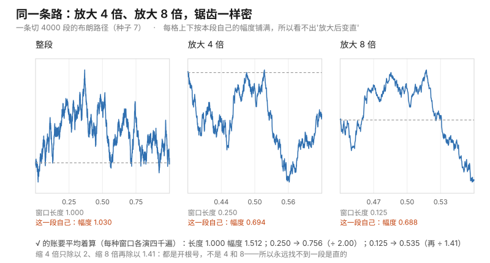
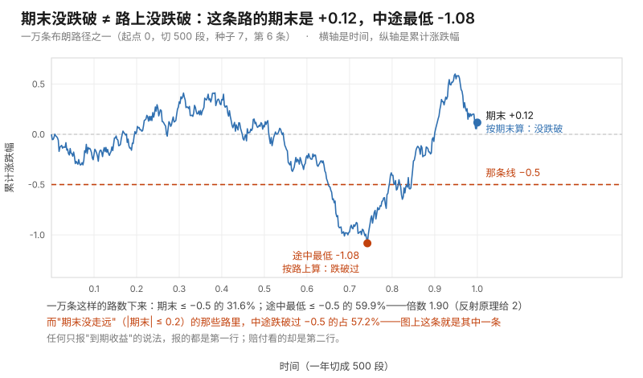
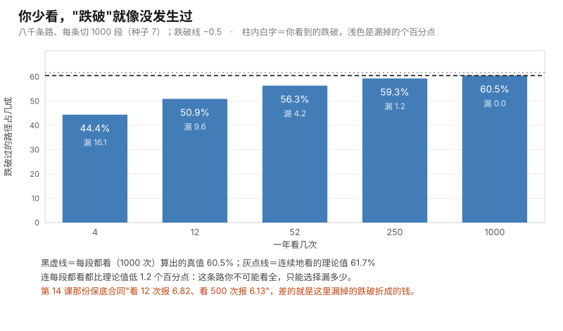

# 第 15 课 · 醉汉回家的路：连续，却没有一段是直的

**模块**：M0 数学与金融必备 ｜ **用时**：约 50 分钟，其中动手 20 分钟 ｜ **前置**：第 05、08、10、13、14 课
**学完你会得到**：一句给自己用的判据（"我看的是终点还是路上"）；一次亲眼看到"这一瞬间涨多快"这个问题在这条路上根本没有答案；以及第一期最后一块地基——知道原书为什么非用蒙特卡洛不可。

**想在浏览器里一格一格跟着跑？** 浏览器版在 [15-brownian-motion.ipynb](../../notebooks/15-brownian-motion.ipynb)：按 `Shift + Enter` 逐格运行，跑出来的数字和本课里印的逐字一致（种子钉在 7）。 也可以[直接在 Colab 里跑](https://colab.research.google.com/github/JavenZheng/monte-carlo-finance/blob/main/notebooks/15-brownian-motion.ipynb)。

---

## 一、有两件事你一直没追问

第一件：你前面几课一直在"每天乘一个随机数"（第 10 课），第 13 课又学会问"这一瞬间多快"，第 14 课用它给期权定价。可价格不是每天跳一次——它在盘中的每一秒都在动，而你把它切成了 250 段。你接受了这个省事，但你没问过：**如果它是连续动的，那"连续"这件事会带来什么新毛病？**

第二件：你的账号日播放量折线，你从上面读出过"这周在涨"。把这张图放大到小时级，还是抖；再放大到分钟级，还是抖。**这张图上有没有哪一段是真的直的、可以叫"趋势"？** 你一直没数过，只是凭感觉挑了一个看着顺眼的尺度。

这两件事是同一件事：一条**连续、却没有一小段是直的**路。它的正式名字叫**布朗运动**，是原书第 3 章第一条主线（§3.1，书页 79），也是整个随机金融的地基。这一课不推公式，只做七个测量——每个测量都回答你上面那两问里的一半。

## 二、把一分钟切成十段、一千段：终点没变，路上变了

第一个测量。让一条路从 0 走到"一分钟结束"，切成 $n$ 段，每段的起伏按 $1/\sqrt{n}$ 缩（这样"总起伏"才不变——这是第 08 课那个 $\sqrt{n}$ 反着用）。

```
    n =    10：终点 平均 +0.007、起伏 1.003（理论 0 与 1.000）；  路上最高点 平均 0.635（段数拉到连续时是 0.798）
    n =   100：终点 平均 -0.007、起伏 1.000（理论 0 与 1.000）；  路上最高点 平均 0.739（段数拉到连续时是 0.798）
    n =  1000：终点 平均 -0.021、起伏 0.986（理论 0 与 1.000）；  路上最高点 平均 0.771（段数拉到连续时是 0.798）
```

**终点那一格始终是同一个分布**（平均 0、起伏 1）——第 08 课的中心极限定理在这里换了个说法：怎么切、切几段，终点都是钟形。**变的是路上**：段数越多，途中最高点平均越高（0.635 → 0.739 → 0.771，往连续情形的 0.798 靠）。

这一句请你记住，它是第七、八节的全部根据：**终点你算得很准，路上发生了什么你知道得很少。** 同一只基金，看月线的人看到的是终点，看日线的人看到的是路上——后者会看到前者永远看不到的东西。

## 三、"这条路多长"没有答案，"这条路多抖"有一个固定的数

第二个测量。把每条路上的小起伏加起来，看它随段数怎么走。两种加法：

```
    切   100 段：总长度 平均   7.95；   平方和 平均 0.995（理论 1.000）
    切  1000 段：总长度 平均  25.23；   平方和 平均 0.999（理论 1.000）
    切 10000 段：总长度 平均  79.77；   平方和 平均 1.000（理论 1.000）
```

**总长度一路涨，永远不收敛。** 段数乘 100，长度大约乘 10（7.95→25.23→79.77，正是 $\sqrt{n}\times 0.798$）。这就是"这条路多长"没有答案的意思：尺子越细，量出来的越长，而且不封顶。你日常画的任何一条价格走势折线，它的长度取决于你取了多少个点——这句话听起来像废话，但第八节就要为它收你的钱。

**平方和反而稳稳收在 1。** 起伏加总不发散、平方加总收敛——收敛到的那个数正好是时间（这里 $T = 1$）。这个量叫**二次变差**（quadratic variation），是连续随机过程和"普通光滑曲线"的根本分界线。

它为什么重要？因为你在这门课里已经三次见过它造出来的那一块：第 10 课对数收益要减掉的 $\sigma^2/2$、第 13 课泰勒展开里"扔不得"的第二项、第 14 课 Black–Scholes 公式分子里的 $\sigma^2/2$。**它们是同一件事。** 光滑曲线上，二阶那一项随步长平方消失、可以不管；在这条路上，一阶增量的**平方**加起来不消失（就是上面那个 1.000），所以二阶项管不掉。这个"管不掉"补出来的那一块，正式名字是**伊藤（Itô）引理**——原书附录 B（书页 545）里那两行式子，本课只是让你在数上先摸到它。

**这个测量替你回答的问题：** 把时间切细之后，哪一项会消失、哪一项不会。会消失的可以省（第 13 课的省事），不会消失的必须付钱。

## 四、"这一瞬间涨多快"：读数随步长一路涨，不停

第三个测量最解气。在第 13 课我们把这套问法用得很好用：$e^x$ 在 $x = 2$ 处，步子从 1 缩到 0.0625，读数 12.6965 → 9.5869 → 8.3947 → 7.8707 → 7.6249，一路收敛到真导数 7.3891。

同一套动作，放到这条路上（在 $t = 0.5$ 处问"这一瞬间涨多快"，每档步长抽两万遍取平均绝对值）：

```
      步长 h     斜率平均绝对值     乘上 √h 之后     理论 √(2/π) = 0.798
    0.50000          1.124            0.795
    0.25000          1.589            0.795
    0.12500          2.248            0.795
    0.06250          3.179            0.795
    0.03125          4.495            0.795
    0.01562          6.357            0.795
    0.00781          8.991            0.795
```

**步子减半，读数乘 1.414，永远不停下来。** 它不发散得乱七八糟——它按 $0.798/\sqrt{h}$ 精确地涨（第三列"乘上 $\sqrt h$ 之后"始终是 0.795，就是理论值 $\sqrt{2/\pi} = 0.798$）。**发散得极有规律，这正是"处处不可导"的意思**：不是没人算得出来，是那个极限根本不存在。

所以第 13 课那个"边际"、第 14 课那个 delta，在这条路上都**不是**"这一瞬间的斜率"。那它们是什么？是**对模型参数**求的导数：delta 是"今天的价 $S_0$ 挪一点，价格函数动多少"，不是"时间挪一点"。**时间和价格在这条路上长得一样抖，但只有价格那一侧可以求导**（因为价格函数对参数是光滑的），时间那一侧不行。原书第 7 章整章算敏感度，算的全是参数那一侧。

这一节给你的判据：**看到"瞬时增长率""这一刻的动量"这种说法，先问它是对什么求的导。** 对时间求的那一种，在布朗路径上没有定义。

## 五、放大多少倍都还是抖：窗口缩一半，幅度只除以 1.414

第四个测量直接回答第一节第二问。取一段长度为 $t$ 的时间，量这条路在这段里的**幅度**（最高点减最低点）：

```
    窗口 1.0000：幅度平均 1.512
    窗口 0.5000：幅度平均 1.069    上一档是本档的 1.414 倍
    窗口 0.2500：幅度平均 0.756    上一档是本档的 1.414 倍
    窗口 0.1250：幅度平均 0.535    上一档是本档的 1.414 倍
    窗口 0.0625：幅度平均 0.378    上一档是本档的 1.414 倍
```

**时间缩一半，幅度只除以 $\sqrt 2$。** 换算个说法：不管窗口取多大，幅度 ÷ $\sqrt{t}$ 都是 1.512 这个数。这条路在任何尺度上一样抖——你把图放大十倍，看到的是同样密度的锯齿，只是矮一点、也密一点。**永远找不到"小到看起来是直的"那一档。** 这个性质叫**自相似**。



图上这三格是同一条路（切 4000 段，种子 7）的三个窗口，每格上下都按这一段自己的幅度铺满，所以你找不到哪一格更"直"。图由 [code/fig15_selfsimilar.py](../../code/fig15_selfsimilar.py) 生成。

于是第一节那个直觉问题有了数：**"再等一会儿趋势就清楚了"这句能不能成立，只看你要压的是哪一个。** 想让**抖动本身**变小，你只能拉长窗口，而幅度按 $\sqrt{t}$ 增长——等得越久，绝对波动越大；真正变小的是"抖动相对于累计变化"那一比，它按 $1/\sqrt{t}$ 缩。**这个根号你已经见过三次：毛边的 $\sigma/\sqrt{n}$（第 07 课）、股价那台机器里的 $\sigma\sqrt{T}$（第 10 课）、相关系数的分母（第 11 课）；这是第四次，它这次量的是时间。**

带走的判据：**想看清方向就拉长窗口，缩小步长只会让你看到更多抖动。** 有人拿高频曲线跟你说"你看它在涨"，你要问的不是"看得够不够细"，而是"窗口放到多长"。

## 六、醉汉回家：几乎一定回，但"平均多久"这个数不存在

第五个测量换回生活场景。一个醉汉在一条直路上，每步左右各一半概率，他能不能走回出发的那个路口？（这就是布朗运动的一维离散版。）

```
    最多等    100 步：回来的占 91.9%（理论 92.0%）；回来的中位步数     2；平均步数（截在这个上限）       9
    最多等    500 步：回来的占 96.4%（理论 96.4%）；回来的中位步数     2；平均步数（截在这个上限）      19
    最多等   2000 步：回来的占 98.3%（理论 98.2%）；回来的中位步数     2；平均步数（截在这个上限）      33
    最多等  10000 步：回来的占 99.2%（理论 99.2%）；回来的中位步数     2；平均步数（截在这个上限）      65
```

三行读法：

**回来的比例确实往 1 走**，而且理论和模拟一位不差（92.0/96.4/98.2/99.2 对 91.9/96.4/98.3/99.2）。一维醉汉几乎一定会回家，这是数学定理，不是安慰话。

**中位数是 2 步。** 一半的醉汉两步就回来了——第一步迈出去，第二步迈回来，游戏结束。

**"平均多少步"跟着你设的上限一起涨。** 9 → 19 → 33 → 65，上限乘 10、平均涨得更多。这不是模拟没跑够：这个量的**期望是无穷大**。第 05 课那个"长尾让平均失去意义"在这里是最凶的版本——不是平均很难估，是**根本没有平均**。

这一条直接打到金融上最常见的那句安慰话。**"跌了不要紧，迟早会回来的"在一维模型里是真的（概率 1），但它附带的"平均多久回来"不存在。** 你扛的是等待成本，而等待的成本没有一个有限的期望可以拿来算账。所以该问的从来不是"会不会回来"，而是"我准备用多少钱和时间去等，等不到怎么办"——第 07 课那笔"要测多少次"的预算，在这里就是命。

顺带一句：三维空间的醉汉就不一定回家了（Pólya 定理，进阶框）。**"会回"这件事不是常识，是维度给的例外。**

## 七、期末在哪 vs 路上跌破过没有：正好两倍

第六个测量把第二节的警告变成数。一万条路径、每条切 500 段、起点 0，同时记录**期末值**和**途中最低点**，看跌破线 $-0.5$ 的比例：

```
    期末 ≤ −0.5：31.6%（钟形表给 30.9%）；   途中最低 ≤ −0.5：59.9%（两倍应是 61.7%）；   倍数 1.90
    '期末没走远'（|期末| ≤ 0.2）的那些路径里，途中跌破 −0.5 的占 57.2%
```

**途中跌破过的概率，正好是期末低于那条线的两倍**（式子见进阶框，叫**反射原理**）。实测 1.90 而不是 2.00，是因为这条路只用 500 段近似、中间漏掉的下跌看不见——那一段漏判第八节会单独量出来。

第二行更扎心：**那些"期末几乎没动"的路径里，57.2% 中途跌破过 −0.5。** 也就是说，一个人完全可能年底截图给你看"基本没亏"，而同一年里他的曲线曾经深深跌穿过那条线——两件事同时为真。

这就是第 14 课那份保底合同的全部道理：**"期末没跌破"从来不等于"路上没跌破过"，而赔付看的是路上。** 现在你也能解释生活里那类宣传了：任何只报"到期收益"的产品，都在用上面这两行数字差给你省掉一半的坏消息。

上面那两条数字画在一条具体的路上，就是这张图。它是一万条里的第 6 条：期末 +0.12（按期末算没跌破），可中途最低到 −1.08（按路上算跌破过）——它正是那 57.2% 里的一个。



图由 [code/fig15_endpoint_vs_path.py](../../code/fig15_endpoint_vs_path.py) 生成，用的就是这一节那一轮抽签（种子 7、一万条、每条 500 段），三个百分比是同一轮数出来的，不是另外编的。

## 八、你多久看一眼，决定你漏掉多少跌破

最后一个测量，也是第一期的收束。同一条路（切 1000 段当成"真实最低"），但只在你看得到的那几个时刻检查有没有跌破：

```
    每段都看（1000 次）算真值：跌破过的占 60.5%（这条路连续地看是 61.7%，连 1000 段都还漏 1.2 个百分点）
    一年看    4 次：你看到的跌破 44.4%（漏了 16.1 个百分点）
    一年看   12 次：你看到的跌破 50.9%（漏了 9.6 个百分点）
    一年看   52 次：你看到的跌破 56.3%（漏了 4.2 个百分点）
    一年看  250 次：你看到的跌破 59.3%（漏了 1.2 个百分点）
    一年看 1000 次：你看到的跌破 60.5%（漏了 0.0 个百分点）
```

**你少看，"跌破"就像没发生过。** 一年只看 4 次，你会漏掉 16.1 个百分点的跌破事件；看 12 次漏 9.6；看到 1000 次才勉强追平——而**连 1000 段都比连续真实值低 1.2 个百分点**。这条路的漏判没有尽头，只有代价。



图由 [code/fig15_monitoring.py](../../code/fig15_monitoring.py) 生成，同样是这一节的抽签（种子 7、八千条、每条 1000 段）。

把这一表和上一课接上：上一课那份保底合同，一年看 12 次报 **6.821**、看 500 次报 **6.134**。现在你知道上一课脚本末尾打印的那 **0.69** 是从哪来的了——就是这里的"漏判折成钱"。**蒙特卡洛必须切时间，一切就漏，所以偏差永远在；能选择的只是漏多少、以及你有没有把这一段写进报告。**

这也是第一期最后要立住的那句话：**这门课不是"用随机数算一个数"，而是"把算这个数欠下的两笔债各报一遍"**——抽签次数欠的毛边（$\sigma/\sqrt{n}$），切时间欠的偏差（$\propto$ 步长）。第 07、08 课给了前者，第 13、14、15 课给了后者。原书第 4 章（方差缩减）和第 6 章（离散化）就是把这两笔债分别做成一整章的工程学。

## 九、今晚就能用起来

代码在 [code/lesson15_brownian_motion.py](../../code/lesson15_brownian_motion.py)。要改成你自己的数据，动第七、八节和练习五里的三个参数就行：那条线（脚本里的 `a`）、看几次（`watches`）、单日起伏（`sd`）。

**第一件：给你的曲线定两条口径，一次报两个数。** 一条是终点（"年末不亏"），一条是路上（"全年最大回撤"）。第七节给的换算是：**路上跌破过的概率大约是期末跌破的两倍**（实测 1.90–1.92），而"期末没走远"的人里 57.2% 中途跌破过。写周报、看产品宣传、评估自己那个账号的时候，把第二条也补上，你立刻比周围人多一个维度。

**第二件：想看清方向就拉长窗口，别缩小步长。** 第五节那张表 1.414、1.414、1.414、1.414 是硬道理：把图放大到分钟级不会让趋势变清楚，只会让锯齿更密。**要压抖动，唯一的办法是拉长观察窗口**，而且压的是"相对抖动"（按 $1/\sqrt{t}$ 缩），不是绝对幅度。下次有人用高频图论证趋势，问"窗口放到多长还成立"。

**第三件：任何"迟早会回来"的论证，先问"平均多久"。** 第六节给了你那一栏：回来的比例往 99.2% 走，**平均等待时间的期望却是无穷大**。所以正确的说法不是"会不会回来"，而是"我愿意为等它花多少钱、多久不回来我就走"——把这句写进你的止损规则或者备货预算，它比任何指标都值钱。

三条必须说清楚：

**第一，布朗运动是模型，不是现实。** 这一课所有干净的数（0.798、1.414、两倍）都建立在"增量独立、正态、方差等于时间"三条上。真实价格会突然跳空（第 09 课那些稀有事件）、尾比钟形厚（第 05 课）、而且大波动后面常跟着大波动（波动聚集，原书 §3.5 处理带跳的过程）。**布朗运动的价值不是准，而是它是第一个能被严格算的对象**——你在它身上学会的标度律（$\sqrt{}$、两倍、漏判）是理解一切更复杂过程的地图，不是预言。

**第二，"处处不可导"不等于"任何导数都不能算"。** 第四节的关键区分：对**时间**求导在这条路上没有定义，对**参数**求导（delta、vega）完全合法、而且正是原书第 7 章在做的事。别把这两件事混了——那是读不懂第 7 章最常见的原因。

**第三，你从图上读出的一切"这一段是趋势"，都要先过第五节和第八节。** 第五节说没有哪一段是直的，第八节说你少看就会漏。**"我看到了一个形态"这句话的证据强度，取决于你看图的尺度和频率，而不是取决于那个形态。**

## 十、练习

**一。** 接第三节那个测量：切 100 段的一条路径，平方和实测 0.949，而理论是 1.000。同一个切法演两百条给 0.995，切 10000 段给 1.000。这三行合起来告诉你平方和这个量法什么性质？0.949 是不是"算错了"？

**二。** $h = 0.01$ 时"这一瞬间涨多快"的读数平均 7.947（理论 7.979）。$h$ 减半读数会乘多少？和第 13 课 $e^x$ 那张表（12.6965 → 7.6249 → 收敛）比，本质区别是什么？

**三。** 整段（窗口 1.0）幅度实测 1.512，窗口 1/16 实测 0.378，比值 0.250。如果你想让幅度只有一半，窗口要缩到多少？

**四。** 把线改成 $-1.0$：期末 ≤ −1.0 占 15.9%、途中最低 ≤ −1.0 占 30.6%、倍数 1.92。为什么不正好是 2.00？该改哪个参数让它更接近 2.00，代价是什么？

**五。** 一笔钱投 250 个交易日、日均 0、单日起伏 2%。实测：期末不亏 43.5%、全年从没跌破 −5% 只有 13.1%、从没跌破 −10% 的 24.0%；而期末不亏的人里只有 29.2% 全年没跌破过 5%。用这四个数，给一个"这个计划平均不亏"的产品写一句给用户的说明。顺带解释：为什么"不亏"连一半都不到？

### 答案

**一。** 不是算错了。0.949 是**一条**路径的平方和——它本身是个随机量，围绕 1.000 晃；演两百条取平均就收到 0.995，切到 10000 段给 1.000。两件事同时成立：**对单条路径，平方和随切法收敛到同一个数**（这是"二次变差是确定的、不随切法消失"），**而对一次抽签，它有自己的毛边**（第 07 课那台机器照样适用）。这也说明第三节那个结论不是取巧：换一个随机种子，平方和照样是 1.000 附近。

**二。** 乘 $\sqrt 2 = 1.414$。第 13 课那张表**步长越小越接近一个固定的数**（7.3891），这一张表**步长越小越往无穷走**，而且走得极有规律（读数 $\times\sqrt{h}$ 恒为 0.795）。前者说明那个函数在这一点的"瞬时"存在，后者说明这条路的"瞬时斜率"不存在。第 13 课我们那句"往前读会偏、两侧读更准"在这里完全不适用：**两侧读也一样随步长发散，没有任何读法能救它。**

**三。** 窗口缩到 **1/4**。因为幅度按 $\sqrt{t}$ 走，要幅度乘 $\frac12$ 就得让 $t$ 乘 $\frac14$。反过来用更重要：想"把抖动压到十分之一"，窗口要拉长 100 倍。

**四。** 两个原因叠着：一是这条路由 500 段近似，中间漏掉的跌破看不见（第八节实测：1000 段仍比连续真值低 1.2 个百分点）；二是一万条路径本身有毛边（比例的标准误约半个百分点）。**改法是加段数**（把 500 改成 5000、50000），倍数会往 2.00 靠；**代价是计算量线性上涨**，而毛边只能靠加路径数、按 $\sqrt{\text{条数}}$ 缩——两笔账要分开付：第 12 课练习四、第 13 课第七节、上一课第七节、本课第八节，是同一条判据的四次现身。

**五。** 老实的写法是：**"这个计划的日均涨跌设为 0；按典型的一年（250 个交易日）来看，约 43.5% 的人期末不亏；但只有 13.1% 的人全年从没让这笔钱跌破过 5%；即便是期末不亏的那批人里，也有约 71%（= 1 − 29.2%）中途跌破过 5%。"** 三个数说的是同一件事：**不亏是终点的事，跌破是路上的事**，而后者的概率大约是前者的两倍（第七节）。**为什么"不亏"不到一半**：这里"日均 0"说的是简单收益，换成对数口径每年要扣掉 $\sigma^2/2 = 2\%^2/2 \times 250 = 5.0\%$——**第 10 课那个波动拖累第四次出现**，它就是"不亏"被推到一半以下的原因（钟形表算出 43.7%，实测 43.5%）。

---

## 十一、一句话

这条路连续、却没有任何一小段是直的，所以"此刻多快"没有答案；但它的抖有一个不随切法消失的量（就是那个 σ²/2），而你能做的只有两件事——把窗口拉长去看方向，以及老实承认你多久看一眼就漏掉多少跌破。

## 第一期结束

到这里，第一期 15 课走完了。你现在可以做这几件事：

**翻开原书。** 第一部分（第 1–3 章）现在是"可读"状态：第 1 章的两个主定理你各跑过一次（第 14 课的定价、第 07 课的毛边），第 2 章的抽样方法你用过（第 09 课逆变换、第 10 课正态），第 3 章的第一节就是这一课。**建议直接从 §3.1 布朗运动（书页 79）读起**，那是本课时最接近的一节。

**下一步（第二期，规划中）**按原书结构走：`M1 随机数与随机变量`（第 2 章：同余发生器、逆变换、接受-拒绝）→ `M2 样本路径的生成`（第 3 章：布朗运动、几何布朗、随机利率、平方根过程、带跳过程）→ `M3 方差缩减`（第 4 章，全书心脏：控制变量、对偶变量、分层、拉丁超立方、重要性抽样）→ `M4 准蒙特卡洛`（第 5 章）→ `M5 离散化方法`（第 6 章）→ `M6 敏感性估计 Greeks`（第 7 章）→ `M7 美式期权定价`（第 8 章）→ `M8 风险管理`（第 9 章）。

**随身带这五张条子**（第一期的全部判据）：报数必带毛边（07）；那个根号到处都在——$\sigma/\sqrt{n}$、$\sigma\sqrt{T}$、$\sqrt{t}$（07、10、15）；偏差与毛边分两行写、用"加十倍次数看误差降到几分之几"分辨（13、14、15）；定价问"我拼得出吗"而不是"我觉得多大概率"（14）；不亏是终点的事、跌破是路上的事（15）。

---

## 进阶框（可跳过，不影响下一课）

**布朗运动的三条定义。** 随机过程 $W(t)$，$t \ge 0$ 叫布朗运动（也叫维纳过程），如果：① $W(0) = 0$ 且**路径连续**；② **独立增量**——不重叠的时间段之间互不透露消息；③ **增量正态、方差等于时间长度**：$W(t) - W(s) \sim N(0,\ t - s)$。本课脚本做的事就是把 ③ 拆成 $n$ 段、每段 $N(0, 1/n)$ 再累加——**独立增量由"每段各抽各的"保证，正态由第 08 课的中心极限定理保证**（第一部分那张"终点起伏恒为 1.000"就是它在场）。三条里 ① 最微妙：路径是连续的，但连续到这个程度**处处不可导**——第三部分实测的那个 $1/\sqrt h$ 发散就是这句话的数值版本。金融里股价的标准写法是第 10 课的几何布朗运动 $S(t) = S_0 \exp\big((\mu - \tfrac{\sigma^2}{2})t + \sigma W(t)\big)$，正式出处 **§3.2 Geometric Brownian Motion（书页 93，PDF 页 103）**；指数里面那个 $\sigma^2/2$ 正是本课第二部分"平方和不消失"的直接后果。

**"切得越细路越长"和"平方和收敛"为什么同时成立。** 每段增量大小约 $\sqrt{1/n}$，$n$ 段直接相加得到约 $n \times \sqrt{1/n} = \sqrt{n}$——**所以总长度按 $\sqrt{n}$ 发散**（第二部分实测 7.95 → 25.23 → 79.77，正是 $\sqrt{n}$ 的倍数）。每段平方约 $1/n$，$n$ 段相加得 $n \times 1/n = 1$——**所以平方和收敛**，这个数叫**二次变差** $\langle W \rangle_T = T$。写成金融常用的记号是 $(dW)^2 = dt$：它是"二阶不消失"的全部内容。光滑函数上 $\Delta = f'\,\delta$，平方后是 $(\delta)^2$ 阶、随切法归零；布朗路径上 $\Delta \sim \sqrt{\delta}$，平方后正好是 $\delta$ 阶、不归零。伊藤引理 $df = f'\,dW + \frac{1}{2}f''(dW)^2$ 里那半项就是被这件事逼出来的。

**反射原理那行式子。** 对 $a > 0$：$P\big(\min_{t \le T} W(t) \le -a\big) = 2\,P\big(W(T) \le -a\big) = 2\,\Phi\!\left(\frac{-a}{\sqrt{T}}\right)$。道理是把"跌破过 $-a$ 的路径"在它第一次碰线之后的部分做个镜像，就得到一条**结束在 $-a$ 以下另一半位置**的路径——一一对应，所以是一倍变两倍。本课第六部分实测 31.6% 与 59.9%（比值 1.90，缺口来自 500 段的漏看），练习四换成 $a = 1$ 给 15.9% 与 30.6%（比值 1.92）。**这一行式子就是原书 §6.4 障碍与极值（书页 366，PDF 页 376）的连续时间起点**，而离散监控的偏差正是它被切成有限段之后欠下的债。

**醉汉回家这件事。** 一维（和二维）的简单随机游走**常返**：回到原点的概率是 1；**三维不返**：约 65% 会回来，剩下三成多永远走远（Pólya 定理，1921）。但"一定回"和"等得到"是两回事：返回时间的分布尾部约按 $n^{-3/2}$ 变薄（第 05 课那个厚尾），**期望因此是无穷大**——这就是第五部分"平均步数跟着上限一起涨"的原因。首达时间的精确密度（$f(t) \propto t^{-3/2} e^{-a^2/2t}$，逆高斯一族）在随机利率与信用风险的章节里还会再出现。

**"从离散到连续"这件事有名字。** 第一部分那张表（切 10、100、1000 段，终点分布始终是平均 0、起伏 1）说的正式定理叫**不变原理（Donsker 定理）**：把随机游走按 $\sqrt{n}$ 正确缩放后，整条路趋近布朗运动。它是"为什么可以用蒙特卡洛模拟连续时间模型"的合法性来源，也是第 08 课中心极限定理的"整条路径版本"。原书在 **§3.1（书页 79，PDF 页 89）** 直接用布朗运动作为一切路径生成的起点，附录 A（书页 539，PDF 页 549）处理收敛与置信区间的严格表述。

---

## 备忘卡

本课出现的东西，正式名字在这里。

**"连续、增量独立、增量正态且方差等于时间长度"那三条**合起来叫**布朗运动 / 维纳过程**（Brownian motion / Wiener process，记作 $W(t)$）；**"每段各抽各的"**叫**独立增量**（independent increments）；**"同样长度的时间段有同一个分布"**叫**平稳增量**（stationary increments）；**"平方加起来不归零、收敛到 $T$"**叫**二次变差**（quadratic variation，记作 $\langle W\rangle_T = T$），它的微分记号是 $(dW)^2 = dt$；**"总长度随切法发散"**说明这条路**处处不可导**（nowhere differentiable，所以"此刻涨多快"没有定义）；**"放大多少倍一样抖"**叫**自相似 / 标度律**（self-similarity，幅度按 $\sqrt{t}$ 走）；**"路上跌破过的概率是期末的两倍"**叫**反射原理**（reflection principle）；**"醉汉一定会回到原点"**叫**常返**（recurrent），配套的坏消息是**首达时间的期望不存在**（first hitting time，尾部 $\propto t^{-3/2}$）；**"随机游走缩放后变成布朗运动"**叫**不变原理**（Donsker's invariance principle）；**"被二阶项逼出来的那条求导法则"**叫**伊藤引理**（Itô's lemma，原书附录 B，书页 545）。

回接第一期的三条线：**$\sqrt{}$** 出现过四次——毛边 $\sigma/\sqrt{n}$（07、08）、股价那台机器里的 $\sigma\sqrt{T}$（10）、相关系数分母上那两个根（11）、窗口幅度 $\sqrt{t}$ 与斜率 $1/\sqrt{h}$（本课）；**$\sigma^2/2$** 出现过四次——波动拖累（10）、泰勒第二项（13）、BS 公式分子（14）、"不亏连一半都不到"（本课练习五）；**偏差与毛边两笔账**也收束在这里：第 12 课练习四、第 13 课第七节、第 14 课第七节、本课第八节是同一条判据的四次现身。

编程约定：`random.gauss(mu, sd)` 造正态增量；`bm(steps)` 这个函数把 $[0,1]$ 切成 steps 段——**每段标准差必须传 `math.sqrt(1.0 / steps)` 而不是 `1.0 / steps`**，这是 $\sqrt{t}$ 标度最容易写错的一处（写错了终点起伏就不是 1.000，第一部分的表立刻拆穿你）；`vals[::nfine // w]` 是"只在你看得到的那几个时刻取值"，第八节整节靠它。

---

## 原书对应与版权说明

本课对应 Glasserman（2003）**§3.1 Brownian Motion（书页 79，PDF 页 89）**：定义三条、路径性质、极值与首达时间；**§3.2 Geometric Brownian Motion（书页 93，PDF 页 103）** 是股价的标准写法，本课第 10 课那台价格机器的连续时间版本（指数里那个 $-\sigma^2/2$ 正是第二部分"平方和不消失"的后果）；**§6.4 Extremes and Barrier Crossings and Brownian Interpolation（书页 366，PDF 页 376）** 对应第六、七部分（途中极值、离散监控的漏判、布朗插值）；**§9.3 A Heavy-Tailed Setting（书页 506，PDF 页 516）** 与第 05、09 课呼应"平均不存在"那一族毛病；**附录 B Results from Stochastic Calculus（书页 545，PDF 页 555）** 是伊藤引理与 $(dW)^2=dt$ 的正式出处；**附录 A Convergence and Confidence Intervals（书页 539，PDF 页 549）** 收束第一部分与第 07、08 课的收敛口径。

本课未复制原书任何文字、图表或表格。所有数字本机实测（Python 3.12，每段前钉种子 7 可逐字复现，整份约 11 秒）：`code/lesson15_brownian_motion.py` 八个部分输出 → 终点与最高点（依次四万、四万、四千遍／n=10/100/1000）起伏 1.003/1.000/0.986、最高点 0.635/0.739/0.771（连续理论 0.798）；总长度与平方和（两百条，n=100/1000/10000）7.95/25.23/79.77 与 0.995/0.999/1.000；斜率读数（两万遍，h 从 0.5 到 0.00781）1.124/1.589/2.248/3.179/4.495/6.357/8.991，乘 $\sqrt h$ 后恒为 0.795（理论 0.798）；窗口幅度（四千遍，t=1 到 1/16）1.512/1.069/0.756/0.535/0.378，逐档比值全为 1.414；醉汉回家（上限 100/500/2000/10000，分别演两万/两万/八千/三千遍）实测 91.9%/96.4%/98.3%/99.2% 对理论 92.0%/96.4%/98.2%/99.2%，中位 2 步、截尾平均 9/19/33/65；期末与途中（一万条、500 段、线 −0.5）31.6% 对钟形表 30.9%、59.9% 对两倍理论 61.7%、倍数 1.90，"期末没走远"那批里途中跌破过的占 57.2%；监控次数（八千条、1000 段）4/12/52/250/1000 次看到 44.4%/50.9%/56.3%/59.3%/60.5%（分别漏 16.1/9.6/4.2/1.2/0.0 个百分点，连续真值 61.7%）；练习 → 单条路径平方和 0.949 与平均 0.995、1.000，h=0.01 斜率 7.947 对理论 7.979，窗口 1/16 幅度比 0.250，线 −1.0 时 15.9%/30.6%/倍数 1.92，250 天日均 0 日起伏 2% → 期末不亏 43.5%（钟形 43.7%）、全年没跌破 −5% 13.1%、没跌破 −10% 24.0%、期末不亏者中仅 29.2% 没跌破过 5%。完整章节页码见 [原书章节索引](../book-index.md)。**建议购买正版**支持作者：Springer, *Monte Carlo Methods in Financial Engineering*, 2003；中译本《金融工程中的蒙特卡罗方法》。

**上一课**：[第 14 课 · 明年的 30 块，今天值几块](14-pricing-by-discounted-expectation.md) ｜ **返回**：[学习路线图](../../README.md)
