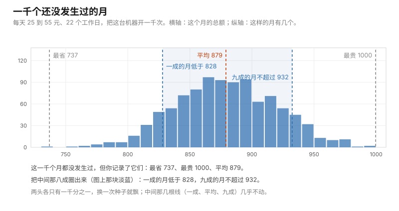

# 第 04 课 · 你的第一个真模拟

**模块**：M-1 工具 ｜ **用时**：约 45 分钟，其中动手 30 分钟 ｜ **前置**：第 01、02、03 课
**这节课之后**：M-1 结束。你能独立读懂并改写第 07 课那台四行计算器，也能自己造一个"还没发生过的月"。
**不想在本地装 Python？** 这一课的浏览器版在 [notebooks/04-your-first-real-simulation.ipynb](../../notebooks/04-your-first-real-simulation.ipynb)：一格一格跟着按 `Shift + Enter`，跑出来的数字和课文里印的逐字一致。

---

## 一、第 01 课你演了十轮，电脑演十轮得到 20%

第 01 课你用六张便利贴演了十轮"连发六条会不会一条都不爆"。这节课开头我先替你把手工那一步走完：我用电脑演了十轮，得到**全空占 20.0%**。

真值是 33.49%。也就是说，我这次手工（现在是机器手工）做的十轮，把一件事的差三倍估小了。

这不是我算错了，这是十轮本来的样子——第 01 课第四节已经预告过这件事。今天我们把它彻底解决：让电脑把同一件事演十万轮。跑出来是 33.4%，和真值对上。而整段程序在我这台上花了 **0.04 秒**。

这就是蒙特卡洛的全部生意：**用极其便宜的重复，换掉你手上那点可怜的样本。**

这节课要教你三件新东西：怎么让电脑抽签（随机数）、怎么让抽签可以被重播（种子）、怎么用抽出来的数算出一个你以前只能猜的东西（月底总额）。

## 二、随机数就是 0 到 1 之间的一次抽签

在浏览器里跑这一行，多跑几次：

```python
import random

print(random.random())
```

你会看到 0 和 1 之间的一个小数，每次都不一样，比如 `0.6394267984578837`。

它就是抽签。而且因为它落在 0 到 1 之间任何位置的机会都一样多，你可以用它做出**任何概率**：想知道"六分之一"这件事发生没发生，就问——它抽到的数是不是小于六分之一？

```python
if random.random() < 1 / 6:
    print("爆了")
```

`1 / 6` 约等于 0.1667，抽签结果落在这以下的机会正好是六分之一。所以这一句就是"发一条，六分之一的概率爆"。

第 09 课会详细讲这件事为什么成立（那节课的名字就叫"随机数其实是排队领号"）。今天你只需要接受一个事实：**所有更花哨的随机——掷骰子、抽播放量、模拟股价——最后都是这么一句比较。**

## 三、把便利贴装进机器

现在把第 01 课那套动作写成代码。一轮 = 发六条，看有没有爆过：

```python
def a_round(rate, posts):
    """发 posts 条，每条爆的概率是 rate。一条都没爆返回 True。"""
    hits = 0
    for _ in range(posts):
        if random.random() < rate:
            hits = hits + 1
    return hits == 0
```

这里有两个新面孔，都很小。`for _ in range(posts):` 是"把下面缩进的行做 posts 次"，下划线 `_` 表示"我不关心现在是第几次，我只关心做了几次"。`return hits == 0` 里的 `==` 才是"相不相等"（第 02 课那个 `=` 是"贴上去"，这里两个等号是"问它相等吗"），答案是一个布尔值：真或假。

然后演很多轮，数一数"全空"的占多少：

```python
def all_quiet_rate(rate, posts, runs):
    """重复 runs 轮，返回其中"全空"的轮占多大比例。"""
    quiet = 0
    for _ in range(runs):
        if a_round(rate, posts):
            quiet = quiet + 1
    return quiet / runs
```

看它的形状：又是一台机器，塞进去三个参数（爆率、几条、演多少轮），吐出一个比例。第三节那台数超过线的那几天的机器，和这台数全空的机器，是同一个骨架。

跑三种轮数：

```python
print("【第一段：把便利贴装进电脑】")
for runs in (10, 1000, 100000):
    random.seed(7)          # 每行都从同一条运气流开头，你看到的差别只来自轮数
    p = all_quiet_rate(1 / 6, 6, runs)
    print(f"演 {runs} 轮 → 全空占 {p * 100:.1f}%")
```

我这台机器输出：

```
演 10 轮 → 全空占 20.0%
演 1000 轮 → 全空占 32.6%
演 100000 轮 → 全空占 33.4%
```

**这就是你这门课第一次看到"演得够多，数就稳下来"。** 十个字以内可以说完，但它是整个蒙特卡洛存在的理由。原书在第一章就用这个姿势开场，你以后会在几乎所有章节里再见到它。

顺便，这个答案还可以手算验证：一条都不爆的概率是 (5/6)⁶ = 33.49%。第 01 课进阶框说过的规矩在这里第一次兑现——**能手算的题，我们先算再演，两个数对上了才继续。** 现在对上了。以后你会碰到算不出来的题，那时你就只能信这套"对过一次"的机器。

## 四、为什么每一行前面要钉一颗种子

`random.seed(7)` 这一行看上去像装饰，其实是这段代码里最重要的方法决定。

电脑不会真的随机。它是按一个固定的算法，从某个起点一步步往下报数——报出来的序列看着毫无规律，但只要起点一样，序列就完全一样。这个起点就叫**种子**。

所以不加这一行，你每跑一次结果都不同，我们没法核对，你也没法跟朋友复现。加了它，你跑出来的和这里贴的**一字不差**：20.0 / 32.6 / 33.4。你可以自己验证。

还有一件事值得现在就明白：我在第一段那个循环里，每一行前面都重新钉了一次种子，而不是在最开头钉一次。为什么？因为这样三行用的是**同一条运气流的不同长度**——10 轮是前 10 轮，1000 轮是前 1000 轮。它们之间的差别干干净净只来自"演了多少遍"，不掺杂"这一次运气好还是差"。做对比实验的时候，把不该变的东西钉住，这是唯一让比较有意义的办法。你以后在公司里做 A/B 测试、在 Colab 里调参数，靠的都是同一个动作。

我在自己机器上试给你看钉种子在替你挡掉什么。把每一行前面的 `random.seed(7)` 删掉，用第一段那台机器连跑三遍：

```
第一遍 → 10 轮 60.0% ｜ 1000 轮 31.8% ｜ 10000 轮 34.5%
第二遍 → 10 轮 50.0% ｜ 1000 轮 34.1% ｜ 10000 轮 32.9%
第三遍 → 10 轮 30.0% ｜ 1000 轮 33.3% ｜ 10000 轮 33.6%
```

看第一列：同一段程序，三遍分别告诉你这件事有 60%、50%、30% 的概率发生——真值是 33.49%。看第三列：三遍都稳稳待在 33 上下。

**轮数不够的时候，你的结论里有一半是你自己那一次的运气。** 这一句你会在第 07 课拿到一个能算的式子，今天先记住这个形状：第三列的散布小到你可以忽略，第一列的散布大到足够让你得出完全相反的结论。

## 五、真正值钱的一步：造一个还没发生过的月

前三节都在算"概率是多少"。但生活里你更常问的是另一类问题：**这个月我大概要花多少？最坏会到多少？**

这类问题没有公式给你（你不知道每天的花销怎么串起来），但你能一句一句地造出来：

```python
def one_month(low, high, workdays):
    """造一个没发生过的月：每个工作日的花销在 low 到 high 之间随机。"""
    total = 0
    for _ in range(workdays):
        total = total + random.uniform(low, high)
    return total
```

`random.uniform(25, 55)` 是"在 25 到 55 之间随挑一个数"，就是你每天那一顿饭。一台新机器，塞进三个参数，吐出一个月的总额。

然后——这里是全部魔法所在——**把这台机器开一千次**：

```python
random.seed(7)
months = []
for _ in range(1000):
    months.append(one_month(25, 55, 22))

months.sort()
p10 = months[int(0.1 * len(months))]
p90 = months[int(0.9 * len(months))]
print(f"最省的月 {months[0]:.0f}，最贵的月 {months[-1]:.0f}")
print(f"平均 {sum(months) / len(months):.0f}")
print(f"一成的月低于 {p10:.0f}，九成的月不超过 {p90:.0f}")
```

我这台机器的输出：

```
最省的月 737，最贵的月 1000
平均 879
一成的月低于 828，九成的月不超过 932
```

逐行说它在干什么。`months.append(...)` 是第 03 课那招：造一个月的总额，接到列表末尾。一千次之后你手上有**一千个月**——它们都没发生，但你记录了它们。`months.sort()` 把这一千个数从小到大排好。排完之后，`months[0]` 是其中最省的那个，`months[-1]` 是最贵的那个，`months[int(0.9 * len(months))]` 是排在九成位置的那个，也就是"九成的月都不超过它"。

最后一句是这一节课真正的礼物。你以前只有一个数字（"我上个月花了 890"），现在你有一整**列**可能的月份，而这一列数可以直接回答"最坏大概多少""几成的把握不超过多少"。

把这一千个月画出来，就是这个样子——横轴是这个月的总额，每一根蓝条是"有一千个月里的几个花成了这么多"，五条虚线就是上面那三行输出：



图由 [code/fig04_thousand_months.py](../../code/fig04_thousand_months.py) 生成，就是上面这一轮（种子 7、一千遍）。看两头那两根灰线：它们各自只压着一根几乎看不见的蓝条。

顺便看一件事：把这一段开头的 `random.seed(7)` 删掉，我连跑五遍，"最省的那个月"在 736 到 763 之间跳，"最贵的那个月"在 1000 到 1023 之间跳，而"平均"那一句五次分别是 879、880、880、881、881。**中间的数稳，两端的数飘。** 这个现象以后会反复出现，你今天先记住它，练习三会让你亲手确认一遍。

第 01 课练习四第一题问你"我下个月的花销会不会超支"，当时我说这题适合蒙特卡洛，前提是你说得出每天怎么波动。今天你把它做出来了。

## 六、今晚就能用的一句话，和三个提醒

代码在仓库里：[code/lesson04_first_real_simulation.py](../../code/lesson04_first_real_simulation.py)。浏览器跑就打开 [https://jupyter.org/try](https://jupyter.org/try) 整段粘进去。

你要改的只有第五节那三个参数：`one_month(25, 55, 22)` 里的下限、上限、天数。任何按天发生、你能说出大致区间的开销都能进去——通勤、外卖、打车、你在直播间忍不住下的单。

跑完之后，你手上第一次有了这样一句可以说出口的话：**"按我每天 25 到 55 块的吃法，下个月大概花 880，九成的月份不会超过 932。"** 注意这句话的结构：一个数（880）＋一个你有把握的范围（932 以下）＋一个它成立的条件（你填的那两个区间）。这三段以后你每次报数都该带着，缺一段就是在假装有把握。

然后三件必须提醒你的事，因为它们决定了你以后会不会被自己的程序骗。

**第一，你的"最贵"从来不会是真的最贵。** 如果你每天在 25 到 55 之间花，二十二天的理论极限是 550 到 1210。可我一千个月里最贵只跑到 1000，最省 737——理论上的两端一次都没出现。原因很清楚：连续 22 天都花到 55 以上，本来就几乎不可能。这没错，但要紧的是反过来那句：**演了一千遍没出现的结局，不等于不会发生。** 你把"最贵的月 1000"当成你的上限，是拿你的轮数当世界的边界。第 15 课之后我们会专门处理这类错误（原书在风险那一章整章在讲它）。

**第二，你填的区间就是那个假世界的墙。** `25` 和 `55` 是第 01 课说的"模型里的参数"。我改成 25 到 70 跑一次，九成那个数从 932 变成 1124；改成 25 到 45，它变成 805。看清楚了：我一个字没多想，只是换了两个数，结论就动了 100 多块。所以别人问你"你这个估算怎么来的"，正确答案不是那个数，是你那堵墙是怎么定的。

**第三，一次跑出来的数不能算数。** 我上面所有数字都是在钉住种子的情况下跑的，这是为了让你能核对。真要拿去做决定，你应该**不钉种子跑很多次，看结果的散布有多大**——那是第 07 课的全部内容。今天先记住：钉种子是为了讲清楚，不钉种子才是为了看清楚。

## 七、练习

**一。** 把第一段里的 `posts` 从 6 改成 13 重跑（其他不动）。跑出多少？拿它和第 01 课第五节那张表对照，你应该得到什么？

**二。** 把 `one_month(25, 55, 22)` 的上限从 55 改成 70，再改成 45。两次"九成的月不超过"各是多少？这告诉你关于"偶尔吃顿贵的"的什么事实？

**三。** 你把 `random.seed(7)` 全部删掉，第二段连跑三次，把三个"最贵的月"记下来。它们差多少？三个"平均"差多少？按第四节的说法解释这个对比。

**四。** 你朋友看了你屏幕上的"最贵的月 1000"，说："那我下个月最多花 1000，超了我请客。" 用第五、六节的哪个事实反驳他？他这个说法里，哪一个假设是他没说出口的？

### 答案

**一。** 我跑出来约 9.2%（真值 9.35%）。第 01 课第五节那张表说：连发十三条一条都不爆的概率是 9.3%，反过来就是"至少爆一条的把握 90.7%"。两节课用两条完全不同的路（手算幂 / 电脑演十万轮）撞到同一个数上，这就是这门课要给你的安全感来自哪里——**不是来自某一种方法多可靠，是来自两种独立方法给出同一个答案。**

**二。** 上限 70 → 最贵 1224、九成不超过 1124；上限 45 → 最贵 850、九成不超过 805。也就是说，把"偶尔一顿贵的"这件事放不放进你的区间，你的月度预算差出一百多块。而这件事用平均数是看不出来的：你算平均的时候是"每天 40 块"，可预算被的是尾部，不是平均。**做计划要按尾部，做评估才按平均**，这个分工以后你会反复用到。

**三。** 我一共跑了五遍不钉种子的第二段。最省的那个月在 736 到 763 之间跳（最大差 27），最贵的那个月在 1000 到 1023 之间跳（差 23），而"平均"这一句五次分别是 879、880、880、881、881——最多差 2 块。

原因是中间那个数由一千个月共同定出来，某一轮的运气会在里面相互抵消；两端的数只由极端的那一两个月决定，它们本身就是运气。按比例看，两端每次动的量是平均的十倍上下。这正好是第六节第二条提醒的具体版本：你要用的那个结论，稳不稳不取决于你演了多少遍的"平均"，取决于你要的那个数是不是坐在尾巴上。

**四。** 反驳用第五节末尾那句：一千次里最贵的是 1000，可理论的墙在 1210，而你真实的墙比 1210 更高（因为你偶尔会吃一顿 120 的聚餐，那本来不在 25–55 里）。**演了一千遍没出现不等于不会发生**，他那句"超了我请客"是把轮数当成了世界的边界。他没说出口的那个假设是"我每天花销都在 25 到 55 之间"——这才是整件事真正该被追问的地方，而不是那个 1000。

---

## 八、一句话

不会算的问题，先造一个你能控制的小世界，让它发生很多次，然后去数——但永远记住，你数的是那个小世界。

## 下一课

M-1 到此结束，从现在起进数学补课模块。第 05 课处理你今天撞到的那件事的另一半：为什么"平均 880"这句话可能是最没信息量的一句——因为你的记录里，典型的一天和平均的一天常常不是同一天。

---

## 进阶框（可跳过，不影响下一课）

**(5/6)⁶ = 33.49% 是怎么来的。** 每条不爆的概率 5/6，六条相互独立，全空就是六个 5/6 相乘，即 (5/6)⁶。第 01 课给过这个式子。凡是这种"独立同分布的固定次数"问题，都有闭式解可以核对模拟程序；这类核对是写下任何模拟之后的第一件事。

**为什么轮数要加到十万才好看。** 从 10 轮到 1000 轮（一百倍），误差从"差十三点"缩到"差九毛"左右；从 1000 到 100000（一百倍），也只从 32.6 走到 33.4。收敛按轮数的平方根走，这就是"根号税"，第 07 课会给它一个可以算的式子。今天只需要有手感：**你要多十倍精度，得多演一百倍。**

**`random.random()` 抽的那个东西有名字，叫均匀分布。** 第 09 课正式讲它，第 10 课讲怎么把均匀抽出来的数变成"每天的花销""第二天的股价"，那才是原书 §2.1–2.2 的内容。你今天已经用上了它的用法，还不欠它任何理论。

**Python 的随机其实有两条路。** 今天用的 `random` 是标准库，浏览器里就能跑；等你开始做几十万个数的批量运算（第 07 课的模拟），我们会换 `numpy`，快很多也更好排错。两条路的思路完全一样，换的只是工具。

**`months[int(0.9 * len(months))]` 是这一列数的分位数。** 它的意思就是"排在九成位置那个数"。以后你要说"最坏的那百分之五是多少"，写法和它一模一样，只是把 0.9 换成 0.95。原书风险那一章（第 9 章）从头到尾就在算这个东西。

---

## 备忘卡

本课出现的东西，正式名字在这里。

**抽签**叫**随机数**（random number）；`random.random()` 给的是 0 到 1 之间均匀分布的一个数。**起点**叫**种子**（random seed）：钉住它，序列就固定、可重播；不钉，每次不同。**一轮 / 一个月**叫**一次实现**（realization），一列数是一条**样本路径**（sample path），这些词第 01 课已经给过。**演了多少遍**叫**模拟次数**（number of simulations），就是你程序里的 `runs`。**你从有限次演练算出来的那个数**叫**估计量**（estimator）——第 01 课的"数出来的比例"、今天的 33.4% 和 879 都是估计量。**排在某个位置的数**叫**分位数**（quantile）：九成分位数就是"九成的情况不超过它"。

---

## 原书对应与版权说明

本课做的是原书第一部分开头的那动作。**§1.1.2 First Examples（书页 3–9，PDF 页 13–19）** 给的就是"用重复的随机演练来估计一个算不出来的量，并看它随演练次数怎么稳定"；**§1.1.3 Efficiency of Simulation Estimators（书页 9 起）** 则把今天第四节那个现象——轮数不够时结论里一半是你自己的运气——变成可以计算的式子，那就是第 07 课。第五节的"下个月花销的分位数"是原书 **Chapter 9 Applications in Risk Management（§9.1 Loss Probabilities and Value-at-Risk，书页 481 起）** 的最小版本：同一个动作，只是那里换成投资组合的损失。

本课未复制原书任何文字、图表或表格。所有输出均在本机 Python 3.12 实测，钉住种子后可逐字复现：第一段 20.0% / 32.6% / 33.4%（真值 33.49%）；`posts` 改 13 → 9.2%（真值 9.35%）、改 20 → 2.6%（真值 2.61%）；第二段（种子 7，1000 个月，25–55，22 天）→ 最省 737 / 最贵 1000 / 平均 879 / 一成低于 828 / 九成不超过 932；上限改 70 → 830 / 1224 / 1044 / 1124；上限改 45 → 675 / 850 / 769 / 805。删掉种子的复现性检查：第一段三遍 → 10 轮 60.0% / 50.0% / 30.0%，1000 轮 31.8% / 34.1% / 33.3%，10000 轮 34.5% / 32.9% / 33.6%；第二段五遍 → 最省 736 至 763、最贵 1000 至 1023、平均 879 至 881。整段耗时 0.04 秒。完整章节页码见 [原书章节索引](../book-index.md)。**建议购买正版**支持作者：Springer, *Monte Carlo Methods in Financial Engineering*, 2003；中译本《金融工程中的蒙特卡罗方法》。

**上一课**：[第 03 课 · 够用就好的三样](03-three-things-enough.md) ｜ **下一课**：[第 05 课 · 为什么"平均值"会骗你](../m0-foundations/05-why-the-average-fools-you.md) ｜ **返回**：[学习路线图](../../README.md)
